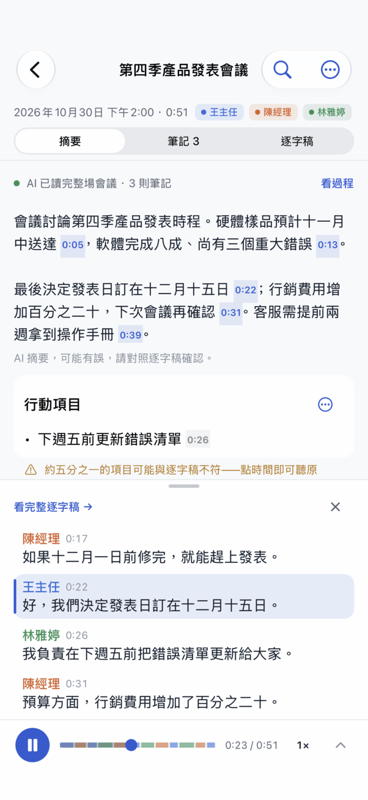
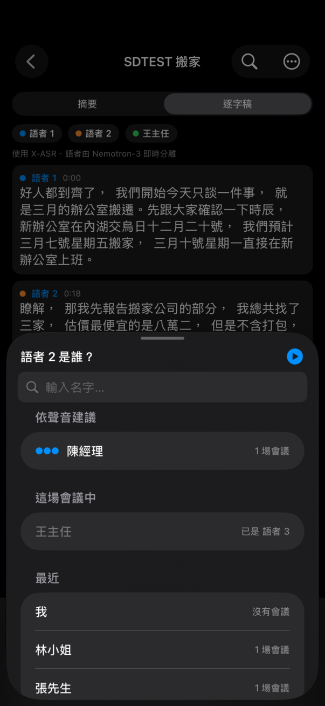

<p align="center">
  
</p>

<h1 align="center">Prime Minutes</h1>

<p align="center">
  <b>錄下會議，手機自己整理出誰說了什麼、決定了什麼。</b><br>
  逐字稿、AI 筆記與摘要全部在手機上離線完成，不用帳號，不上傳。
</p>

<p align="center">
  <a href="https://github.com/vieenrose/PrimeMinutes/releases/latest"></a>
  <a href="https://testflight.apple.com/join/saH9YxEA"></a>
  
  <a href="https://vieenrose.github.io/PrimeMinutes/slides/PrimeMinutes-zh-TW.html"></a>
</p>

<p align="center"><br>
<sub>連續錄兩場會議，停下來就自動完成筆記、摘要和標題（部分片段加速）</sub></p>

## 下載安裝

| | 怎麼裝 | 需求 | 掃碼 |
|---|---|---|:---:|
| **Android** | 到 [Releases](https://github.com/vieenrose/PrimeMinutes/releases/latest) 下載 APK，App 每天會自動檢查新版 | Android 8.0 以上；RAM 8 GB 以上最順 |  |
| **iPhone** | 先裝 TestFlight，再開啟[公開測試連結](https://testflight.apple.com/join/saH9YxEA) | iOS 17.0 以上；RAM 6 GB 以上最順 |  |

第一次開啟會先下載模型（約 2.5 GB 起，可設定只用 Wi‑Fi）。iPhone 更新由 TestFlight 負責。RAM 4.5 GB 以上會邊錄邊整理筆記，6 GB 以上能改用較完整的 E4B 模型；較小的 iPhone 在錄完後才整理，3 GB 機型（如 iPhone XR）無法執行。

## 能做什麼

| 邊錄邊出字 | 自動整理筆記 | 摘要點了就聽原話 |
|:---:|:---:|:---:|
|  |  |  |
| **搜尋和提問** | **認得說話的人** | **逐字稿隨手修正** |
|  |  |  |

- **邊錄邊出字**：說完話大約兩秒，文字就上螢幕，還標好是誰說的。
- **自動整理筆記**：錄音時就把決議、待辦、提議、還沒定案的事和數字整理出來；停下後自動寫好摘要和標題。
- **摘要點了就聽原話**：每個時間點都能直接播放，播放器上方同時跳出那幾句原話，對照原本怎麼說；文字、說話者、換人位置都能修正，也能復原。
- **搜尋和提問**：用意思找遍所有會議，直接問問題，回答會附上出處。
- **合集**：同一個專案的會議收進一個合集（例如「尾牙籌備」），可以只針對這幾場提問；標題開頭一樣的會議，App 會主動問要不要建成合集。
- **認得說話的人**：名字用手機聯絡人，跨會議通用；開啟「辨識聲音」後，下次開會會建議名字（選用）。
- **匯入和分享**：匯入音訊、影片、iCloud Drive 等雲端硬碟的檔案或 Podcast；用 AirDrop、電子郵件分享成 PDF、Word，或整場會議 `.pmin`，iPhone 和 Android 互相打得開。

## 隱私與離線

- 錄音、逐字稿、筆記和聲音資料都只存在你的手機，所有模型都在手機上跑。
- 只有下載模型和檢查 Podcast 新集數會連網；不登入帳號，也不上傳雲端。
- 「辨識聲音」預設關閉，聲音資料不會匯出或備份，隨時可以刪除。幫別人命名前請先取得同意。
- 匯入或分享的內容由你自己負責；Podcast 等線上內容請確認你有權轉錄，從這類來源分享時預設不附音訊。

## 相關連結

- [使用指南](docs/USER_GUIDE.md)：每個畫面怎麼用、運作方式和已知限制
- [產品簡報](https://vieenrose.github.io/PrimeMinutes/slides/PrimeMinutes-zh-TW.html)
- [官網](https://vieenrose.github.io/PrimeMinutes/)
- [討論區](https://github.com/vieenrose/PrimeMinutes/discussions)
- [回報問題](https://github.com/vieenrose/PrimeMinutes/issues)

## 開發者

這個分支是 iPhone 版（SwiftUI）；Android 版在 [android 分支](https://github.com/vieenrose/PrimeMinutes/blob/android/README.md)。需要 macOS、Xcode（iOS 26 SDK）與 cmake：

```bash
bash ios/native/build_app.sh iphoneos arm64        # 原生引擎 + App bundle
xcodebuild -project "ios/Xcode/Prime Minutes.xcodeproj" -scheme "Prime Minutes" -configuration Release \
  -destination "id=<裝置>" DEVELOPMENT_TEAM=<ID> -allowProvisioningUpdates SKIP_NATIVE_BUILD=1 build
bash ios/tests/run.sh                               # 與 Android 黃金資料比對
python3 tools/uiparity/check.py                     # 介面字串與 Android 的對齊程度
```

也可以開啟 `ios/Xcode/Prime Minutes.xcodeproj`，選好 Team 和 iPhone 直接 Run。更多見 [開發說明](docs/DEVELOPMENT.md)。

## 授權

App 以 [GPL-3.0-or-later](https://github.com/vieenrose/PrimeMinutes/blob/android/LICENSE) 授權；模型、資料與第三方元件各依其授權，完整清單見 [NOTICE](NOTICE)，App 內在「設定 › 關於 › 開放原始碼授權」。
