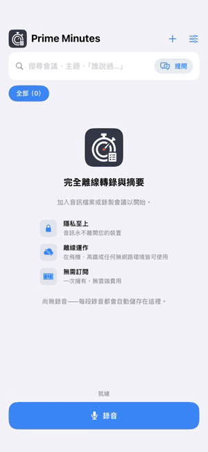
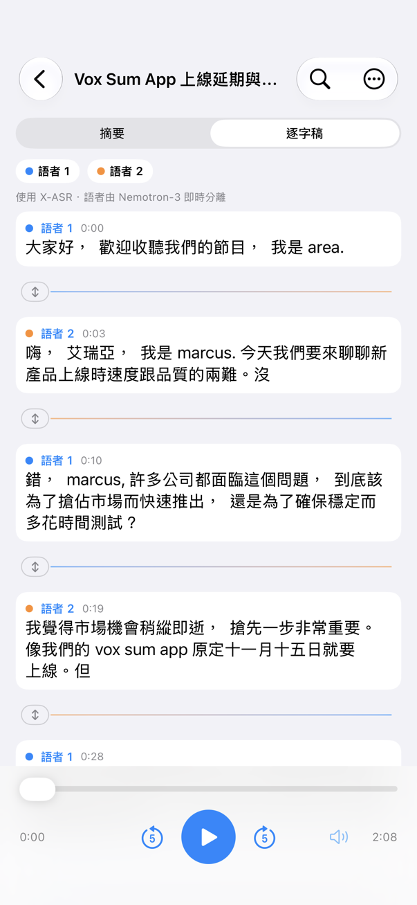
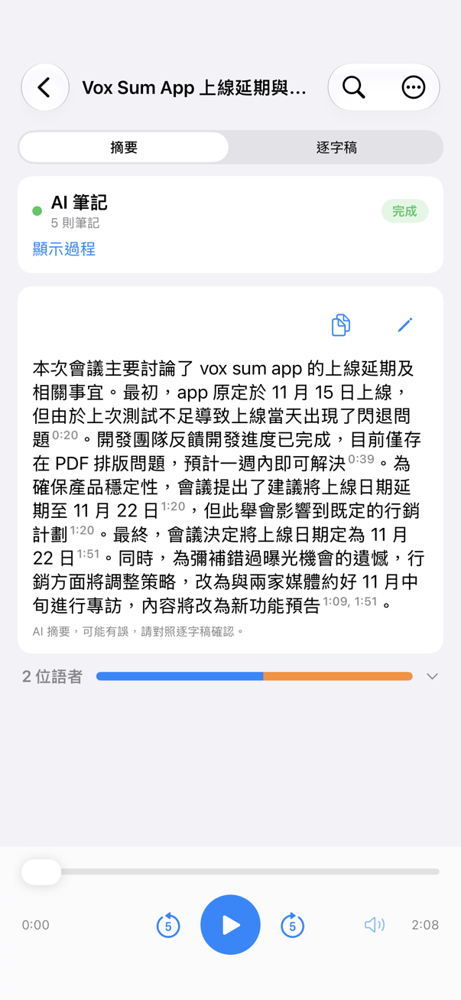
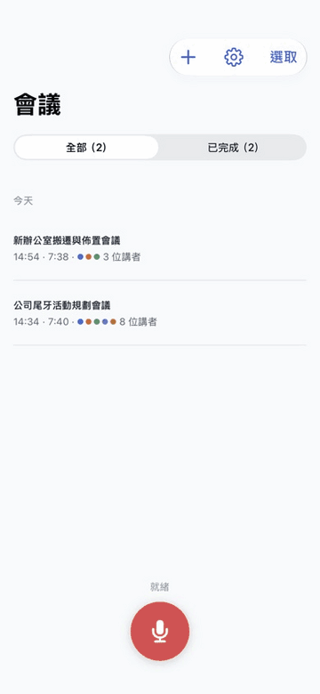
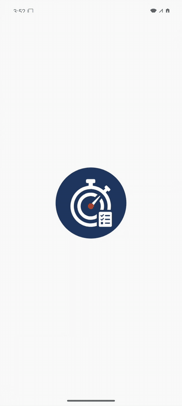

<h1 align="center">Prime Minutes for iOS</h1>

<p align="center">
  <b>會議錄音 → 標註語者的逐字稿 → 摘要。<br>全程在 iPhone 上完成，完全離線。</b>
</p>

<p align="center">
  
  
</p>

Prime Minutes for iOS 是 [Android 版](https://github.com/vieenrose/PrimeMinutes/blob/android/README.md) 的原生 SwiftUI 移植：同一套語音引擎、同一個 AI 筆記模型與閱讀協定（Swift 版的閱讀器與 Android 的黃金測試資料逐位元組一致），介面與功能對齊 Android。

<p align="center"><br><sub>錄音室：連續錄兩場會議。從空的資料庫開始，錄完公司尾牙籌備會議後按「下一場」，立即接著錄辦公室搬遷會議；第一場的 AI 筆記在背景接續整理，停止後兩場都自動完成筆記、摘要與標題。全程即時播放，未加速。於 iPhone 14 Pro Max 錄製（公開示範會議音訊），AI 筆記模型：行動版 E2B。</sub></p>

<p align="center">



</p>
<p align="center">


</p>

## 特色

- **完全離線、無帳號**：音訊不離開手機，模型只在第一次使用時下載。
- **即時逐字稿與語者**：錄音時文字即時上螢幕，同時標註語者。
- **邊開會邊做筆記**：AI 筆記在錄音中閱讀逐字稿，寫下決議、待辦與數字；停止後很快完成摘要。
- **每句都可核對**：摘要與筆記的時間點一下，就從原話開始播放。
- **依語意搜尋整個會議庫**：在首頁輸入「誰提到預算」或「延期」，就列出意思相近的段落與筆記，不必記得原話。搜尋模型（EmbeddingGemma 2，約 160 MB）另行下載，同樣完全離線。
- **向會議提問（實驗性）**：輸入問題，AI 筆記模型根據搜尋找到的段落作答並附出處，一點就跳到原話。
- **錄音不會遺失**：開始錄音前就排入佇列，App 被終止也保留音訊；處理失敗的項目留在佇列可「重試」。
- **可編輯、可匯出**：修正文字、改派或合併語者；匯出 Prime Minutes 場次 `.m4a`（與 Android 互通）、PDF、Markdown、純文字或字幕。
- **依手機調整**：首次啟動做一秒測試選執行緒數；所有推論皆在 CPU 上執行。

## 搜尋與提問

| 語意搜尋 | 向會議提問 |
|:---:|:---:|
|  |  |
| 輸入「大家的車要停哪裡」：原話說的是「有沒有停車位……月租一個四千五」，用詞不同也找得到；點段落就從 3:50 開始播放。 | 問「尾牙頭獎是什麼？」：AI 筆記模型讀過搜尋找到的段落後作答，並附上出處；點出處就跳到 1:55 的原話。 |

兩段皆在 iPhone 14 Pro Max 上即時錄製（App 內每秒 10 格擷取），未加速；會議標題由 AI 筆記模型自動產生。搜尋在輸入時先比對關鍵字，一兩秒後補上語意相近的結果；提問約 5 秒完成（E2B）。搜尋模型（約 160 MB）在搜尋框下方或「設定」下載；提問需在「設定 › 實驗功能」開啟。

## 使用

**錄音**：首頁底部的錄音鈕。逐字稿即時出現，語者確定後標上顏色；AI 筆記卡片顯示它在閱讀或寫筆記。停止後場次自動轉錄、摘要並取標題，完成時發出「場次已就緒」通知。

**摘要**：段落式摘要（超過 12 行可展開／收合，可編輯、複製），藍色時間點可直接播放；待辦事項另列一卡；下方一行是各語者的發言比例。

**逐字稿**：點任一句從該處播放；長按可修改文字、把這句移給其他語者，或把整位語者合併到另一位；點語者可改名。修改逐字稿後會提示重新摘要。

**場次選單**（右上 **⋯**）：分享逐字稿、匯出（`.m4a` 場次、PDF、MD、TXT、SRT、VTT、LRC）、**重新轉錄**、**重新摘要**（保留逐字稿與語者名稱；完成後可「復原」）。換了 AI 筆記模型後開啟舊場次會提示重新摘要。

**播放列**：播放／暫停、±5 秒、進度、音量（靜音、25–100%）。

**匯入**：首頁 **＋** 可加入「檔案」App 裡的音訊、Podcast，或開啟 Prime Minutes 場次 `.m4a`；也可從其他 App 分享音訊過來。

**設定**：語言（English、繁體中文、简体中文）、外觀（自動、淺色、深色、電子紙）、文字大小、語者標註延遲（5–30 秒）、AI 筆記模型（E2B，或 RAM 足夠的 iPhone 可選 E4B）、硬體狀態列、推論（執行緒數）、顯示待辦事項、模型與儲存空間管理、關於。

完整操作說明與介面測試地圖見 [`docs/USER_GUIDE.md`](docs/USER_GUIDE.md)。

## 需求

- iOS 17.0 以上，arm64 iPhone。驗證機型：iPhone 14 Pro Max（6 GB）。
- 模型首次使用時下載：語音引擎約 275 MB，AI 筆記模型 E2B 約 2.2 GB（E4B 約 3.3 GB）。
- RAM 不足 4.5 GB 的 iPhone 自動改為循序處理：錄音結束後才閱讀。3 GB 機型（如 iPhone XR）無法可靠執行 E2B。
- 唯一的網路連線：下載模型與 Podcast。

## 與 Android 版的差異

- 僅以 CPU 推論；在 iPhone 14 Pro Max 上 Metal GPU 沒有明顯加速，因此已移除 GPU 選項。
- 沒有 App 內更新（由 App Store／TestFlight 負責）、沒有 Android 的背景可靠性設定。iOS 以 `BGProcessingTask` 在 App 離開後繼續處理佇列。
- 不提供 YouTube 匯入（Android 限定）。
- 中斷的處理不會跳出詢問：佇列在下次啟動時自動從檢查點接續。

## 已知限制

與 Android 相同：摘要模型以中文會議訓練，英文會議也會寫出中文摘要；部分會議紀錄內容可能與原話不符，請點時間核對；偶爾會多分出發言很少的語者，可用「合併語者」修正。語意搜尋以句子的意思比對，不相關的句子也可能被列出；「提問」由裝置上的小模型作答，可能漏掉段落中明明有的答案，請以出處為準。

## 運作方式

- **聽寫**：[nemo-x-asr-diarizer](https://github.com/vieenrose/nemo-x-asr-diarizer.cpp)：語音辨識（X-ASR）與語者分離（Nemotron-3）在同一條時間軸上的串流引擎，以 C 介面接到 Swift。
- **搜尋與提問**：[EmbeddingGemma 2 270M](https://huggingface.co/Luigi/primeminutes-embed-litert)（LiteRT，動態 int8）把每段逐字稿、每則筆記與摘要轉成向量，查詢時與關鍵字比對的結果融合（RRF）；「提問」把分數最高的段落交給 AI 筆記模型作答。
- **AI 筆記與摘要**：Gemma-4-E2B 會議模型（行動版）在 LiteRT 上執行（[自訂引擎](https://github.com/vieenrose/LiteRT-LM/tree/mobile-fused-attention)，`CLiteRTLM.xcframework`）。閱讀協定（`MeetingReader`、`ReaderSummarizer`）以 Swift 重寫。

## 從原始碼建置

需要 macOS 與 Xcode（iOS 26 SDK）、cmake。在 Mac 上：

```bash
bash ios/native/build_app.sh iphoneos arm64        # 原生引擎 + SwiftUI App bundle
# 簽署並安裝：開啟 ios/Xcode/Prime Minutes.xcodeproj 選 Team 與 iPhone 後 Run，或
xcodebuild -project ios/Xcode/Prime Minutes.xcodeproj -scheme Prime Minutes -configuration Release \
  -destination "id=<裝置>" DEVELOPMENT_TEAM=<ID> -allowProvisioningUpdates SKIP_NATIVE_BUILD=1 build
bash ios/tests/run.sh                               # 閱讀器與 Android 黃金資料比對
python3 tools/uiparity/check.py                     # 介面字串與 Android 的對齊程度
```

`DEV=1` 開啟開發用的 `VOX_*` 環境變數（自動匯入、開啟場次、下載模型等）。引擎移植、模擬器與實機驗證的細節見 [`docs/DEVELOPMENT.md`](docs/DEVELOPMENT.md)。

## 授權

應用程式以 [GPL-3.0-or-later](https://github.com/vieenrose/PrimeMinutes/blob/android/LICENSE) 授權；模型與資料各依其授權，見 [Android 版 README](https://github.com/vieenrose/PrimeMinutes/blob/android/README.md#授權)。
