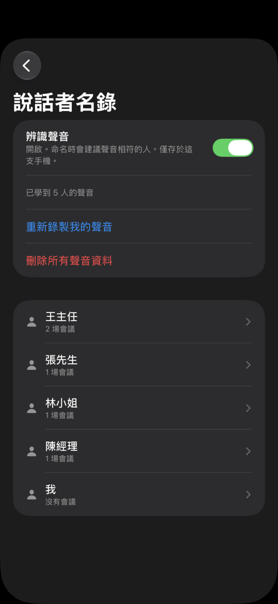
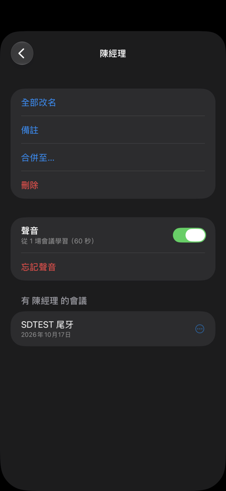
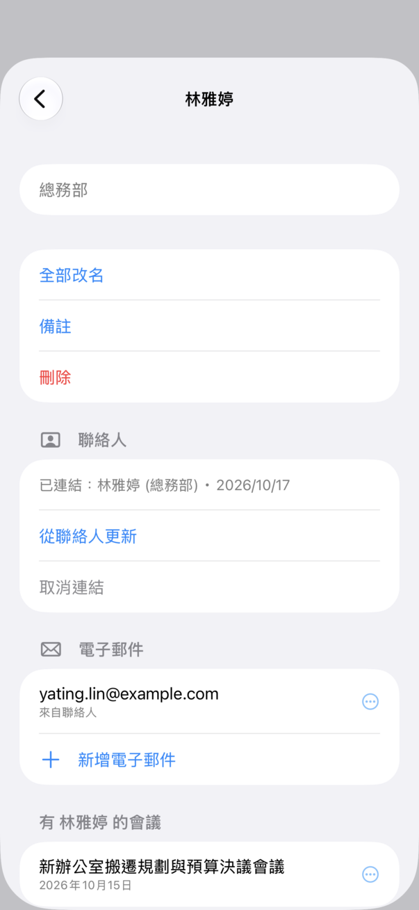
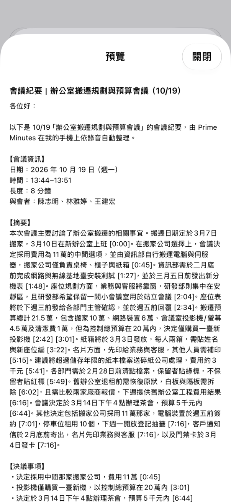

<h1 align="center">Prime Minutes for iOS</h1>

<p align="center">
  <b>會議錄音 → 標註語者的逐字稿 → 摘要。<br>全程在 iPhone 上完成，完全離線。</b>
</p>

<p align="center">
  
  
</p>

Prime Minutes for iOS 是 [Android 版](https://github.com/vieenrose/PrimeMinutes/blob/android/README.md) 的原生 SwiftUI 移植：同一套語音引擎、同一個 AI 筆記模型與閱讀協定（Swift 版的閱讀器與 Android 的黃金測試資料逐位元組一致），介面與功能對齊 Android。

<p align="center"><br><sub>錄音室：連續錄兩場會議。從空的資料庫開始，錄完公司尾牙籌備會議後按「下一場」，立即接著錄辦公室搬遷會議；第一場的 AI 筆記在背景接續整理，停止後兩場都自動完成筆記、摘要與標題。全程即時播放，未加速。於 iPhone 14 Pro Max 錄製（公開示範會議音訊），AI 筆記模型：行動版 E2B。</sub></p>

<p align="center">


</p>
<p align="center">


</p>

## 特色

- **完全離線、無帳號**：音訊不離開手機，模型只在第一次使用時下載。
- **即時逐字稿與語者**：錄音時文字即時上螢幕，同時標註語者。
- **邊開會邊做筆記**：AI 筆記在錄音中閱讀逐字稿，寫下決議、待辦與數字；停止後很快完成摘要。
- **每句都可核對**：摘要與筆記的時間點一下，就從原話開始播放。
- **依語意搜尋整個會議庫**：在首頁輸入「誰提到預算」或「延期」，就列出意思相近的段落與筆記，不必記得原話。搜尋模型（EmbeddingGemma 2，約 160 MB）另行下載，同樣完全離線。
- **向會議提問（實驗性）**：點首頁的「提問」，AI 筆記模型根據搜尋找到的段落作答並附出處，一點就跳到原話。
- **在這場會議內搜尋與提問**：會議畫面的搜尋列列出符合的 AI 筆記與逐字稿句子（附時間，點了就跳過去）；**✦ 問這場會議** 只根據這場會議的段落作答，先前的問答會留在這場會議裡。
- **錄音不會遺失**：開始錄音前就排入佇列，App 被終止也保留音訊；處理失敗的項目留在佇列可「重試」。
- **可編輯、可匯出**：修正文字、改派或合併語者；匯出 Prime Minutes 場次 `.m4a`（與 Android 互通）、PDF、Markdown、純文字或字幕。
- **依手機調整**：首次啟動做一秒測試選執行緒數；所有推論皆在 CPU 上執行。

## 搜尋與提問

| 語意搜尋 | 向會議提問 |
|:---:|:---:|
|  |  |
| 輸入「大家的車要停哪裡」：原話說的是「有沒有停車位……月租一個四千五」，用詞不同也找得到；點段落就從 3:50 開始播放。 | 問「尾牙頭獎是什麼？」：AI 筆記模型讀過搜尋找到的段落後作答，並附上出處；點出處就跳到 1:55 的原話。 |

兩段皆在 iPhone 17e 上即時錄製（App 內每秒 10 格擷取），未加速；會議標題由 AI 筆記模型自動產生。搜尋在輸入時先比對關鍵字，一兩秒後補上語意相近的結果；提問約 5 秒完成（E2B），作答時面板顯示目前的階段（搜尋、閱讀 N 段摘錄、回答）與秒數。搜尋模型（約 160 MB）在搜尋框下方或「設定」下載；AI 筆記模型與搜尋模型都在手機上之後，搜尋框右側就會出現「提問」按鈕。

## 調整說話者分界

| 移動分界並試聽 | 分界編輯器 | 從這裡分開 |
|:---:|:---:|:---:|
|  |  |  |

換人說話時，逐字稿偶爾把下一位的頭一兩個字留在上一句。兩位語者之間的 **⇕** 把手會開啟「語者分界」：拖曳標記、點下一位說的第一個字，或用 ‹ › 逐字移動，每次移動都自動播放分界後的聲音；**套用** 後兩句的文字與時間一起更新，匯出的字幕也一樣。一句話裡藏著別人的插話時，長按 → **從這裡分開…** 並選擇語者。頂端 ↶ ↷ 可復原、重做。語音辨識引擎本身也會把換人的位置對齊語者分離偵測到的起點（不重疊時），英文會議的分界完全正確率由 53% 提升到 59%。於 iPhone 14 Pro Max 錄製（App 內每 0.2 秒擷取一格），未加速。

## 說話者名錄

| 依聲音建議 | 說話者名錄 | 人物頁 |
|:---:|:---:|:---:|
|  |  |  |
| 「搬家」會議的語者 2 是誰？聲音與「尾牙」會議的陳經理相符（●●● 很可能）；已命名的人列在「最近」。 | 「設定 → 說話者名錄」：每個人與他出現的會議；上方是「辨識聲音」開關。 | 全部改名、合併、刪除；「聲音」一列顯示學自幾場會議，可停止學習或忘記聲音。 |

為語者命名時，從名錄選人或新增：名字在每場會議都一樣，改名一次全部會議都更新；名錄也用於篩選會議庫與「提問」（「陳經理說了什麼？」）。

## 聯絡人與寄給與會者

| 人物頁：聯絡人與電子郵件 | 寄給與會者 | 預覽 |
|:---:|:---:|:---:|
|  |  |  |
| 「從聯絡人選擇…」開啟系統的聯絡人挑選器：只有你點選的那一位會交給 App，不需要通訊錄權限；聯絡人的電子郵件加到這個人身上。 | 場次選單 →「寄給與會者…」：會議中有電子郵件的人預先勾選（「我」除外），缺地址可當場補上並存到此人；可選摘要、紀要或只要決議與待辦，附 PDF／TXT／錄音。 | 郵件內容由固定範本產生（顯示中的摘要 + 筆記整理的紀要，待辦依負責人分組），寄送時不再呼叫模型。 |

為語者命名時也可以「從聯絡人選擇…」，再確認在 Prime Minutes 中的名字。按「在郵件 App 中開啟」後，有設定郵件帳號時開啟系統的撰寫視窗（附件一併帶入）；沒有時改用 `mailto:` 交給預設的郵件 App（不含附件）；都無法開啟時改用分享表單，並把收件人地址複製到剪貼簿。App 本身從不寄出郵件。

**辨識聲音（選用，預設關閉）**：開啟後，App 記住你命名過的人的聲音，在之後的會議中建議名字（●●● 很可能、●●○ 可能）。

- **只在這支手機上**：聲音不上傳，也不包含在匯出（`.m4a` 場次、PDF 等）與 iCloud／裝置備份中。
- 「聲音」是從會議中此人最多 60 秒的語音算出的一串數字，不是錄音；「這是我…」朗讀約 20 秒，也只保留這串數字。
- **建議只是建議**：沒有你的點選，名字絕不會被套用；與此人其他會議不符的聲音，會先問「仍要學習」或「只保留名字」。
- 隨時可在人物頁**忘記某人的聲音**（之後不再學習，直到你重新開啟），或在名錄上方**刪除所有聲音資料**；**刪除會議也會刪除它提供的聲音樣本**。
- **命名前請先徵得對方同意**：在某些地區，聲紋屬於需要當事人同意的個人資料。

聲音模型 [CAM++ zh-en](https://huggingface.co/Luigi/primeminutes-speaker-litert)（3D-Speaker，Apache-2.0，約 29 MB）在開啟時下載一次，於 CPU 上執行；在 iPhone 14 Pro Max 上每場約 8 分鐘的會議約 3 秒（2 執行緒），只在沒有錄音、轉錄或 AI 筆記時，且電量高於 20% 或充電中才在背景計算。

## 使用

**第一次使用**：開啟 App 時先列出要下載的模型與總量（語音約 271 MB、AI 筆記約 2.2 GB），可選「立即下載」、「僅限 Wi‑Fi」或「稍後」；未連 Wi‑Fi 時會提醒可能使用行動數據。下載進度與「取消」顯示在首頁上方與設定；切換到其他 App、鎖定螢幕或斷線時下載會暫停（「已暫停 · 會自動繼續」），回到 App 且有網路時從中斷處接續，Podcast 單集也一樣。之後錄音或匯入前若還缺模型，會再詢問一次。

**錄音**：首頁底部的錄音鈕。逐字稿即時出現，語者確定後標上顏色；AI 筆記卡片顯示它在閱讀或寫筆記。停止後場次自動轉錄、摘要並取標題，完成時發出「場次已就緒」通知。沒有偵測到說話的錄音標為「未偵測到語音」，不寫 AI 筆記，也不列在「已完成」。

**摘要**：段落式摘要（超過 12 行可展開／收合，可編輯、複製），藍色時間點可直接播放；待辦事項另列一卡；下方一行是各語者的發言比例。

**逐字稿**：點任一句從該處播放；長按可修改文字、把這句移給其他語者、從某字分開成兩句，或把整位語者合併到另一位（合併前先確認，之後可「復原」）；點語者可改名；兩位語者之間的 **⇕** 可調整分界（見上方）；頂端 ↶ ↷ 復原、重做編輯。修改文字後會提示重新摘要（調整分界與語者則不會）。

**場次選單**（右上 **⋯**）：分享逐字稿、匯出（`.m4a` 場次、PDF、MD、TXT、SRT、VTT、LRC）、**重新轉錄**、**重新摘要**（保留逐字稿與語者名稱；完成後可「復原」）。換了 AI 筆記模型後開啟舊場次會提示重新摘要。

**播放列**：播放／暫停、±5 秒、進度、音量（靜音、25–100%）。

**匯入**：首頁 **＋** 可加入「檔案」App 裡的音訊、Podcast，或開啟 Prime Minutes 場次 `.m4a`；也可從其他 App 分享音訊過來。選好 Podcast 單集後，這一集立刻出現在首頁並標示下載進度，下載完成後自動排入處理；點按排隊、處理中或下載中的一列可即時查看（處理中可同時播放音訊）。

**提問**：點首頁搜尋框右側的「提問」（或先在搜尋框輸入問題再點），AI 筆記模型只根據找到的段落作答，每個論點附上出處，點出處即可核對；可以接著追問。回答使用提問的語言（用英文問就用英文答，介面語言不變）。需要搜尋模型與 AI 筆記模型。

**在這場會議內**：會議畫面的放大鏡除了標示符合處，還在搜尋列下方列出符合的 AI 筆記與逐字稿句子（附時間，≈ 為依語意找到的），點一筆就捲到那句。**✦**（或 ⋯ →「問這場會議」）只根據這場會議作答，出處只標時間；只需要 AI 筆記模型（沒有搜尋模型或索引時改用關鍵字找段落），先前的問答保留在這場會議（最多 20 則，↻ 清除，刪除會議時一併刪除）。

| 搜尋這場會議 | 問這場會議 |
|---|---|
|  |  |

截圖為 iPhone 14 Pro Max（淺色主題，辦公室搬遷示範會議）。

**說話者名錄**：設定 → 說話者名錄。點逐字稿的語者名稱即可從名錄或聯絡人選人；人物頁可全部改名、加備註、合併、把某場會議分出去、刪除、連結聯絡人與管理電子郵件，以及管理聲音（見上方「說話者名錄」）。

**寄給與會者**：場次選單 →「寄給與會者…」（或摘要頁語者比例下方的按鈕），以系統郵件 App 寄出會議紀要（見上方「聯絡人與寄給與會者」）。

**設定**：語言（English、繁體中文、简体中文）、外觀（自動、淺色、深色、電子紙）、文字大小、語者標註延遲（5–30 秒）、AI 筆記模型（E2B，或 RAM 足夠的 iPhone 可選 E4B）、硬體狀態列、推論（執行緒數）、向會議提問（預設開啟）、顯示待辦事項、模型與儲存空間管理、關於。

完整操作說明與介面測試地圖見 [`docs/USER_GUIDE.md`](docs/USER_GUIDE.md)。

## 需求

- iOS 17.0 以上，arm64 iPhone。驗證機型：iPhone 14 Pro Max（6 GB）。
- 模型在第一次開啟時詢問後下載（會先顯示總量，可選僅限 Wi‑Fi）：語音引擎約 271 MB，AI 筆記模型 E2B 約 2.2 GB（E4B 約 3.3 GB）。
- RAM 不足 4.5 GB 的 iPhone 自動改為循序處理：錄音結束後才閱讀。3 GB 機型（如 iPhone XR）無法可靠執行 E2B。
- 唯一的網路連線：下載模型與 Podcast。

## 與 Android 版的差異

- 僅以 CPU 推論；在 iPhone 14 Pro Max 上 Metal GPU 沒有明顯加速，因此已移除 GPU 選項。
- 沒有 App 內更新（由 App Store／TestFlight 負責）、沒有 Android 的背景可靠性設定。iOS 26 以上離開 App 後佇列仍在背景繼續處理（系統顯示進度）；較舊版本由 `BGProcessingTask` 或下次啟動接續。
- 不提供 YouTube 匯入（Android 限定）。
- 中斷的處理不會跳出詢問：佇列在下次啟動時自動從檢查點接續。

## 已知限制

與 Android 相同：摘要模型以中文會議訓練，英文會議的筆記、標題與摘要改寫成英文（依逐字稿自動判斷，英文品質只在少數公開會議上量測過）；部分會議紀錄內容可能與原話不符，請點時間核對；偶爾會多分出發言很少的語者，可用「合併語者」修正。語意搜尋以句子的意思比對，不相關的句子也可能被列出；「提問」由裝置上的小模型作答，可能漏掉段落中明明有的答案，請以出處為準。

## 運作方式

- **聽寫**：[nemo-x-asr-diarizer](https://github.com/vieenrose/nemo-x-asr-diarizer.cpp)：語音辨識（X-ASR）與語者分離（Nemotron-3）在同一條時間軸上的串流引擎，以 C 介面接到 Swift。
- **搜尋與提問**：[EmbeddingGemma 2 270M](https://huggingface.co/Luigi/primeminutes-embed-litert)（LiteRT，動態 int8）把每段逐字稿、每則筆記與摘要轉成向量，查詢時與關鍵字比對的結果融合（RRF）；「提問」先找出段落最相關的兩場會議，把分數最高的段落（同一場重疊的段落合併）交給 AI 筆記模型作答。
- **AI 筆記與摘要**：Gemma-4-E2B 會議模型（行動版）在 LiteRT 上執行（[自訂引擎](https://github.com/vieenrose/LiteRT-LM/tree/mobile-fused-attention)，`CLiteRTLM.xcframework`）。閱讀協定（`MeetingReader`、`ReaderSummarizer`）以 Swift 重寫。

## 從原始碼建置

需要 macOS 與 Xcode（iOS 26 SDK）、cmake。在 Mac 上：

```bash
bash ios/native/build_app.sh iphoneos arm64        # 原生引擎 + SwiftUI App bundle
# 簽署並安裝：開啟 ios/Xcode/Prime Minutes.xcodeproj 選 Team 與 iPhone 後 Run，或
xcodebuild -project ios/Xcode/Prime Minutes.xcodeproj -scheme Prime Minutes -configuration Release \
  -destination "id=<裝置>" DEVELOPMENT_TEAM=<ID> -allowProvisioningUpdates SKIP_NATIVE_BUILD=1 build
bash ios/tests/run.sh                               # 閱讀器與 Android 黃金資料比對
python3 tools/uiparity/check.py                     # 介面字串與 Android 的對齊程度
```

`DEV=1` 開啟開發用的 `VOX_*` 環境變數（自動匯入、開啟場次、下載模型等）。引擎移植、模擬器與實機驗證的細節見 [`docs/DEVELOPMENT.md`](docs/DEVELOPMENT.md)。

## 授權

應用程式以 [GPL-3.0-or-later](https://github.com/vieenrose/PrimeMinutes/blob/android/LICENSE) 授權；模型與資料各依其授權，見 [Android 版 README](https://github.com/vieenrose/PrimeMinutes/blob/android/README.md#授權)。
