<p align="center">
  
</p>

<h1 align="center">Prime Minutes for Android</h1>

<p align="center">
  <b>會議錄音 → 標註語者的逐字稿 → 摘要。<br>全程在手機上完成，完全離線。</b>
</p>

<p align="center">
  <a href="https://github.com/vieenrose/PrimeMinutes/releases/latest"></a>
  
  
</p>

<p align="center"><br><sub>錄音室：連續錄兩場會議。從空的資料庫開始，錄完公司尾牙籌備會議後按「下一場」，立即接著錄辦公室搬遷會議；第一場的 AI 筆記在背景接續整理，停止後兩場都自動完成筆記、摘要與標題。全程即時播放，未加速。於 Galaxy Note10+ 錄製，AI 筆記模型：行動版 E4B。</sub></p>

## 特色

- **完全離線、無帳號**：音訊不離開手機，模型只在第一次使用時下載。
- **即時逐字稿與語者**：說話約 0.4 秒後文字上螢幕，同時標註語者（AMI / AISHELL-4 語者歸屬正確率 95.4% / 92.3%）。
- **邊開會邊做筆記**：AI 筆記在錄音中閱讀逐字稿，寫下決議、待辦與數字；停止後約 1.5 分鐘完成摘要。
- **每句都可核對**：摘要與筆記的時間點一下，就從原話開始播放。
- **依語意搜尋整個會議庫**：在首頁輸入「誰提到預算」或「延期」，就列出意思相近的段落與筆記，不必記得原話；逐字稿內也可切換 **≈** 依語意找句子。搜尋模型（EmbeddingGemma 2，約 160 MB）另行下載，同樣完全離線。
- **向會議提問（實驗性）**：點首頁的「提問」，摘要模型根據搜尋找到的段落作答並附出處，一點就跳到原話。
- **錄音不會遺失**：停止即存檔，可連續錄多場，稍後再批次處理；處理中按「停止」一定保留已轉錄的進度，之後「繼續處理」從停下的地方接續。沒有說話的錄音標為「未偵測到語音」，不會被當成已完成的會議。
- **可編輯、可匯出**：修正文字與語者；匯出 `.m4a`、PDF、Markdown 或字幕。
- **依手機調整**：首次啟動自動偵測核心數並做一秒測試選執行緒；所有推論皆在 CPU 上執行（GPU 實測沒有加速，見 [`docs/GPU_NPU.md`](docs/GPU_NPU.md)）。

## 畫面

| 錄音 | AI 筆記 | 摘要 | 逐字稿 |
|:---:|:---:|:---:|:---:|
| 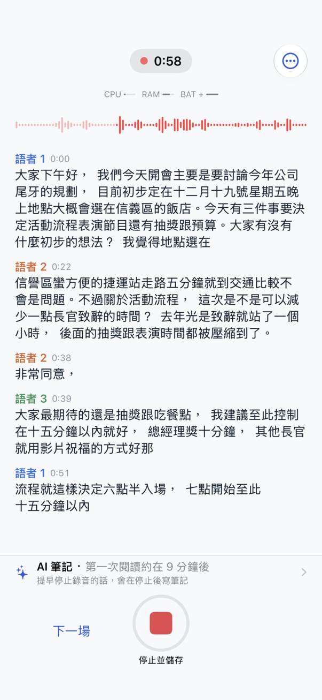 | 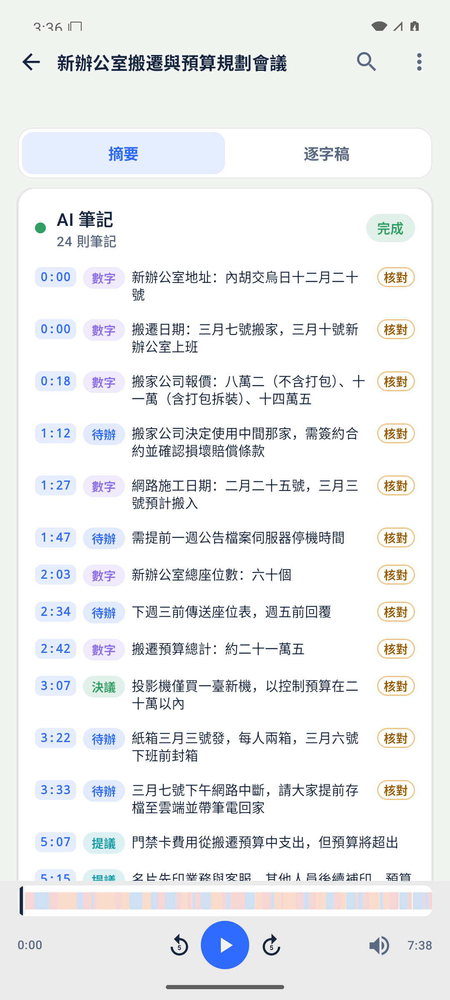 |  | 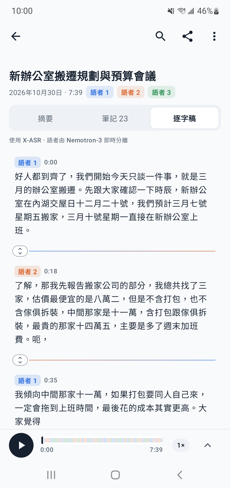 |

<p align="center">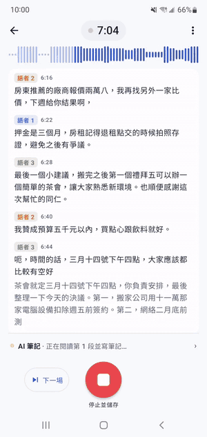<br><sub>錄音進行中，AI 筆記讀完一段逐字稿後逐字寫下筆記。</sub></p>

示範會議為兩場合成會議：尾牙籌備會議與辦公室搬遷會議（各三位語者，約 7 分半，[`docs/demo`](docs/demo)），在 Galaxy Note10+ 上即時錄音拍攝，未經修飾。

## 搜尋與提問

| 語意搜尋 | 向會議提問 |
|:---:|:---:|
|  |  |
| 輸入「大家的車要停哪裡」：原話說的是「停車位……月租一個四千五」，用詞不同也找得到；點段落就從 3:50 開始播放。 | 輸入「尾牙頭獎是什麼？」再點「提問」：AI 筆記模型讀過搜尋找到的段落後作答，並附上出處；點出處就跳到 1:56 的原話。 |

兩段皆在 Galaxy Note10+ 上即時錄製，未加速。搜尋在輸入時先比對關鍵字，約一秒後補上語意相近的結果；提問約 8 秒完成（讀入段落約 5.5 秒、寫答案約 2.5 秒，E2B），作答時面板顯示目前的階段（搜尋、閱讀 N 段摘錄、回答）與秒數。搜尋模型（約 160 MB）在搜尋框下方或「設定」下載；AI 筆記模型與搜尋模型都在手機上之後，搜尋框右側就會出現「提問」按鈕。

## 調整說話者分界

| 移動分界（中文） | 分界編輯器 | Adjust a boundary (English) |
|:---:|:---:|:---:|
|  | 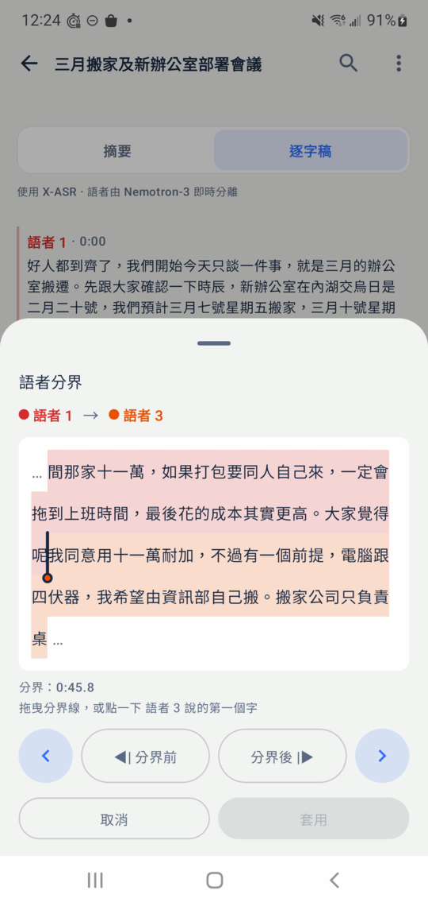 | 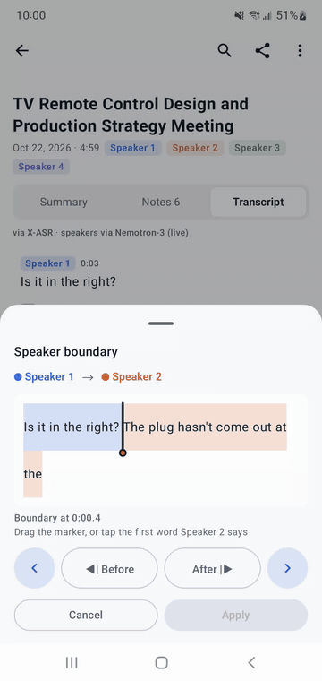 |

換人說話時，逐字稿偶爾把下一位的頭一兩個字留在上一句。兩位語者之間的 **⇕** 把手會開啟「語者分界」：拖曳標記、點下一位說的第一個字，或用 ‹ › 逐字移動，每次移動都自動播放分界後的聲音；**套用** 後兩句的文字與時間一起更新，匯出的字幕也一樣。一句話裡藏著別人的插話時，長按 → **從這裡分開…** 並選擇語者。頂端 ↶ ↷ 可復原、重做。語音辨識引擎本身也會把換人的位置對齊語者分離偵測到的起點（不重疊時），英文會議的分界完全正確率由 53% 提升到 59%。兩段動畫皆在 Galaxy Note10+ 上即時錄製，未加速（中文：辦公室搬遷示範會議；英文：AMI 公開會議 IS1009c 片段）。

## 說話者名錄

| 為語者命名（依聲音建議） | 說話者名錄 | 人物頁 | 辨識聲音的說明 |
|:---:|:---:|:---:|:---:|
| 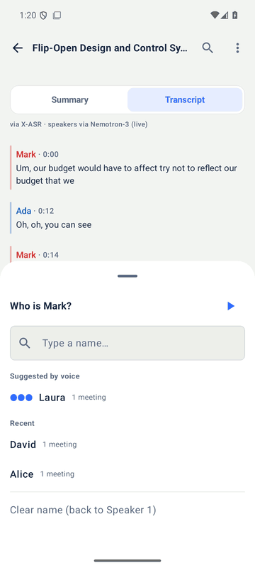 | 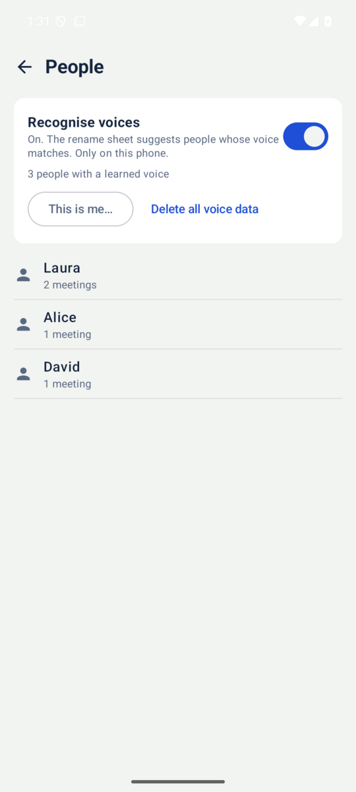 | 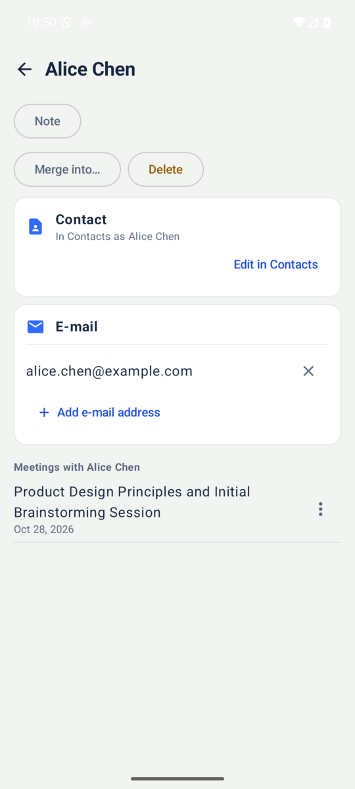 | 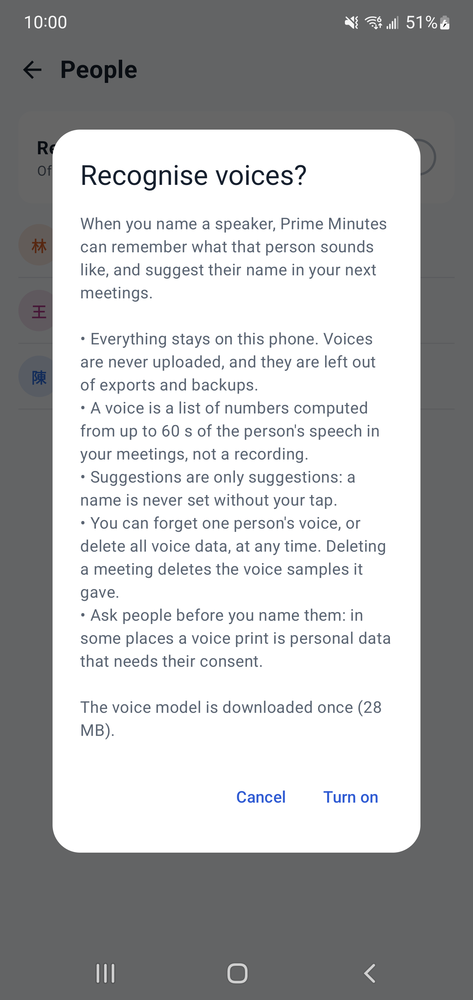 |

為語者命名時，從名錄選人或新增：名字在每場會議都一樣，在人物頁改名一次，全部會議都更新；名錄也用於篩選會議庫與「提問」（「陳經理說了什麼？」）。入口：設定 → 說話者名錄，或點逐字稿的語者名稱。

**辨識聲音（選用，預設關閉）**：開啟後，App 記住你命名過的人的聲音，在之後的會議中建議名字（●●● 很可能、●●○ 可能）。

- **只在這支手機上**：聲音不上傳，也不包含在匯出（`.m4a` 場次、PDF 等）與 Android 備份中。
- 「聲音」是從會議中此人最多 60 秒的語音算出的一串數字，不是錄音；「這是我…」朗讀約 20 秒，也只保留這串數字。
- **建議只是建議**：沒有你的點選，名字絕不會被套用；與此人其他會議不符的聲音，會先問「仍要學習」或「只保留名字」。
- 隨時可在人物頁**忘記某人的聲音**，或在名錄上方**刪除所有聲音資料**；**刪除會議也會刪除它提供的聲音樣本**。
- **命名前請先徵得對方同意**：在某些地區，聲紋屬於需要當事人同意的個人資料。

聲音模型 [CAM++ zh-en](https://huggingface.co/Luigi/primeminutes-speaker-litert)（3D-Speaker，Apache-2.0，約 29 MB，固定於版本 `8b7a1151`）在開啟時下載一次，於 CPU 上執行，只在沒有錄音、轉錄或 AI 筆記時於背景計算。截圖為英文介面（AMI 公開會議）。

### 聯絡人與「寄給與會者」

| 人物頁：聯絡人與電子郵件 | 寄給與會者 |
|:---:|:---:|
|  |  |

名錄中的人可以有電子郵件：在人物頁 **從聯絡人選擇…**（系統聯絡人選擇器，**不需要聯絡人權限**，只有你點選的那一位會交給 App），或自己輸入；名字不會被聯絡人改掉。會議選單（或語者卡片）的 **寄給與會者…** 會預先勾選這場會議中有電子郵件的人（「我」除外），內容可選摘要、紀要或只要決議與待辦，可附 PDF、TXT 或 `.m4a`，再開啟你自己的郵件 App，填好收件人、主旨與內文，由你確認後送出。

- **App 不寄信，也不連任何伺服器**；郵件內文以固定範本組成（畫面上的摘要 + 筆記中的決議、待辦〔依負責人分組〕、數字與待確認事項），寄送時**不再呼叫 AI 模型**，可先「預覽」。
- 電子郵件與聯絡人連結只存在這支手機的名錄中（不含於匯出與 Android 備份）；刪除某人也會從各會議的「上次分享」紀錄移除他。
- 截圖為示範資料（虛構的聯絡人與地址）。

## 使用

**第一次使用**：開啟 App 時先列出要下載的模型與總量（語音約 271 MB、AI 筆記約 2.2 GB），可選「立即下載」、「僅限 Wi‑Fi」或「稍後」；未連 Wi‑Fi 時會提醒可能使用行動數據。下載進度與「取消」顯示在首頁上方與設定頂端；斷線或手機休眠時下載會暫停（「下載已暫停 · 會自動繼續」），網路恢復後從中斷處接續，Podcast 與 YouTube 的下載也一樣。之後錄音或匯入前若還缺模型，會再詢問一次。

**錄音**：逐字稿即時出現，語者確定後標上顏色。上方的 AI 筆記卡片顯示它在閱讀逐字稿或正在寫筆記。**下一場**存檔並立即開始下一場；**停止並儲存**直接開啟這場會議，約 1.5 分鐘後摘要完成。沒有偵測到說話的錄音以「未偵測到語音」與麥克風關閉圖示標示，不寫 AI 筆記，也不列在「已完成」。

**AI 筆記**：每則筆記標示類型（決議、待辦、提議、未決、數字）與時間；決議、待辦與數字可「核對」，一點就跳到原話。「顯示詳細過程」可看每段的處理情形。

**摘要**：段落式摘要，藍色時間點可直接播放；下方一行是各語者的發言比例。

**逐字稿**：點任一句從該處播放；長按可修改文字、改派或合併語者（合併前先確認，之後仍可「復原」）、從某字分開成兩句；點語者名稱或標題可改名；兩位語者之間的 **⇕** 可調整分界（見上方）；頂端 ↶ ↷ 復原、重做編輯。

**搜尋**：首頁上方的搜尋框先依標題與關鍵字過濾，停頓片刻後再依語意比對每場會議的段落、筆記與摘要，符合的段落（標示 **≈**）列在會議下方，點了就從那裡開始播放。第一次使用時搜尋框下方會提示下載搜尋模型；已有的會議在閒置時於背景建立索引（設定 › 儲存空間可查看進度）。逐字稿的搜尋列也有 **≈** 切換：關閉時只找完全相同的字，開啟時找意思相近的句子。

**提問**：點首頁搜尋框右側的「提問」（或先在搜尋框輸入問題再點），摘要模型只根據找到的段落作答，每個論點附上出處（會議 · 時間），點出處即可核對；可以接著追問。回答使用提問的語言（用英文問就用英文答，介面語言不變）。需要搜尋模型與摘要模型，且裝置閒置（沒有錄音、轉寫或摘要在進行）。

**匯出與重新處理**（場次右上 **⋮**）：

- **Prime Minutes 場次（.m4a）**：音訊、逐字稿、語者與摘要合為一檔，任何播放器都能播放，也可在 Prime Minutes 重新開啟。
- **文件**：PDF、Markdown、純文字。**字幕**：SRT、VTT、LRC（含語者）。
- **重新轉錄**（重跑語音辨識與語者分離）或**重新摘要**（保留逐字稿）。

**匯入**：首頁 **＋** 可加入手機上的音訊檔、Podcast、YouTube，或從其他 App 分享音訊過來。選好 Podcast 單集或 YouTube 影片後，這一場立刻出現在首頁，標示下載進度；斷線時暫停並在恢復後接續，失敗時顯示原因與「重試」，App 被關閉後重新開啟也會接續；下載完成後自動開始處理。點按該列可查看下載狀態或刪除（連同已下載的部分）。匯入途中按「停止」會保留原始檔，之後「繼續處理」從停下的地方接續，直到整個檔案轉錄完成。

**背景執行**：錄音、10 分鐘以上的匯入或批次處理第一次開始時，App 會說明原因並請你允許它不受電池最佳化限制（部分手機，如 Samsung、小米，會在螢幕關閉時凍結受限制的 App，工作會停到你再次開啟 App）；可選「暫時不要」，設定中也能隨時開啟。

**說話者名錄**：設定 → 說話者名錄。點逐字稿的語者名稱即可從名錄選人；人物頁可全部改名、加備註、合併、把某場會議分出去、刪除、連結聯絡人與電子郵件，以及管理聲音（見上方「說話者名錄」）。會議選單的 **寄給與會者…** 以郵件 App 寄出摘要與紀要（見上方「聯絡人與寄給與會者」）。

**設定**：外觀（自動、淺色、深色、電子紙）、文字大小（85–150%，整個 App）、硬體狀態列、語言（English、繁體中文、简体中文，介面與產生的文字一起切換）、語者標註延遲、AI 筆記模型（E2B，或 8 GB 手機可選 E4B）、推論（執行緒數，「建議」一鍵測試）、向會議提問（預設開啟）、實驗功能（行動項目）、模型管理（含搜尋模型與舊會議的索引）。

<details>
<summary>更多畫面：匯出、重新處理、設定、匯入</summary>

| 匯出 | 重新處理 | 設定 | 匯入 |
|:---:|:---:|:---:|:---:|
| 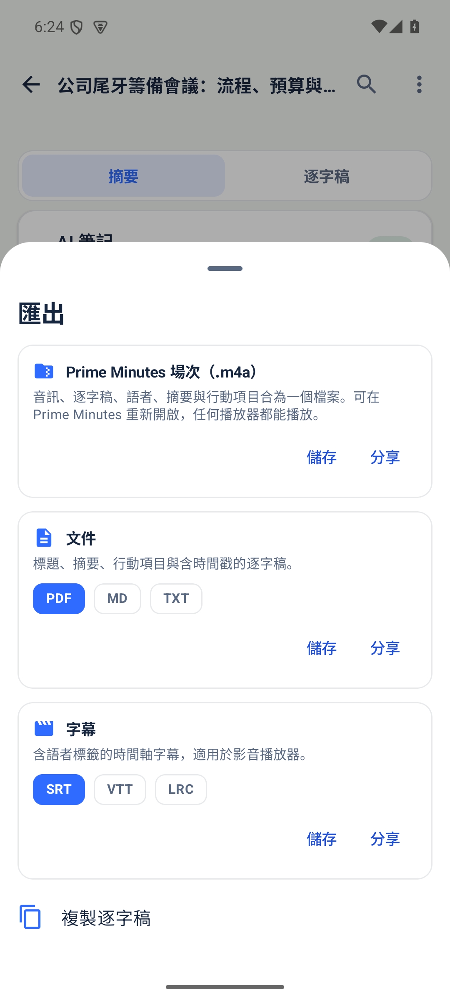 | 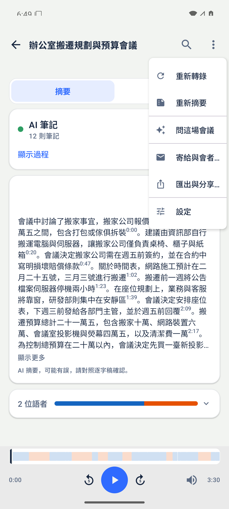 | 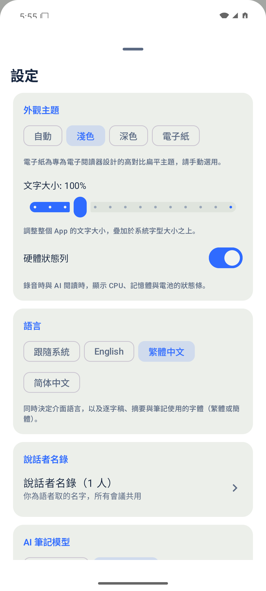 | 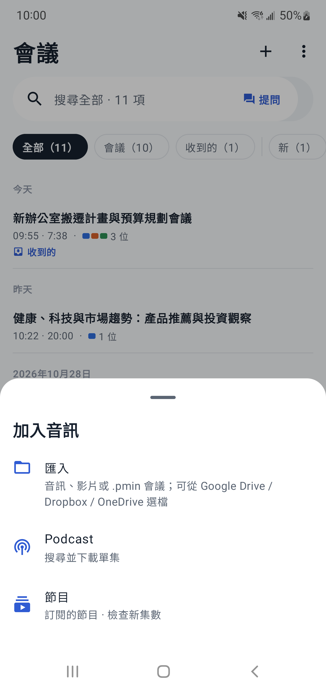 |

</details>

## 安裝

從 [**Releases**](https://github.com/vieenrose/PrimeMinutes/releases/latest) 下載 APK。

- Android 8.0 以上，ARMv8.2（dotprod）處理器，約 2019 年後的手機。
- 模型在第一次開啟時詢問後下載（會先顯示總量，可選僅限 Wi‑Fi）：語音引擎約 271 MB，AI 筆記模型 E2B 約 2.2 GB（E4B 約 3.3 GB），下載後準備一次（約一分鐘）；語意搜尋模型約 160 MB，可選。
- RAM 8 GB 以上：AI 筆記在錄音中同步閱讀；較小的手機在錄音結束後閱讀。
- 唯一的網路連線：下載模型，以及每天檢查一次新版本。

## 已知限制

- 摘要模型以中文會議訓練：英文會議的筆記、標題與摘要改寫成英文（依逐字稿自動判斷），但英文會議的品質只在少數公開會議上量測過；中英夾雜的會議依多數語言決定。
- 會議紀錄中約六分之一的內容與原話不符（E2B，上游量測；E4B 約九分之一），請點時間核對。
- 很長的會議：AI 筆記每段只帶著精簡過的前段筆記閱讀，寫標題與摘要時也只取最重要的筆記（決議、未決、待辦優先），早段的細節可能不會出現在摘要裡。
- 偶爾會多分出發言很少的語者，可用「合併語者」修正；語音辨識漏掉標點時，換人的位置可能落在一個詞的中間。
- E4B 只能在 RAM 8 GB 以上的手機選用；錄音中同時執行時整個 App 約佔 4 GB 記憶體。
- 語意搜尋以句子的意思比對，不相關的句子也可能得到不低的分數而被列出；「提問」由裝置上的小模型作答，可能漏掉段落中明明有的答案，請以出處為準。

## 運作方式

- **聽寫**：[nemo-x-asr-diarizer](https://github.com/vieenrose/nemo-x-asr-diarizer.cpp) 是單一串流引擎，在同一條時間軸上完成語音辨識（X-ASR）與語者分離（Nemotron-3）。
- **搜尋與提問**：[EmbeddingGemma 2 270M](https://huggingface.co/Luigi/primeminutes-embed-litert)（LiteRT，動態 int8）把每段逐字稿、每則筆記與摘要轉成向量，查詢時與關鍵字比對的結果融合（RRF）；「提問」先找出段落最相關的兩場會議，把分數最高的段落（同一場重疊的段落合併）交給 AI 筆記模型作答。
- **AI 筆記與摘要**：[Gemma-4-E2B 會議模型（行動版）](https://huggingface.co/Luigi/gemma-4-E2B-meeting-agent-zh-GGUF/tree/main/mobile-v1) 在 [LiteRT](https://github.com/google-ai-edge/LiteRT) 上執行（[自訂引擎](https://github.com/vieenrose/LiteRT-LM/tree/mobile-fused-attention)）；8 GB 記憶體的手機可改用 [E4B](https://huggingface.co/Luigi/gemma-4-E4B-meeting-agent-zh-LiteRT)。

錄音時，語音辨識優先（它落後就會漏音）；AI 筆記在背景把已確定的句子讀進上下文，每累積約 1,500 token（數分鐘的語音）才真正閱讀一次並寫筆記。停止後只剩最後一段要讀，所以摘要很快完成。在 Galaxy Note 10+（Snapdragon 855）上，約 7 分半的示範會議即時錄音，摘要於停止後約 77 秒完成，記憶體峰值 2.4 GB；改用 E4B 約 3 分鐘、4.0 GB。

AI 筆記（閱讀代理）的設計——閱讀協定、筆記類型、約 1,500 token 的閱讀窗、4k 上下文（每段從精簡過的筆記重新開始）、標題與摘要的呼叫——見 meeting-summarizer 的 [`docs/voxsumdroid-integration.md`](https://github.com/vieenrose/meeting-summarizer/blob/main/docs/voxsumdroid-integration.md)。Prime Minutes 與該協定只有兩處不同：每窗筆記超過上限時優先保留決議與待辦；錄音停止後即使即時辨識漏掉部分音訊，也直接以即時逐字稿寫摘要。

完整操作說明（含介面測試地圖）見 [`docs/USER_GUIDE.md`](docs/USER_GUIDE.md)。模組對應見 [`docs/ARCHITECTURE.md`](docs/ARCHITECTURE.md)，準確度評測見 [`tools/nemo-eval`](tools/nemo-eval/README.md)。

## 從原始碼建置

需要 Android Studio、SDK 35、NDK 27.2：

```bash
git clone https://github.com/vieenrose/PrimeMinutes.git && cd VoxSum
git submodule update --init           # 不要加 --recursive
./gradlew :app:assembleDebug          # arm64-v8a；模擬器用 -PprimeminutesAbi=x86_64
./gradlew :app:testDebugUnitTest
scripts/test-on-device.sh             # 裝置上的儀器測試（獨立 app ID，不影響正式版）
```

## 授權

應用程式以 [GPL-3.0-or-later](LICENSE) 授權；模型與資料各依其授權：

<table>
  <tr><th>元件</th><th>授權</th><th>相關子專案</th></tr>
  <tr><td>X-ASR（語音辨識）</td><td>Apache-2.0</td><td rowspan="2"><a href="https://github.com/vieenrose/nemo-x-asr-diarizer.cpp">nemo-x-asr-diarizer.cpp</a><br>（語音辨識與語者分離整合為單一串流引擎）</td></tr>
  <tr><td>Nemotron-3 Diarization（語者分離）</td><td>OpenMDW-1.1</td></tr>
  <tr><td>EmbeddingGemma 2 270M（語意搜尋）</td><td><a href="https://ai.google.dev/gemma/terms">Gemma</a></td><td><a href="tools/embed-export">tools/embed-export</a><br>（LiteRT 重新封裝）</td></tr>
  <tr><td>Gemma-4-E2B 會議模型（AI 筆記、摘要）</td><td>Apache-2.0</td><td><a href="https://github.com/vieenrose/meeting-summarizer">meeting-summarizer</a><br>（閱讀代理的訓練與協定）</td></tr>
  <tr><td>示範會議音訊（以 VibeVoice-1.5B 合成）</td><td>MIT</td><td><a href="docs/demo">docs/demo</a></td></tr>
  <tr><td>AISHELL-4（語者歸屬正確率評測）</td><td>CC BY-SA 4.0</td><td rowspan="2"><a href="tools/nemo-eval/README.md">tools/nemo-eval</a></td></tr>
  <tr><td>AMI（語者歸屬正確率評測）</td><td>CC BY 4.0</td></tr>
</table>
