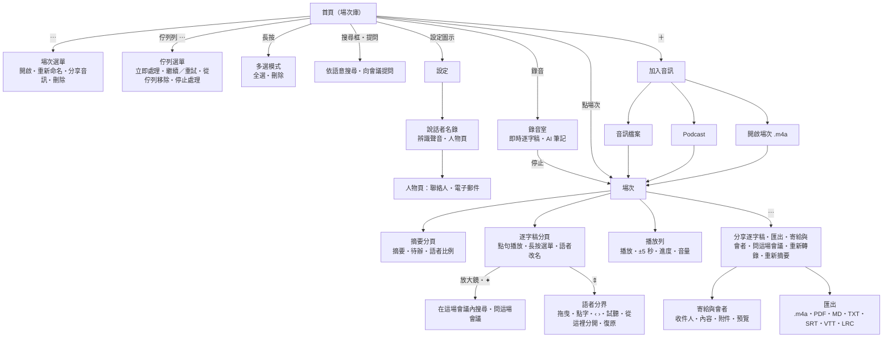
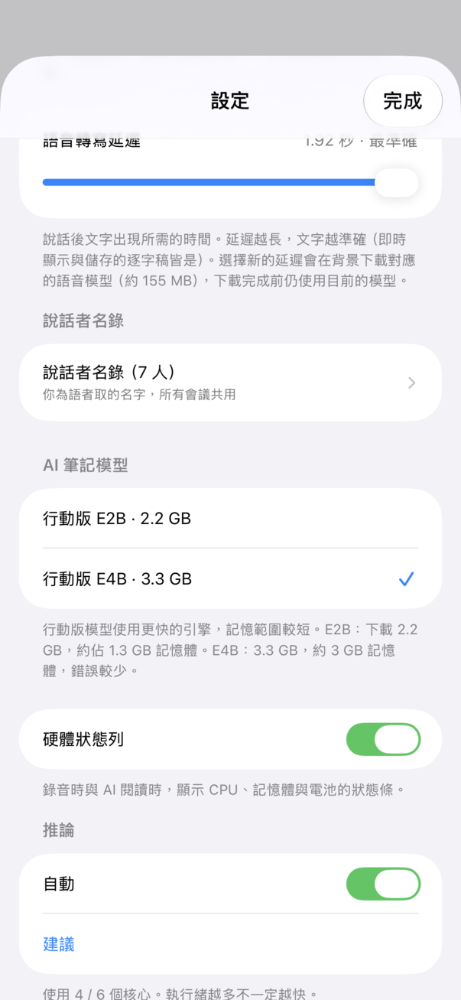
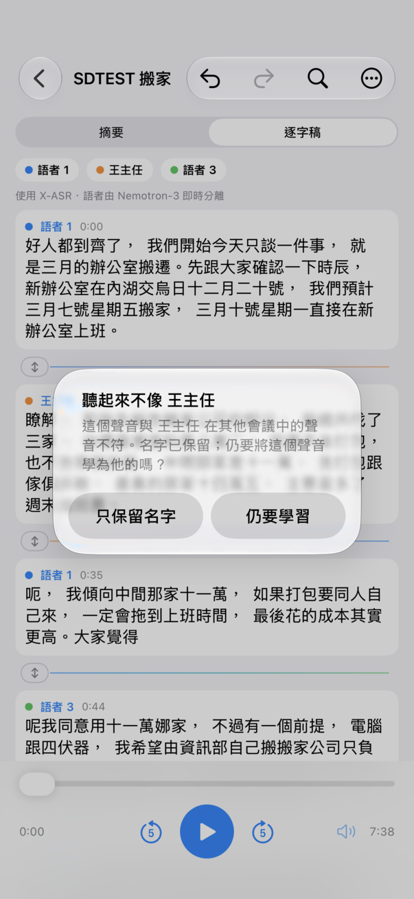
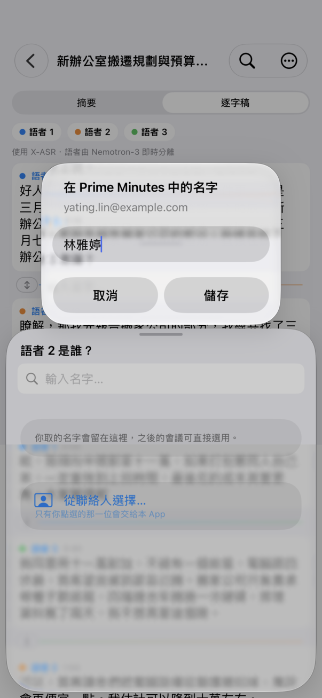
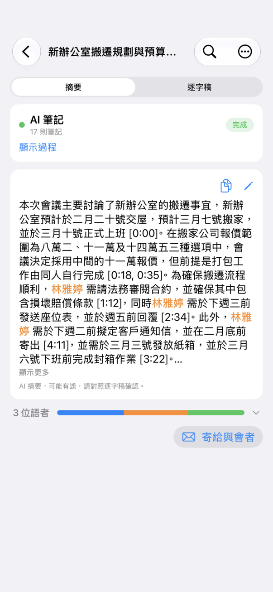

# Prime Minutes iOS 使用說明（含介面測試地圖）

結構與 [Android 版使用說明](https://github.com/vieenrose/PrimeMinutes/blob/android/docs/USER_GUIDE.md) 相同：

- **使用說明**：每一節介紹一個畫面。
- **測試地圖**：每一節最後的表格列出該畫面上的每個操作（節點）、進入方式、預期結果與驗證狀態。

驗證欄：✅ 手動＝在 iPhone 14 Pro Max 上實際操作確認；⬜＝尚未在實機驗證（已編譯）。截圖取自 iPhone 14 Pro Max（淺色主題、繁體中文介面、中文示範會議）；少數較早的截圖取自 iPhone 17 Pro 模擬器（iOS 26）。
與 Android 的差異：沒有 YouTube、App 內更新、NPU 選項與中斷復原對話框（佇列會自動接續）。

畫面結構：

---

## 1. 首頁（場次庫）

  

所有錄音與匯入的場次依日期（今天、昨天、日期）分組。上方可搜尋會議、主題或「誰說過…」，並以晶片篩選；右側的 **提問** 向會議提問（第 1a 節）。沒有場次時顯示說明（隱私、離線、免費）。沒有偵測到說話的錄音以麥克風斜線圖示與「未偵測到語音」標示，不寫 AI 筆記，也不列在「已完成」。底部的 **錄音** 開始一場新會議。排入佇列或處理中的項目列在最上方。

| 節點 | 如何到達 | 預期結果 | 驗證 |
|---|---|---|---|
| 搜尋會議、主題、「誰說過…」 | 首頁上方輸入框 | 立即依標題與關鍵字篩選；停頓後依語意比對段落、筆記與摘要，符合的段落（≈，附時間與語者）列在場次下方，點段落從該處播放；語意比對進行中且還沒有結果時顯示「搜尋中…」，比對完仍沒有結果才顯示「沒有符合搜尋的場次。」 | ✅ 手動（iPhone 14 Pro Max） |
| 依語意搜尋 — 下載模型 | 搜尋模型未下載時，搜尋框下方 | 下載約 160 MB 後，為既有會議建立索引（「正在建立索引…」）；之後每場會議結束後自動建立 | ⬜ |
| 提問 | 搜尋框右側；AI 筆記模型與搜尋模型都已下載時出現（設定 › 向會議提問，預設開啟） | 搜尋框有文字時直接提問，空白時開啟提問面板（第 1a 節） | ✅ 手動（iPhone 14 Pro Max） |
| 篩選晶片 全部／已完成 | 有場次時 | 只列出該狀態的場次 | ⬜ |
| 點場次 | 點一列 | 開啟場次（第 5 節） | ✅ 手動 |
| 點場次（排隊或處理中） | 點佇列中的一列 | 開啟即時畫面：狀態與進度（處理中時右側顯示硬體狀態列）、AI 筆記與逐字稿隨處理出現，音訊可同時播放；處理完成後畫面直接變成這場會議 | ✅ 手動（iPhone 14 Pro Max） |
| 點場次（Podcast 下載中） | 點下載中的一列 | 顯示下載進度（百分比與已下載量）、「已暫停」與「繼續」，或失敗原因與「重試」；⋯ 可刪除（連同已下載的部分）；下載完成後同一畫面接著顯示處理進度 | ✅ 手動（iPhone 14 Pro Max） |
| 錄音 | 底部按鈕 | 首次要求麥克風權限；拒絕時顯示「需要麥克風權限」；允許後進入錄音室（第 4 節） | ✅ 手動 |
| ＋ | 右上 | 加入音訊（第 3 節） | ✅ 手動 |
| 設定圖示 | 右上 | 設定（第 8 節） | ✅ 手動 |
| 下載列 | 模型下載中 | 名稱、進度與取消 | ✅ 手動 |

第一次開啟時（以及之後錄音、匯入或下載 Podcast 單集前若還缺模型），**下載 AI 模型？** 列出需下載的總量與每個模型的大小；未連上 Wi‑Fi（或開啟低數據模式）時提醒可能使用行動數據。

| 節點 | 預期結果 | 驗證 |
|---|---|---|
| 立即下載 | 在背景下載；首頁上方與設定顯示下載卡片：進度與「取消」 | ⬜ |
| 下載暫停 | App 被暫停（切到其他 App、鎖定螢幕）或斷線時不再當成失敗：卡片顯示「已暫停」與「繼續」，已下載的部分保留；回到 App 且有網路、按「繼續」或稍候片刻後從中斷處接續。Podcast 單集的下載也一樣 | ✅ 手動（iPhone 14 Pro Max：Podcast 單集在背景完成下載；被終止後重新開啟從 .part 接續。「已暫停」畫面本身未實機確認） |
| 僅限 Wi‑Fi | 連上 Wi‑Fi 後自動下載 | ⬜ |
| 稍後 | 本次不下載；下次錄音或匯入前再詢問 | ⬜ |

### 1a. 向會議提問（實驗性）

  

| 節點 | 如何到達 | 預期結果 | 驗證 |
|---|---|---|---|
| 提問 | 搜尋框輸入問題 → 提問；或空白時點提問，在面板輸入 | 「正在搜尋會議… N 秒」→「正在閱讀 N 段摘錄… N 秒」→「正在回答… N 秒」→ 答案逐字出現，下方列出出處（時間 · 場次 — 段落）與免責聲明；模型讀到的逐字稿摘錄標有語者（已命名的用名字，否則「語者 N」），所以能回答「誰負責…」 | ✅ 手動（iPhone 14 Pro Max：約 6 秒） |
| 點答案中的出處或下方出處 | 答案完成後 | 關閉面板，開啟該場次並從該段開頭播放 | ✅ 手動（iPhone 14 Pro Max） |
| 回答的語言 | 用英文或中文提問 | 回答使用提問的語言（例如中文介面下用英文問，就用英文答）；問題太短或中英夾雜時跟隨介面語言 | ✅ 手動（iPhone 14 Pro Max） |
| 繼續提問… | 面板底部輸入框 | 帶著前一輪對話追問；↻（新對話）清除對話 | ⬜ |
| 裝置忙碌 | 錄音、轉寫或摘要進行中提問 | 「請等目前的錄音、轉寫或摘要完成後再提問。」 | ⬜ |
| 停止 | 答題中 | 保留已產生的部分 | ⬜ |

## 2. 場次與佇列選單

場次列右側的 **⋯**：

| 節點 | 何時出現 | 預期結果 | 驗證 |
|---|---|---|---|
| 開啟 | 一律 | 開啟場次 | ⬜ |
| 重新命名 | 一律 | 對話框輸入新標題 | ⬜ |
| 分享音訊 | 有音訊檔 | 系統分享面板 | ⬜ |
| 刪除 | 一律 | 確認對話框；取消不刪 | ⬜ |
| 長按 → 多選 | 長按一列 | 勾選多列，全選、批次刪除（需確認） | ⬜ |

佇列列（處理中、排入佇列、已停止、失敗）右側的 **⋯**：

| 節點 | 何時出現 | 預期結果 | 驗證 |
|---|---|---|---|
| 停止處理 | 正在處理 | 停止，列顯示「已停止，可繼續」；已轉錄的進度一定保留。AI 筆記整理時被終止，重新開啟後只重寫筆記，不重做轉錄 | ✅ 手動（iPhone 14 Pro Max：整理筆記時終止 App，重開後只跑 AI 筆記） |
| 繼續 | 已停止 | 從檢查點接續；已完成的轉錄不重做 | ⬜ |
| 重試 | 處理失敗（列上顯示錯誤） | 重新處理；失敗時也會發出通知 | ⬜ |
| 立即處理 | 排入佇列、尚未處理 | 移到最前並開始 | ⬜ |
| 從佇列移除 | 未在處理 | 移出佇列 | ⬜ |

離開 App 時（iOS 26 以上），佇列會在背景繼續處理，系統會顯示「正在處理會議」與進度；背景處理比較慢。若系統收回時間或 App 被終止，目前的錄音會在中斷點保留在佇列，由下次背景工作或下次啟動接續。

## 3. 加入音訊

   

| 節點 | 預期結果 | 驗證 |
|---|---|---|
| 音訊檔案 | 「檔案」挑選器；複製時顯示「正在匯入分享的音訊…」，完成後排入佇列；失敗時顯示「匯入失敗」 | ✅ 手動 |
| Podcast | 搜尋節目 → 選集：首頁立刻出現這一集（標題即單集名稱），標示下載進度；下載完成後排入佇列處理。可連續選多集，依序下載。切到其他 App 或斷線時暫停、回到 App 後接續；App 被終止後重新開啟也從已下載的部分接續；失敗時該列顯示原因與「重試」 | ✅ 手動（iPhone 14 Pro Max：下載中背景化 → 已暫停 → 回到 App 接續；終止後重開從 .part 接續；刪除下載中的一集會一併刪除 .part。失敗與「重試」未實機確認） |
| 開啟場次 | 選 Prime Minutes 場次 `.m4a`（Android 匯出的也可以）：直接還原逐字稿、語者與摘要，不重新轉錄 | ✅ 手動 |
| 從其他 App 分享 | 分享音訊到 Prime Minutes | 同「音訊檔案」 | ⬜ |

## 4. 錄音室

錄音前就把錄音排入佇列，App 被終止也保留音訊。錄音時套用自動增益（只放大小聲的語音），逐字稿即時出現；語者在設定的延遲後標上顏色。AI 筆記每讀滿一段逐字稿（約 1,500 個詞元）才寫一批：第一次閱讀前，卡片顯示「進度條滿時開始第一次閱讀」，錄音約一分鐘後改為「第一次閱讀約在 N 分鐘後」（依目前的說話速度），並提示提早停止錄音的話筆記在停止後才寫。RAM 不足 4.5 GB 時，AI 筆記在錄音結束後才閱讀。

 

| 節點 | 預期結果 | 驗證 |
|---|---|---|
| 計時與即時逐字稿 | 逐字稿隨說話更新 | ✅ 手動 |
| AI 筆記卡片 | 閱讀中／寫筆記；展開可看每則筆記 | ✅ 手動 |
| 停止 | 存檔、轉錄、摘要並取標題；完成後通知「場次已就緒」 | ✅ 手動 |

## 5. 場次：摘要分頁

   

| 節點 | 預期結果 | 驗證 |
|---|---|---|
| 摘要卡片 | 超過 12 行時「顯示更多／顯示較少」 | ✅ 手動 |
| 編輯（筆形） | 編輯摘要後儲存 | ✅ 手動 |
| 複製 | 複製摘要，提示「已複製摘要」 | ⬜ |
| 時間點 | 點藍色時間點從該處播放（支援 `[mm:ss]` 與 `[h:mm:ss]`） | ⬜ |
| 待辦事項 | 開啟「顯示待辦事項」時出現；超過 8 行可展開；可複製 | ✅ 手動 |
| 沒有摘要 | 顯示「沒有偵測到語音」或「尚無摘要」說明 | ⬜ |
| 沒有可記的內容 | 摘要只有一行「這段錄音沒有需要記下的事項」 | ⬜ |
| 很長的會議 | 筆記多到一次寫不完時（約 40–75 分鐘以上，依討論密度而定），摘要分成最多四段依時間順序撰寫，涵蓋開頭到結尾，摘要較長、撰寫也較久；較短的會議仍一次寫成 | ✅ 自動（ProseTests） |
| 模型已更換 | 開啟以舊模型摘要的場次時，提示重新摘要 | ⬜ |

 

60 分鐘的公開中文會議（AliMeeting，iPhone 17e，E4B 行動版 v2）：69 則筆記，摘要分段撰寫，時間標記與待辦延伸到會議後段（35 分鐘以後）。

## 6. 場次：逐字稿分頁

  

 

上方註明處理流程（X-ASR + Nemotron-3 語者分離）。

| 節點 | 預期結果 | 驗證 |
|---|---|---|
| 點一句 | 從該處播放 | ✅ 手動 |
| 長按 → 編輯 | 修改文字並儲存 | ⬜ |
| 長按 → 移給語者 | 這句改派給另一位語者 | ⬜ |
| 長按 → 合併語者 | 先確認；該語者全部併入另一位，下方「已合併語者」橫幅 8 秒內可點 **復原**（移動單句同樣可復原） | ✅ 手動（iPhone 14 Pro Max，DEV 觸發：確認框與復原橫幅） |
| 語者改名 | 點語者名稱：「語者 N 是誰？」面板，從說話者名錄選人、輸入新名字或從聯絡人選擇（第 9 節） | ✅ 手動（iPhone 14 Pro Max） |
| 修改後 | 有摘要時提示「逐字稿已變更，要重新摘要嗎？」 | ⬜ |
| 搜尋（放大鏡）→ ≈ | 關閉 ≈：找出含有搜尋字詞的句子；開啟 ≈（搜尋模型已下載時）：也找出意思相近的句子 | ✅ 手動（iPhone 14 Pro Max） |

### 6b. 在這場會議內搜尋與提問

  

搜尋列下方列出這場會議符合的 **AI 筆記** 與 **逐字稿** 句子（各依時間排序，標示 **≈** 的是依語意找到的）；點一筆就捲到那句並把播放位置停在那裡。**✦**（搜尋列、結果清單最後一列、⋯ 選單的「問這場會議」）只拿這場會議的段落作答；出處只顯示時間；摘錄以說話者名字交給模型，所以「誰負責…」的問題能回答人名。設計與預設值：[docs/design/in-session-search-ask.md](design/in-session-search-ask.md)。錄音／處理中的即時畫面沒有逐字稿搜尋（與先前相同），請在會議完成後從會議畫面使用。

| 節點 | 如何到達 | 預期結果 | 驗證 |
|---|---|---|---|
| 結果清單 | 放大鏡 → 輸入 | AI 筆記・N、逐字稿・N 兩組，各附時間；清單鈕收合／展開；最多 50 筆 | ✅ 手動（iPhone 14 Pro Max） |
| 點結果 | 結果清單 | 清單收合，逐字稿捲到該句（筆記的 m:ss 對到以該時間顯示的那句），播放位置停在該句開頭 | ⬜ 裝置未逐項點選；✅ 自動（主機測試：筆記 3:22 對到 202.4 秒那句） |
| ≈ 依語意 | 搜尋列的 ≈ | 加入依語意找到的筆記與句子（標 ≈）；結果清單開著時畫面不跳到第一個符合處 | ✅ 手動（iPhone 14 Pro Max，示範會議「預算」、「battery」） |
| 問這場會議 | ✦ 或 ⋯ → 問這場會議 | 「正在搜尋這場會議…」→ 答案，出處為這場會議的時間 | ✅ 手動（iPhone 14 Pro Max：取段落約 1.4 秒，作答約 15 秒，E2B） |
| 尚未建立索引 | 沒有搜尋模型，或索引尚未完成 | 仍可提問（只用關鍵字找段落），同時在背景建立索引 | ✅ 手動（iPhone 14 Pro Max：未建索引的示範會議，關鍵字 10 段、取 4 段，作答 4.7 秒） |
| 先前的問題 | 再次開啟問這場會議 | 這場會議先前的問答列在「先前的問題」下（最多 20 則）；↻ 清除；刪除會議時一併刪除 | ✅ 手動（iPhone 14 Pro Max：寫入、再開啟列出、↻ 後為 0 則、刪除會議後 .askhistory 消失）、✅ 自動（主機測試） |

### 6a. 調整說話者分界（Adjust a speaker boundary）

   

語者換人時，逐字稿偶爾把下一位的前一兩個字留在上一句（或反過來）。完成的逐字稿中，兩位不同語者的相鄰句子之間有一條細線和 **⇕** 把手；點把手開啟「語者分界」：

- 上方是上一句的結尾接著下一句的開頭，底色標示各自的語者，標記（直線加圓點）之後屬於下一位。中文以字為單位，英文以詞為單位。
- **拖曳**標記、**點**下一位開始說的那個字，或用 **‹ ›** 一次移一格。
- 每次移動後自動播放分界之後約 2 秒，聽是誰在說；**◀| 分界前**／**分界後 |▶** 重播分界前、後各 2 秒。
- **套用** 後兩句的文字與時間一起更新（匯出的字幕也跟著改），其他句子、語者名稱與 AI 筆記不變，也不會提示重新摘要。
- 一句話裡其實有另一個人插話時：長按該句 → **從這裡分開…**，在「後半段是誰說的？」選好分界與語者（先列相鄰句的語者，再列其他語者，最後是「＋ 新語者」）。
- 頂端的 **↶ 復原**／**↷ 重做** 可逐步還原或重做分界調整、分句、改字、改派與改名。
- VoiceOver：標記是一個可調整的元素，上下滑動即左右移動，並唸出「語者 N 從「某字」開始」；另有「往前一字」「往後一字」動作。

| 節點 | 預期結果 | 驗證 |
|---|---|---|
| 分界把手 ⇕ | 開啟「語者分界」 | ✅ 手動（iPhone 14 Pro Max，DEV 觸發） |
| ‹ ›／拖曳／點字 | 標記移動，自動試聽分界之後 | ✅ 手動（‹ › 步進，DEV 觸發；播放位置隨試聽前進） |
| 套用 | 兩句文字與時間更新，下方「已調整分界」；重新啟動 App 後仍在 | ✅ 手動（iPhone 14 Pro Max）、✅ 自動（ios/tests BoundaryEditsTests） |
| 長按 → 從這裡分開… | 選分界與語者，後半段成為新的一句 | ✅ 手動（DEV 觸發）、✅ 自動（BoundaryEditsTests） |
| ↶ 復原／↷ 重做 | 逐步還原與重做 | ⬜ |

## 7. 播放列與場次選單

| 節點 | 預期結果 | 驗證 |
|---|---|---|
| 播放／暫停、±5 秒、進度 | — | ✅ 手動 |
| 音量 | 靜音、25／50／75／100% | ✅ 手動 |
| ⋯ → 分享逐字稿 | 系統分享面板（純文字） | ⬜ |
| ⋯ → 匯出 | 選格式；`.m4a` 場次匯出時顯示「匯出中」；失敗時提示 | ✅ 手動 |
| 匯出格式 | TXT（略過空行）、MD（標題、摘要、逐字稿條列）、SRT／VTT（每段 ≤32 字）、LRC、PDF | ✅ 手動 |
| ⋯ → 問這場會議 | 只用這場會議作答（第 6b 節） | ✅ 手動 |
| ⋯ → 寄給與會者… | 寄送面板（第 9a 節） | ✅ 裝置 |
| ⋯ → 重新轉錄 | 重跑語音辨識與語者分離 | ⬜ |
| ⋯ → 重新摘要 | 保留逐字稿與語者名稱；完成時畫面即時更新並顯示「新摘要已完成 · 復原」 | ✅ 手動 |

## 8. 設定

 

| 節點 | 預期結果 | 驗證 |
|---|---|---|
| 語言 | English／繁體中文／简体中文，介面與產生的文字一起切換 | ⬜ |
| 外觀 | 自動、淺色、深色、電子紙 | ✅ 手動 |
| 文字大小 | 整個 App 的文字縮放 | ⬜ |
| 語者標註延遲 | 5–30 秒（預設 15） | ⬜ |
| 語音轉寫延遲 | 0.16／0.48／0.96／1.92 秒（預設 1.92 秒），滑桿四段：最快、最不準／快／平衡／最準確。延遲越長，文字越準確（即時顯示與儲存的逐字稿皆是）；選擇新的延遲會在背景下載對應的語音模型（約 155 MB），下載完成前使用已安裝中最接近的模型 | ✅ 手動（iPhone 14 Pro Max，畫面） |
| 說話者名錄 | 開啟說話者名錄（第 9 節），顯示已命名的人數 | ✅ 手動 |
| AI 筆記模型 | E2B（預設）或 E4B（6 GB 以上 RAM 的 iPhone；載入時可用記憶體低於 2.5 GB 則該次改用 E2B） | ✅ 手動 |
| 硬體狀態列 | 錄音時在錄音室標題列右側、處理時在即時畫面的狀態列右側顯示 CPU、記憶體、電池；首頁不顯示 | ✅ 手動（iPhone 14 Pro Max） |
| 推論執行緒 | 自動（首次一秒測試）或手動；載入失敗時自動降低 | ✅ 手動 |
| 顯示待辦事項 | 摘要分頁多一張待辦卡 | ✅ 手動 |
| 向會議提問（預設開啟） | 首頁搜尋框右側出現「提問」（第 1a 節）；需要 AI 筆記模型與搜尋模型 | ✅ 手動 |
| 儲存空間：下載搜尋模型／為舊會議建立索引 | 未下載時顯示「下載搜尋模型（約 160 MB）」；下載後顯示待建立索引的會議數與「為舊會議建立索引」，全部完成時顯示「所有會議都已建立搜尋索引。」 | ⬜ |
| 儲存空間 | 列出每個模型（含編譯快取大小），可刪除 | ✅ 手動 |
| 關於 | 版本、元件與授權 | ⬜ |

## 9. 說話者名錄

   

設定 → 說話者名錄：你命名過的每個人，與他出現的會議。點逐字稿的語者名稱會開啟選人面板：依聲音建議（開啟辨識聲音時）、這場會議已有的人（灰色）、最近、全部，以及搜尋與「新增為新的人」。名字跨會議共用：在人物頁全部改名，每場會議都跟著更新。

**辨識聲音**（選用，預設關閉）：開啟前先說明隱私：一切只在這支手機上，聲音不上傳，不包含在匯出與備份中；「聲音」是最多 60 秒語音算出的一串數字，不是錄音；建議絕不會在沒有你點選時套用；可隨時忘記某人的聲音或刪除所有聲音資料，刪除會議也會刪除它提供的聲音樣本；命名前請先徵得對方同意。聲音模型（約 29 MB）開啟時下載一次。

| 節點 | 預期結果 | 驗證 |
|---|---|---|
| 選人面板 | 依聲音建議（●●● 很可能／●●○ 可能，每位語者最多 3 人，同一人不同時建議給兩位語者）、這場會議已有的人、最近、全部；依聲音建議的人不在「最近／全部」重複 | ✅ 手動（iPhone 14 Pro Max：「搬家」語者 2 建議陳經理 ●●●，cos 0.97） |
| 沒有建議時的說明 | 「這位語者清楚的語音不足」「正在比對聲音…」「尚未學到任何聲音」「沒有相符的已知聲音」 | ⬜ |
| 辨識聲音開關 | 先顯示說明，「開啟」後下載模型（進度條），再於背景為每場會議計算聲音；關閉時保留資料 | ✅ 手動（下載 29 MB 約 3 秒） |
| 背景計算 | 不與錄音、轉錄或 AI 筆記同時進行；電量高於 20% 或充電中；每場約 8 分鐘的會議約 3 秒 | ✅ 手動（status.log：decode 0.1 秒、embed 2.7–3.0 秒） |
| 已學到 N 人的聲音 | 只計你確認過名字的人 | ✅ 手動 |
| 這是我… | 朗讀約 20 秒，只保留聲音向量；建立或使用名為「我」的人 | ✅ 手動（DEV：以音訊檔代替麥克風） |
| 刪除所有聲音資料 | 先確認；刪除每個人的聲音與每場會議的聲音資料，並關閉辨識；名字保留 | ✅ 手動 |
| 人物頁：聲音 | 學自幾場會議（秒數）、待確認的會議數、學習開關 | ✅ 手動 |
| 人物頁：忘記聲音 | 先確認；刪除此人的聲音並停止學習，直到重新開啟開關（之後從已命名的會議重新學習） | ✅ 手動 |
| 聽起來不像 X | 確認的名字與此人其他會議的聲音不符時詢問「仍要學習」或「只保留名字」；名字一律保留 | ✅ 手動 |
| 刪除會議 | 也刪除它提供的聲音樣本（與該場的聲音資料檔） | ⬜（主機測試 VoiceTests 驗證） |
| 人物頁：全部改名、備註、合併至…、刪除、分出某場會議 | 改名與合併改寫每場相關會議；刪除時可保留或清除會議中的名字 | ✅ 手動 |

### 9a. 聯絡人與寄給與會者

    

人物頁的「聯絡人」區塊可「從聯絡人選擇…」（系統挑選器，App 只拿到你點選的聯絡人，不需通訊錄權限）、「從聯絡人更新」、「取消連結」；「電子郵件」區塊列出地址（★ 為寄信時使用的預設地址），可新增、設為預設、移除。為語者命名時，選人面板最下方也有「從聯絡人選擇…」：選好後確認「在 Prime Minutes 中的名字」，同名的人會詢問是否為同一人。

場次選單 →「寄給與會者…」開啟寄送面板：收件人（會議中已連結的人，有地址者預先勾選，「我」不寄給自己；缺地址可直接輸入或從聯絡人選擇，並存到此人；「新增其他收件人」只用於這封信）、內容（摘要、紀要、只要決議與待辦）、附件（無、PDF、TXT、錄音 .m4a）、郵件語言、預覽。【會議資訊】的時間：錄音為實際開始到結束；匯入為檔案本身記錄的建立時間，沒有時只列日期；更新前的舊會議照舊。至少一人有電子郵件時，摘要頁語者比例下方也會出現「寄給與會者」。

| 節點 | 預期結果 | 驗證 |
|---|---|---|
| 人物頁 → 從聯絡人選擇… | 開啟系統聯絡人挑選器（無電子郵件的聯絡人為灰色） | ✅ 裝置（14 Pro Max，DEV 觸發：挑選器顯示於設定面板之上；畫面截圖無法擷取系統挑選器內容）；實際點選聯絡人 ⬜ |
| 命名語者 → 從聯絡人選擇… | 挑選器 →「在 Prime Minutes 中的名字」→ 儲存：新增此人、連結聯絡人、加入地址，語者改名 | ✅ 裝置（挑選器顯示；之後的流程以 DEV 模擬選取驗證） |
| 人物頁：聯絡人與電子郵件 | 「已連結：名字（公司）· 日期」、地址來源（來自聯絡人／你輸入的）、★ 預設 | ✅ 裝置 |
| 寄給與會者面板 | 收件人勾選規則、缺地址的「新增」、內容與附件選項、語言（會議語言） | ✅ 裝置（中文與英文會議） |
| 預覽 | 主旨、收件人與固定範本內容（摘要 + 紀要，待辦依負責人分組） | ✅ 裝置；範本內容由主機測試 MeetingMailTests 的黃金檔驗證 |
| 在郵件 App 中開啟 | 有郵件帳號：系統撰寫視窗（HTML、附件），寄出／存草稿記錄於分享紀錄；無帳號：`mailto:`；都不行：分享表單並複製地址 | ✅ 裝置：此手機無郵件帳號，走 `mailto:`（status.log：mailto ok=true）；撰寫視窗與分享表單 ⬜ |

---

## 附錄 A. 示範影片

| 語意搜尋 | 向會議提問 |
|:---:|:---:|
|  |  |
| 輸入「大家的車要停哪裡」：用詞不同也找得到停車的段落；點段落就從該處開始播放。 | 輸入「誰負責聯絡遊覽車公司？」再點「提問」：摘錄標有語者，回答指出「語者 3」並附上出處（等待段 ×4）。 |

iPhone 17e，E4B 行動版 v2。搜尋在輸入時先比對關鍵字，一兩秒後補上語意相近的結果；提問約 15 秒完成，作答時面板顯示目前的階段與秒數。

 錄音進行中（約第 5 分鐘起），AI 筆記讀完一段逐字稿後寫下筆記（×2，iPhone 17e，E4B 行動版 v2）。會議內搜尋與提問（上方 6b 節的動畫）為即時錄製，提問約 10 秒完成。

更多畫面：  

## 附錄 B. 與 Android 版的差異

- 僅以 CPU 推論（Metal GPU 在 iPhone 上沒有明顯加速）。
- 沒有 App 內更新（由 App Store／TestFlight 負責），也沒有 Android 的電池最佳化設定。iOS 26 以上離開 App 後佇列仍在背景繼續處理（系統顯示進度）；較舊版本由 `BGProcessingTask` 或下次啟動接續。
- 不提供 YouTube 匯入。
- 中斷的處理不會跳出詢問：佇列在下次啟動時自動從檢查點接續；錄音開始前就排入佇列，App 被終止也保留音訊。
- 下載在切換到其他 App 或鎖定螢幕時暫停，回到 App 且有網路時從中斷處接續。

## 附錄 C. 運作方式

- **聽寫**：[nemo-x-asr-diarizer](https://github.com/vieenrose/nemo-x-asr-diarizer.cpp)：語音辨識（X-ASR）與語者分離（Nemotron-3）在同一條時間軸上的串流引擎，以 C 介面接到 Swift；換人的位置會對齊語者分離偵測到的起點（不重疊時）。
- **AI 筆記與摘要**：Gemma-4-E2B 會議模型（行動版 v1），或 6 GB 以上 RAM 的 iPhone 上 E4B 行動版 v2（載入時 `os_proc_available_memory` 低於 2.5 GB 則該次改用 E2B，見 `ReaderGate`），在 LiteRT 上執行（[自訂引擎](https://github.com/vieenrose/LiteRT-LM/tree/mobile-fused-attention)，`CLiteRTLM.xcframework`）。閱讀協定（`MeetingReader`、`ReaderSummarizer`）以 Swift 重寫，與 Android 的黃金測試資料逐位元組一致。從舊版 E4B 升級時，新版在背景下載（相同的檔案直接沿用），下載完成前繼續使用舊版。
- **搜尋與提問**：[EmbeddingGemma 2 270M](https://huggingface.co/Luigi/primeminutes-embed-litert)（LiteRT，動態 int8）把每段逐字稿、每則筆記與摘要轉成向量，查詢時與關鍵字比對的結果融合（RRF）；「提問」先找出最相關的兩場會議，把分數最高的段落交給 AI 筆記模型作答。
- **辨識聲音**：[CAM++ zh-en](https://huggingface.co/Luigi/primeminutes-speaker-litert)（3D-Speaker）在 CPU 上執行（約 8 分鐘的會議約 3 秒），只在沒有錄音、轉錄或 AI 筆記時，且電量高於 20% 或充電中才在背景計算。

## 附錄 D. 已知限制

- 摘要模型以中文會議訓練：英文會議的筆記、標題與摘要改寫成英文（依逐字稿自動判斷），英文品質只在少數公開會議上量測過。
- 部分會議紀錄內容可能與原話不符，請點時間核對。
- 偶爾會多分出發言很少的語者，可用「合併語者」修正。
- 語意搜尋可能列出不相關的句子；「提問」由裝置上的小模型作答，可能漏掉段落中明明有的答案，請以出處為準。
