# Prime Minutes 使用說明（含介面測試地圖）

這份文件有兩個用途：

- **使用說明**：每一節介紹一個畫面，附截圖。
- **測試地圖**：每一節最後的表格列出該畫面上的每個操作（節點）、進入方式、預期結果與驗證狀態，作為介面測試的清單。

驗證欄：✅ 手動＝在模擬器或實機上實際操作確認；✅ 自動＝由 `app/src/androidTest` 的儀器測試涵蓋（括號內為測試類別）；⬜＝尚未驗證。最後一次全面驗證：2026-10-03，v0.47.0，Pixel 模擬器（8 GB）與 Galaxy Note 10+。

畫面結構：

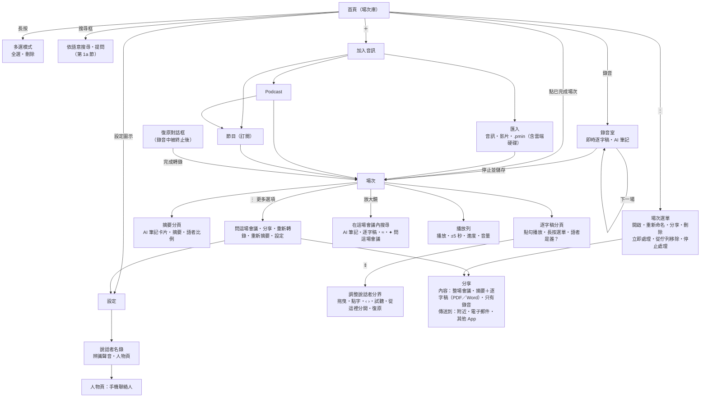

---

## 1. 首頁（場次庫）


所有錄音與匯入的場次依日期分組列在這裡（還沒有場次時，會說明第一次錄音要下載多少模型，建議使用 Wi‑Fi）。沒有偵測到說話的錄音（靜音、只有雜音）以麥克風關閉圖示與「未偵測到語音」標示：可以開啟與刪除，但不寫 AI 筆記，也不列在「已完成」。上方可搜尋標題，右側的 **提問** 向會議提問（第 1a 節）。場次庫有兩種以上來源時，搜尋框下方出現依來源篩選的晶片：**全部／會議／Podcast／收到的**；Podcast 單集的列顯示節目封面與「節目 · 日期 · 長度」，別人分享來的會議標示 **收到的**。底部的 **錄音** 開始一場新會議；有尚未處理的錄音時，上方會多一個 **處理待辦（N）**。

| 節點 | 如何到達 | 預期結果 | 驗證 |
|---|---|---|---|
| 搜尋會議、主題、「誰說過…」 | 首頁上方輸入框 | 立即依標題與關鍵字篩選；停頓後依語意比對段落、筆記與摘要，符合的段落（≈，附時間與語者）列在會議下方，點段落從該處播放；語意比對進行中且還沒有結果時顯示「搜尋中…」，比對完仍沒有結果才顯示「沒有符合搜尋的會議。」 | ✅ 手動（Note 10+）、✅ 自動（EmbedDeviceTest.hybridSearch） |
| 依語意搜尋 — 下載模型 | 搜尋模型未下載時，搜尋框下方 | 下載約 160 MB 後，閒置時為既有會議建立索引（「正在建立索引…」） | ✅ 手動 |
| 提問 | 搜尋框右側；AI 筆記模型與搜尋模型都已下載時出現（設定 › 向會議提問，預設開啟） | 搜尋框有文字時直接提問，空白時開啟提問面板（第 1a 節） | ✅ 手動（Note 10+） |
| 未偵測到語音 | 沒有說話的錄音處理完後 | 麥克風關閉圖示；不列在「已完成」篩選；點開可看錄音 | ✅ 手動（Note 10+） |
| 來源晶片 全部／會議／Podcast／收到的 | 場次庫有兩種以上來源時出現 | 只列出該來源的場次；選 Podcast 時單集依節目分組，點節目標題開啟節目頁（第 4a 節） | ✅ 手動（Galaxy A53） |
| 篩選晶片 新／已完成 | 有「新」場次時出現，在來源之內篩選 | 只列出該狀態的場次；全部已完成時晶片不顯示 | ✅ 手動 |
| 點場次（已完成） | 點一列 | 開啟場次（第 6 節） | ✅ 手動 |
| 點場次（處理中） | 點正在處理的一列 | 即時查看處理進度：狀態列右側顯示硬體狀態列，逐字稿與 AI 筆記隨處理出現，音訊可同時播放 | ✅ 手動 |
| 點場次（下載中） | 點 Podcast 下載中的一列 | 開啟該場次：下載卡片顯示進度（百分比與已下載量）、「已暫停」或失敗原因，可「立即繼續」「重試」或「刪除」（連同已下載的部分）；下載完成後同一畫面接著顯示處理進度 | ✅ 手動（Note 10+） |
| 處理待辦（N） | 有未處理錄音時 | 依序轉錄並摘要；完成後列變為已完成 | ✅ 手動（Note 10+） |
| 錄音 | 底部大按鈕 | 首次要求麥克風權限，進入錄音室（第 5 節） | ✅ 手動 |
| 錄音中…（返回） | 錄音進行中回到首頁 | 回到錄音室，錄音不中斷 | ✅ 手動 |
| ＋ | 右上 | 加入音訊選單（第 4 節） | ✅ 手動 |
| 設定圖示 | 右上 | 設定（第 9 節） | ✅ 手動 |
| 有可用更新橫幅 | 有新版本時 | 更新＝下載並安裝；稍後＝隱藏 | ⬜ |


第一次開啟時（以及之後錄音或匯入前若還缺模型），**下載 AI 模型？** 列出需下載的總量與每個模型的大小；未連上 Wi‑Fi 時以橘色提醒可能使用行動數據。

| 節點 | 如何到達 | 預期結果 | 驗證 |
|---|---|---|---|
| 立即下載 | 下載對話框 | 在背景下載；首頁上方（不論資料庫是否為空）與設定頂端都顯示下載卡片：已下載／總量、百分比與「取消」 | ✅ 手動（Note 10+，語音模型約 273 MB，約 1 分鐘下載完成；模擬器：空資料庫與設定上的卡片） |
| 下載卡片：取消 | 下載進行中 | 停止下載；本次開啟期間網路變化不會自動重新開始（重新開啟 App 或再次同意下載才會）；錄音或匯入仍會下載所需的模型 | ✅ 手動 |
| 下載暫停 | 下載中斷線、手機休眠 | 不再當成失敗：卡片顯示「下載已暫停 · 會自動繼續」與「繼續」，已下載的部分保留；網路恢復、回到 App、按「繼續」或稍候片刻就從中斷處接續，已完成的檔案不重新下載 | ✅ 手動（Note 10+：下載語音模型時切斷 Wi‑Fi 與行動數據；模擬器：恢復網路後接續） |
| 僅限 Wi‑Fi | 下載對話框 | 已連上 Wi‑Fi 時立即在背景下載；未連 Wi‑Fi 時提示並在連上後自動下載 | ✅ 手動（Note 10+，Wi‑Fi 下立即下載；未連 Wi‑Fi 的情況未實機確認） |
| 稍後 | 下載對話框 | 本次不下載；下次錄音或匯入前再詢問 | ✅ 手動（Note 10+） |
| 長時間工作的電池提示 | 錄音、10 分鐘以上的匯入或批次處理開始時，App 仍受電池最佳化限制 | 「讓長時間工作持續執行？」說明原因；允許＝系統的「停止最佳化電池用量嗎？」對話框；暫時不要＝工作照常進行，答案會記住、不再詢問（可在設定開啟）；未作答就關閉＝下次長時間工作再問 | ✅ 手動（Note 10+，以錄音觸發：暫時不要、允許 → 系統對話框 → 已列入例外） |

  


錄音、10 分鐘以上的匯入或批次處理第一次開始時，若 App 仍受電池最佳化限制，會先說明原因（部分手機在螢幕關閉時會凍結受限制的 App）並詢問一次。

### 1a. 向會議提問（實驗性）

  

需要 AI 筆記模型與語意搜尋模型；兩者都在手機上時，首頁搜尋框右側出現 **提問**。作答時面板顯示目前的階段與經過的秒數。

| 節點 | 如何到達 | 預期結果 | 驗證 |
|---|---|---|---|
| 提問 | 搜尋框輸入問題 → 提問；或空白時點提問，在面板輸入 | 「正在搜尋會議… N 秒」→「正在閱讀 N 段摘錄… N 秒」→「正在回答… N 秒」→ 答案逐字出現，下方列出出處（會議 · 時間）與免責聲明；模型讀到的逐字稿摘錄標有語者（已命名的用名字，否則「語者 N」），所以能回答「誰負責…」 | ✅ 手動（Note 10+、iPhone 14 Pro Max） |
| 點出處 | 答案下方 | 開啟該會議並從該時間播放 | ✅ 手動 |
| 回答的語言 | 用英文或中文提問 | 回答使用提問的語言（例如中文介面下用英文問，就用英文答）；問題太短或中英夾雜時跟隨介面語言 | ✅ 手動（Note 10+、iPhone 14 Pro Max） |
| 繼續提問… | 面板底部輸入框 | 帶著前一輪對話追問；↻ 清除對話 | ✅ 手動 |
| 裝置忙碌 | 錄音、轉寫或摘要進行中提問 | 「請等目前的錄音、轉寫或摘要完成後再提問。」；答題中若有工作開始，答案中止 | ⬜ |
| 停止 | 答題中 | 保留已產生的部分 | ✅ 手動 |

## 2. 場次 ⋮ 選單

 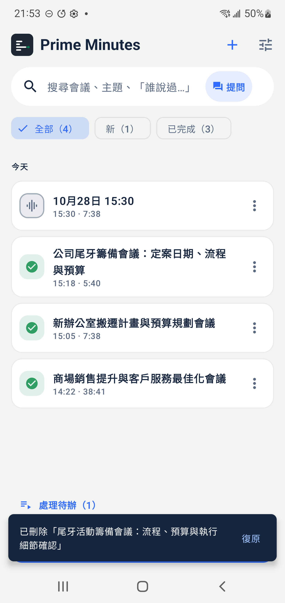 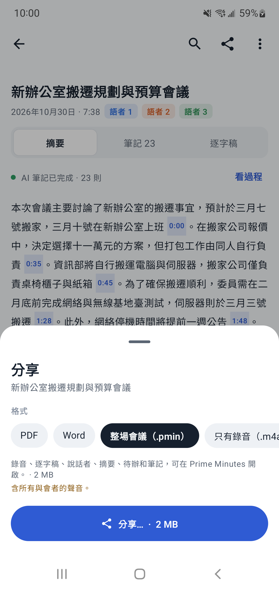

每列右側的 **⋮** 依場次狀態提供不同操作。

| 節點 | 何時出現 | 預期結果 | 驗證 |
|---|---|---|---|
| 開啟 | 已完成 | 開啟場次 | ✅ 手動 |
| 重新命名 | 一律 | 對話框輸入新標題，確定後列上標題更新（新場次的預設標題為日期時間，如「10月6日 00:11」，摘要完成後換成 AI 擬的標題） | ✅ 手動 |
| 分享 | 已完成 | 開啟分享面板：先選內容，再選傳送到哪裡（第 2a 節） | ✅ 手動（Note 10+、Galaxy A53） |
| 刪除（或在列上向左滑） | 一律 | 立即從清單移除，底部顯示「已刪除「…」」與 **復原**；幾秒內點復原即放回原處，否則才真正刪除 | ✅ 手動（Note 10+） |
| 繼續處理 | 處理被中斷（停止、App 被終止）且已留有進度 | 從已存的最後穩定段落接續語音辨識，語者編號與先前一致；已完成的部分不重做 | ✅ 手動 |
| 立即處理 | 未處理，或已排入佇列且沒有正在處理的項目 | 開始轉錄與摘要；在「停止」之後也能再次開始 | ✅ 手動 |
| 從佇列移除 | 已排入佇列、尚未處理 | 移出佇列，保留錄音（列變為「新」） | ✅ 手動 |
| 正在處理的場次 | 該列沒有 ⋮；點一下開啟即時畫面 | 即時畫面頂端的「停止」停止處理，該列回到「排入佇列」，稍後自動繼續 | ✅ 手動 |

處理中按下「停止」，或 App 被終止後，已轉錄的穩定段落與 AI 筆記會存下來。下次開啟時會詢問 **繼續中斷的場次？**，也可隨時從 ⋮ 選 **繼續處理**。「停止」一定會保留進度：連按兩次，或通知與畫面上的「停止」先後按下，都只存一次、不會遺失；在 AI 筆記整理時停止，完整的逐字稿也會保留，繼續處理時只需重寫筆記。匯入檔案中途停止時，原始檔會保留：繼續處理從已存的段落接續，並一路轉錄到檔案結尾。

 

### 2a. 分享與匯出

 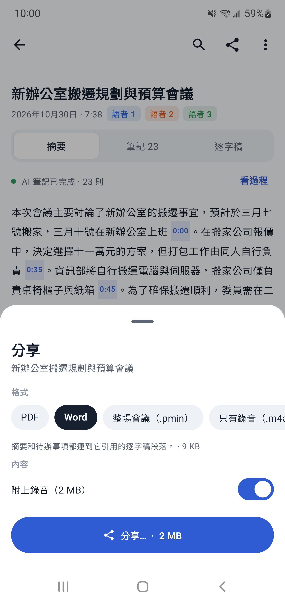

場次列的 ⋮（或場次畫面右上角 ⋮）→ **分享**。面板分兩步：上面選 **內容**，下面選 **傳送到**。每個選項旁顯示檔案大小。

**內容**

1. **整場會議（.pmin）**：錄音、逐字稿、說話者、摘要、待辦事項、AI 筆記與你的修改，對方用 Prime Minutes（Android 或 iPhone）開啟後直接還原，不需模型、不必重新處理。
2. **摘要＋逐字稿**：上方選 **PDF** 或 **Word**（記得上次的選擇）。文件依序是標題（日期、長度、與會者）、摘要、待辦事項、逐字稿；摘要與待辦事項裡的每個時間都連到它引用的那段逐字稿，那段旁邊有「↑ 摘要」可跳回。AI 筆記不放進文件（只在 .pmin 裡）。待辦事項一律附上，不受「顯示行動項目」設定影響。開啟 **附上錄音** 會另外附一個 `.m4a`；錄音很大或來自 Podcast 等線上來源時預設關閉。
3. **只有錄音（.m4a）**。

含錄音的選項會提醒「含所有與會者的聲音」；線上來源的場次提醒版權屬於發布者。

**傳送到**

- **附近（Quick Share）**：傳到旁邊的手機或電腦（傳給 iPhone 時，對方用 AirDrop 收的 iPhone 版也能開 .pmin）。
- **電子郵件**：直接開啟郵件 App，檔案已附上、主旨是會議標題，由你填收件人再寄出；超過 25 MB 時提醒很多郵件伺服器會拒收。
- **其他 App…**：系統分享面板（LINE 等）。

App 不登入任何帳號，也不直接上傳到雲端。

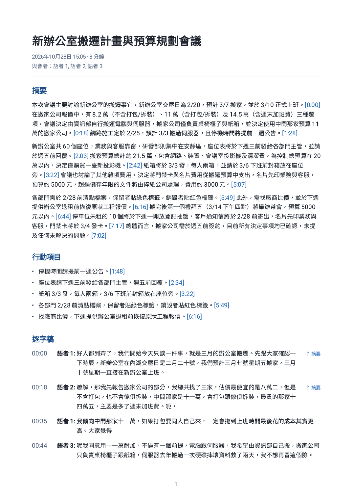 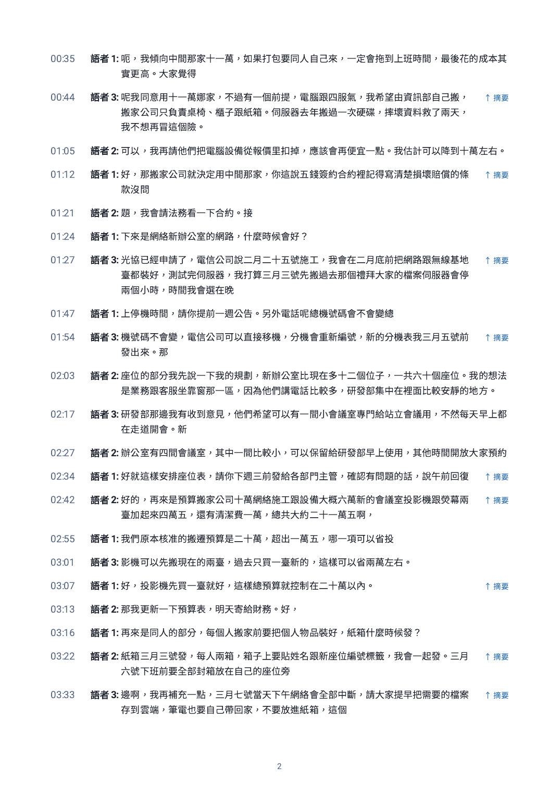 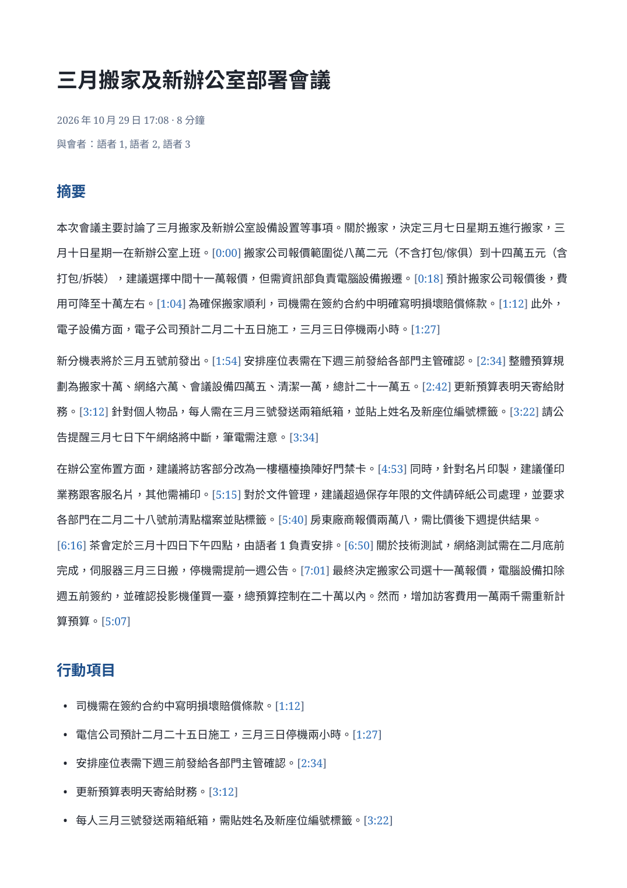 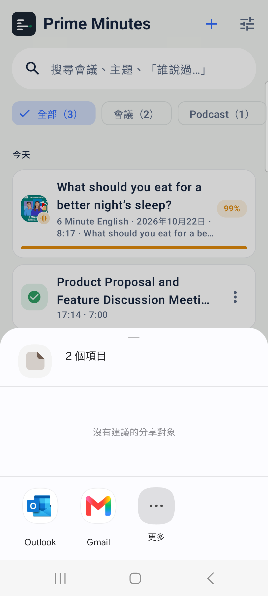

**接收**：在 Quick Share 通知、「我的檔案」或雲端硬碟 App 點 `.pmin`（Samsung「我的檔案」會先跳出 App 選單，選 **Prime Minutes**）。App 直接還原整場會議，列上標示 **收到的**，並提示「會議已存入 Prime Minutes，可以刪除「下載」中的原始檔案。」；資料庫已有同一場時詢問「開啟現有的」或「保留副本」。


| 節點 | 預期結果 | 驗證 |
|---|---|---|
| 分享面板 | 內容三選一（含大小）、PDF／Word、附上錄音、傳送到三類 | ✅ 手動（Note 10+、Galaxy A53）、✅ 自動（ShareKitTest） |
| PDF／Word | 標題、摘要、待辦事項、逐字稿；時間連到逐字稿、「↑ 摘要」連回；無 AI 筆記 | ✅ 自動（PdfExportTest、DocxExportTest、ExportNotesTest） |
| 電子郵件 | 只列郵件 App（有多個時讓你選），選定後開啟撰寫畫面，檔案已附上 | ✅ 手動（Galaxy A53：選擇畫面；撰寫畫面未截圖，避免顯示帳號） |
| 收到 .pmin | 還原、標示「收到的」、重複時詢問 | ✅ 手動（Galaxy A53） |

## 3. 多選模式

 

長按一列進入多選。

| 節點 | 如何到達 | 預期結果 | 驗證 |
|---|---|---|---|
| 長按場次 | 首頁 | 進入多選，標題列顯示「已選取 1 個」 | ✅ 手動 |
| 點其他場次 | 多選中 | 加入或取消選取 | ✅ 手動 |
| 全選 | 多選標題列 | 選取所有顯示中的場次 | ✅ 手動 |
| 刪除 | 多選標題列 | 立即移除，底部顯示「已刪除 N 個場次　復原」；幾秒內點「復原」即可救回 | ✅ 手動（復原） |
| 結束選取（X） | 多選標題列 | 回到一般首頁 | ✅ 手動 |

## 4. 加入音訊

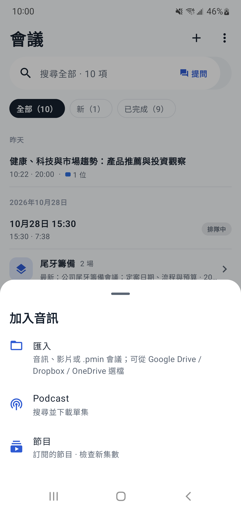 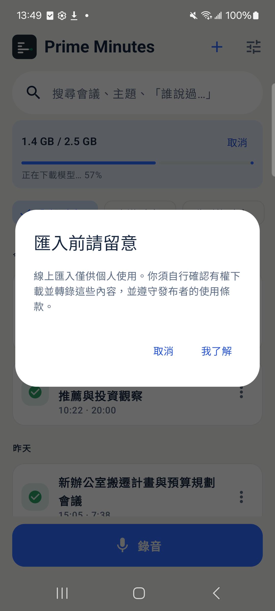 

處理事先錄好的音訊。也可以從其他 App 把音訊「分享」給 Prime Minutes。

| 節點 | 如何到達 | 預期結果 | 驗證 |
|---|---|---|---|
| 匯入 | ＋ → 匯入 | 系統檔案選擇器，可選音訊、影片或 `.pmin` 會議，也可從 Google Drive、Dropbox、OneDrive 選檔（第 4b 節）；音訊與影片轉錄並摘要（長時間的靜音會快速略過），`.pmin` 直接還原 | ✅ 手動、✅ 自動（AddSourceSheetTest） |
| Podcast → 搜尋 → 節目 → 轉錄 | ＋ → Podcast | 列出單集與長度；選取後首頁立刻出現這一集（標題即單集名稱），標示下載進度，下載完成後自動轉錄（正在處理其他項目時排在其後） | ✅ 手動、✅ 自動（SourceSheetsTest，搜尋） |


| YouTube／PeerTube 連結 | 其他 App 把 YouTube 或 PeerTube 連結傳給 Prime Minutes（Prime Minutes 不在文字的分享選單中，一般不會發生） | 不再匯入：顯示「不支援影片連結」說明。舊版排入但尚未下載的影片會標示「已不再支援匯入 YouTube 與 PeerTube」，可刪除；已轉錄的場次不受影響 | ✅ 手動（Note 10+） |
| 第一次線上匯入 | 第一次按 ＋ → Podcast 或 節目 | 先顯示「匯入前請留意」：僅供個人使用、須自行確認有權下載與轉錄、遵守發布者條款；按「我了解」後不再出現 | ✅ 手動（Note 10+） |
| 收到的會議（.pmin） | 在 Quick Share、檔案管理（例如 Samsung「我的檔案」）或其他 App 點 `.pmin` 檔 | 開啟 Prime Minutes 並還原整場會議，列在「收到的」，提示「會議已存入 Prime Minutes，可以刪除「下載」中的原始檔案。」；資料庫已有同一場時詢問「開啟現有的」或「保留副本」 | ✅ 手動（Galaxy A53） |
| 從其他 App 分享 | 其他 App → 分享 → Prime Minutes | 閒置時直接轉錄；處理中時詢問「匯入這個檔案？」（匯入會中斷處理） | ✅ 手動 |
| Podcast 下載中斷線 | 下載單集音訊時網路中斷 | 不當成失敗：該列與場次畫面顯示「下載已暫停 · 會自動繼續」；網路恢復、回到 App 或按「立即繼續」後從中斷處接續，下載完成後照常轉錄 | ✅ 手動（Note 10+，Podcast：下載中切斷 Wi‑Fi 與行動數據 → 暫停、已下載部分保留 → 恢復後接續） |
| Podcast 下載失敗 | 來源無法下載（例如已下架） | 該列標示「下載失敗：原因」（紅色），保留在首頁；點開後可「重試」或「刪除」 | ✅ 自動（DownloadItemTest），實機未確認 |
| 下載中 App 被關閉 | 下載途中強制關閉或重新開機後開啟 App | 該列仍在首頁，從已下載的部分接續下載 | ✅ 手動（Note 10+：強制停止後重開，從中斷處接續） |

  

### 4b. 從雲端匯入

錄音存在 Google Drive、Dropbox 或 OneDrive（例如會議室電腦錄好後上傳）時：＋ → **匯入** → 在系統檔案選擇器左上角的選單選該雲端（手機上要先安裝並登入那個 App），再點檔案。檔案會先下載到手機，再像一般匯入一樣在手機上轉錄；`.pmin` 會議直接還原。Prime Minutes 本身不登入任何雲端帳號。選擇器裡看不到某個雲端時，先打開那個 App 一次，或在選擇器的「瀏覽」中啟用它。

### 4a. Podcast 訂閱（節目）

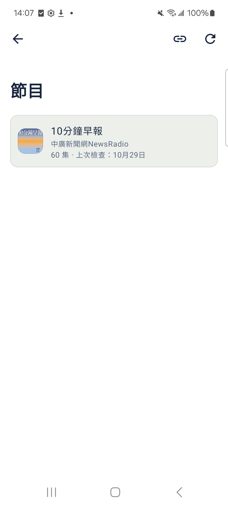 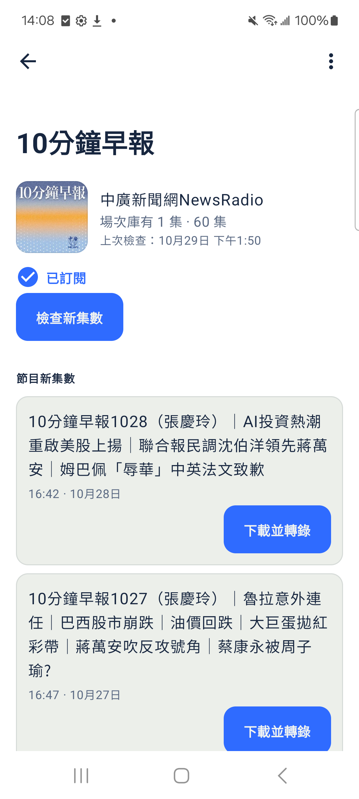 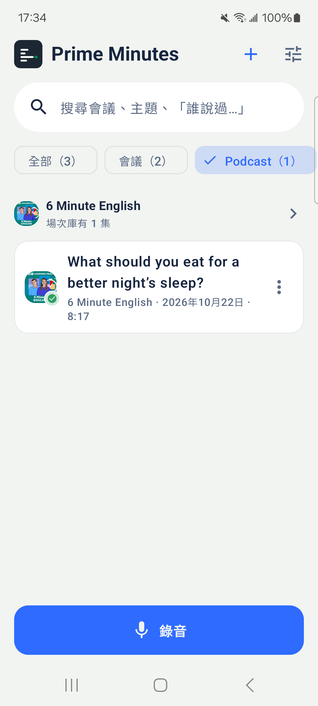

**訂閱＝儲存節目連結，不付費。** 新集數在你按「檢查新集數」／「全部檢查」，或打開超過 24 小時沒檢查的節目頁時去抓（一次一個 RSS 請求）。開啟 **設定 → 在背景檢查新集數** 後，App 每天在 Wi‑Fi 下讀一次已訂閱節目的 RSS（暫停的節目略過），有新集時發通知；背景只讀節目清單，不下載任何單集。這個開關預設關閉；關閉時 App 完全不在背景連線。取得的單集走與上面「Podcast → 轉錄」完全相同的下載與轉錄流程。

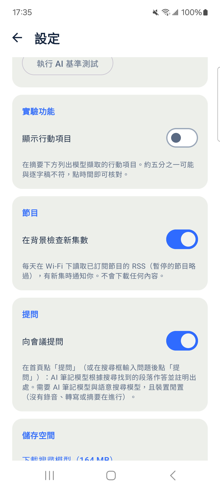 

| 節點 | 如何到達 | 預期結果 | 驗證 |
|---|---|---|---|
| 訂閱此節目 | ＋ → Podcast → 搜尋 → 點節目 → 「訂閱此節目」 | 寫入訂閱；目前 feed 裡的單集全部記為「已看過」，不會一次下載舊集；按鈕改成「已訂閱」，點它開節目頁 | ✅ 手動（Note 10+）、✅ 自動（SubscriptionsTest） |
| 貼上 RSS 連結 | ＋ → Podcast →「貼上 RSS 連結」，或節目清單右上角連結圖示 | 剪貼簿有網址時自動帶入；「預覽」顯示節目名稱與集數 →「訂閱此節目」 | ✅ 手動（Note 10+，`vox_sub_feed`） |
| 節目清單 | ＋ → 節目 | 每個訂閱一列：節目名稱、出演者、「N 集 · 上次檢查」或「已暫停 · 不會檢查新集數」；有新集時顯示「N 集新」徽章；右上角「全部檢查」略過暫停中的節目 | ✅ 手動（Note 10+） |
| 節目頁 | 節目清單 → 點一列，或首頁 Podcast 篩選中點節目標題 | 封面、出演者、「場次庫有 N 集 · M 集」、上次檢查時間、「訂閱／已訂閱」與「檢查新集數」；先列「節目新集數」（還不在場次庫的單集，最新在前，可「下載並轉錄」），再列「在場次庫」的單集。沒訂閱的節目也能開 | ✅ 手動（Note 10+、Galaxy A53） |
| 下載並轉錄 | 節目頁 → 某集「下載並轉錄」 | 首頁立刻出現這一集並下載、轉錄；同一集再按一次不會產生第二列，而是提示「已在場次庫 · 開啟該場次」 | ✅ 手動（Note 10+，重複提交只得一列） |
| 空間不足 | 可用空間不足以放下這一集（約檔案 3 倍＋200 MB） | 不下載，提示「空間不足 · 等待空間」；下載途中磁碟寫滿時該列顯示同一句並暫停（保留已下載部分），有空間後自動接續，不標為失敗 | ✅ 手動（Note 10+，`vox_sub_lowspace` 模擬）、✅ 自動（以錯誤訊息判斷，網路錯誤不誤判） |
| 暫停／繼續訂閱、分享、刪除 | 節目清單長按一列，或節目頁右上角 ⋮ | 暫停後「全部檢查」略過它（節目頁手動檢查仍可用）；分享送出「節目名稱 — RSS 連結」；刪除後可在提示列「復原」，已下載的場次保留 | ✅ 手動（Note 10+，暫停後全部檢查略過） |
| 在背景檢查新集數 | 設定 → Podcast | 預設關閉；開啟後每天在 Wi‑Fi 下檢查一次，有新集時通知「新增 N 集」，點通知開節目清單；通知被關閉時只在節目清單顯示徽章；不下載內容 | ✅ 手動（Galaxy A53）、✅ 自動（BackgroundCheckTest） |
| 節目搬家 | 節目的 RSS 永久轉址（301/308） | 自動改用新連結並提示「訂閱連結已搬家 · 已追隨新連結」；已看過的集數不受影響；暫時轉址不改連結 | ✅ 自動（SubscriptionsTest） |
| 檢查失敗 | 來源已下架、需付費、不是 RSS、沒有音訊 | 節目頁顯示「訂閱來源失效：原因」，保留上次的單集清單 | ✅ 自動（SubscriptionsTest） |

已知限制：訂閱功能推出前匯入的單集沒有記錄來源網址，若手動再按「下載並轉錄」可能重複匯入；接收其他 App 分享的 RSS 連結與 OPML 匯入／匯出排在下一版。

## 5. 錄音室

  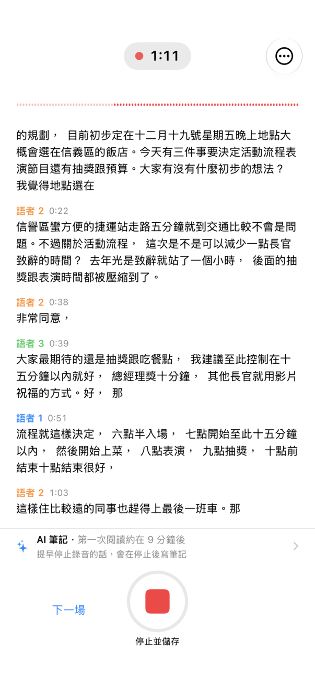

逐字稿在說話後依設定的轉寫延遲出現（預設約 2 秒，見第 9 節）；語者確定後標上顏色，尚未確定的句子為淺灰。上方 **AI 筆記** 卡片顯示它正在閱讀逐字稿或正在寫筆記（正在寫的筆記逐字出現）。AI 筆記每讀滿一段逐字稿（約 1,500 個詞元）才寫一批，所以第一則筆記要等幾分鐘才出現（示範會議約在第 6 分鐘），這是正常的：第一次閱讀前，卡片顯示「進度條滿時開始第一次閱讀」，錄音約一分鐘後依目前的說話速度改為「第一次閱讀約在 N 分鐘後」，下方的細條是這一段逐字稿已累積的量；提早停止錄音的話，筆記在停止後才寫（卡片上也這樣提示）。標題列右側的細條是硬體狀態列（CPU、記憶體、電池；「BAT +」表示充電中），數值過高時轉紅，可在設定中關閉。RAM 8 GB 以上的手機在錄音中同步閱讀；較小的手機在錄音結束後閱讀。第一次錄音時，模型下載的進度也顯示在這裡，麥克風在下載期間已開始錄音；下載後 AI 筆記模型會準備一次（「正在準備…（僅首次，約一分鐘）」）。

| 節點 | 如何到達 | 預期結果 | 驗證 |
|---|---|---|---|
| 計時器與音量條 | 錄音中 | 時間遞增，音量條隨聲音跳動 | ✅ 手動 |
| 硬體狀態列 | 錄音中；處理中的會議畫面 | 錄音時在標題列右側，處理時在進度條上方的狀態列右側，每 2 秒更新；閒置、首頁與已完成的會議不顯示；關閉設定後隱藏 | ✅ 手動（Note 10+） |
| 即時逐字稿 | 錄音中 | 文字即時出現，語者依序上色 | ✅ 手動（模擬器、Note 10+） |
| AI 筆記卡片 | 錄音中（8 GB 以上） | 閱讀逐字稿 → 整理筆記中，筆記逐字出現 | ✅ 手動 |
| 下一場 | 錄音中 | 存檔並立刻開始下一場；前一場自動處理 | ✅ 手動 |
| 停止並儲存 | 錄音中 | 存檔並開啟場次；AI 筆記讀完最後一段後寫摘要 | ✅ 手動 |
| 返回 | 左上 | 回首頁，錄音不中斷 | ✅ 手動 |
| 錄音失敗 | 例如語音引擎無法載入 | 顯示錯誤並回到首頁；已錄的音訊保留在「處理待辦」 | ✅ 手動（Note 10+，修正前後） |

## 6. 場次：摘要分頁

  

**AI 筆記** 卡片列出所有筆記：類型（決議、待辦、提議、未決、數字）與時間，時間一點就從原話播放；決議、待辦與數字另有 **核對**。下方是段落式摘要，灰色時間標籤同樣可播放，提到的語者以粗體和該語者的顏色標示（改名後跟著更新）；最下方一行是各語者的發言比例。

| 節點 | 如何到達 | 預期結果 | 驗證 |
|---|---|---|---|
| AI 筆記卡片狀態 | 摘要分頁 | 停止後依序：整理筆記中 → 撰寫摘要 → 完成 | ✅ 手動 |
| 重新開啟場次 | 首頁點已完成場次 | 筆記與時間點仍在（「N 則筆記」） | ✅ 手動 |
| 顯示過程／隱藏過程 | AI 筆記卡片 | 展開／收合筆記列表 | ✅ 手動 |
| 顯示詳細過程／簡化顯示 | 展開後 | 每段的處理與上下文用量 | ✅ 手動 |
| 顯示活動紀錄（N） | 詳細過程中 | 每則筆記的保留或捨棄原因 | ✅ 手動 |
| 筆記時間／核對 | 筆記上 | 從該時間播放 | ✅ 手動 |
| 編輯摘要（鉛筆） | 摘要卡右上 | 編輯摘要，儲存／取消 | ✅ 手動 |
| 複製摘要 | 摘要卡右上 | 提示「已複製摘要」 | ✅ 手動 |
| 摘要中的時間點 | 藍色時間 | 從該時間播放 | ✅ 手動 |
| 語者比例 | 點一下 | 展開／收合圖例 | ✅ 手動 |
| 英文會議 | 匯入或錄製英文會議 | 筆記、標題、摘要與紀錄標題為英文；從會議開頭起，同意的事項即標為決議，語氣保留的說法（如 “we could…”）仍為提議；中文會議不變（語言依逐字稿判斷，設定的語言只切換繁／簡） | ✅ 手動（Note 10+、iPhone 14 Pro Max，E2B，英文與中文會議各一） |

 

| 節點 | 如何到達 | 預期結果 | 驗證 |
|---|---|---|---|
| 標題 | 點頂端標題 | 編輯標題，儲存／取消 | ✅ 手動 |
| 行動項目卡片 | 設定 → 實驗功能開啟時 | 列在摘要下方，可複製與編輯 | ✅ 手動 |

## 7. 場次：逐字稿分頁

  

| 節點 | 如何到達 | 預期結果 | 驗證 |
|---|---|---|---|
| 點一句 | 逐字稿 | 從該句播放，播放中的句子高亮 | ✅ 手動 |
| 長按一句 → 編輯 | 長按選單 | 就地編輯，儲存後保存在場次中 | ✅ 手動（重新開啟後仍在） |
| 長按 → 將此句移至 → 語者 N | 長按選單 | 該句改派語者，保存在場次中 | ✅ 手動（重新開啟後仍在） |
| 長按 → 合併語者至 → 語者 N | 長按選單 | 先確認「將「語者 1」合併至「語者 2」？」；合併後整位語者併入另一位，其他語者的名稱不變；下方提示「已合併語者」，點 **復原** 可還原（移動單句同樣可復原） | ✅ 手動（Note 10+）、✅ 自動（SpeakerEditsTest） |
| 點語者名稱 | 每段開頭的「語者 N」 | 開啟「語者 N 是誰？」面板：依聲音建議（開啟辨識聲音時）、這場會議中、最近、手機的聯絡人、搜尋、「新增「…」為新的人」（存入手機聯絡人，接著可順手填電子郵件）、「把這位語者叫做「…」」（只用於這場會議）、「清除名字」；選定後這位語者的每一句都換成該名字；已命名的語者可直接開啟人物頁或新增電子郵件（見第 9a、9b 節） | ✅ 手動 |
| 搜尋這場會議 | 頂端放大鏡 | 標示符合處並列出 AI 筆記與逐字稿的結果清單，上一個／下一個，關閉搜尋（第 7b 節） | ✅ 手動 |

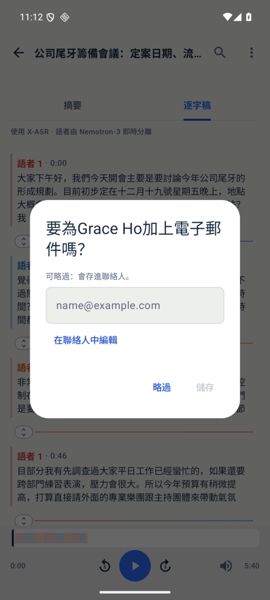 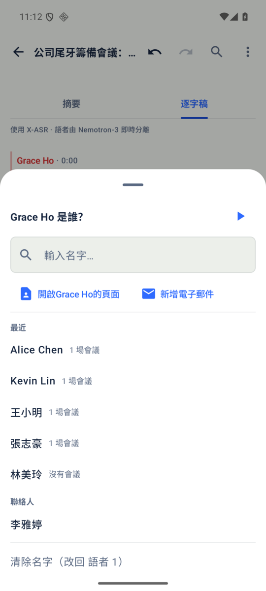 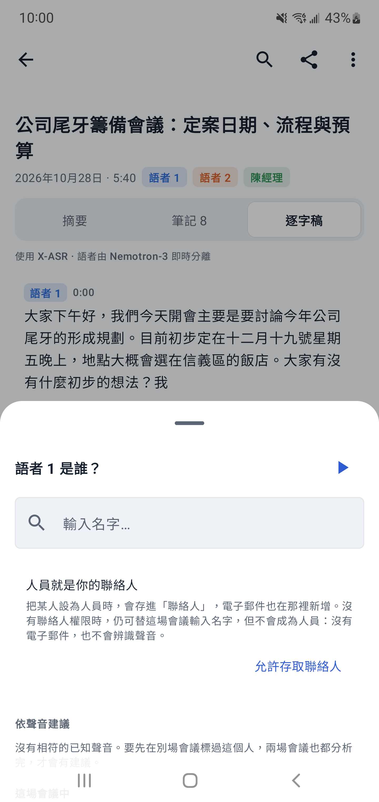

  

### 7b. 在這場會議內搜尋與提問

  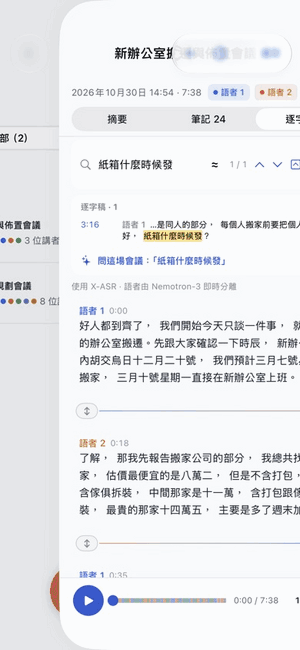

搜尋列下方列出這場會議符合的 **AI 筆記** 與 **逐字稿** 句子（各依時間排序，標示 **≈** 的是依語意找到的）；點一筆就捲到那句並把播放位置停在那裡。**✦**（搜尋列、結果清單最後一列、⋮ 選單的「問這場會議」）只拿這場會議的段落作答，不會被其他相似的會議搶走出處；出處只顯示時間。設計與預設值：[docs/design/in-session-search-ask.md](design/in-session-search-ask.md)。英文介面：[搜尋](screenshots/meeting-search-en.png)、[提問](screenshots/meeting-ask-en.png)（AMI 公開會議）。

| 節點 | 如何到達 | 預期結果 | 驗證 |
|---|---|---|---|
| 結果清單 | 頂端放大鏡 → 輸入 | AI 筆記・N、逐字稿・N 兩組，各附時間；可用清單鈕收合／展開；最多 50 筆 | ✅ 手動（Note 10+、模擬器、iPhone 14 Pro Max） |
| 點結果 | 結果清單 | 清單收合，逐字稿捲到該句（筆記的 m:ss 對到以該時間顯示的那句）並標為播放中，播放位置停在該句開頭（不自動播放） | ✅ 手動（Note 10+：關鍵字筆記、≈ 筆記、關鍵字句子、≈ 句子各一）、✅ 自動（單元測試：筆記 3:22 對到 202.4 秒那句、播放位置不落在上一句） |
| ≈ 依語意 | 搜尋列的 ≈ | 加入依語意找到的筆記與句子（標 ≈）；會議尚未建立索引時不顯示 ≈ | ✅ 手動（Note 10+） |
| 問這場會議 | ✦ 或 ⋮ → 問這場會議 | 「正在搜尋這場會議…」→ 答案，出處為這場會議的時間；點出處回到逐字稿該處 | ✅ 手動（Note 10+、模擬器、iPhone 14 Pro Max） |
| 尚未建立索引 | 沒有搜尋模型，或索引尚未完成 | 仍可提問（只用關鍵字找段落），同時在背景建立索引 | ✅ 手動（模擬器） |
| 先前的問題 | 再次開啟問這場會議 | 這場會議先前的問答列在「先前的問題」下（最多 20 則）；↻ 清除 | ✅ 手動（Note 10+） |
| 處理中的會議 | 正在轉寫或閱讀的會議 | 可搜尋已出現的句子與筆記（只用關鍵字，沒有 ≈ 與 ✦）；點結果捲到該句，播放位置在處理完成後才停到該處；提問等工作完成後才回答 | ✅ 手動（Note 10+：轉錄中搜尋「紙箱」4 筆，點結果捲到該句） |

### 7a. 調整說話者分界（Adjust a speaker boundary）

  

語者換人時，逐字稿偶爾把下一位的前一兩個字留在上一句（或反過來）。完成的逐字稿中，兩位不同語者的相鄰句子之間有一條細線和 **⇕** 把手；點把手開啟「語者分界」：

- 上方是上一句的結尾接著下一句的開頭，前一位語者的字底色為其顏色，標記（直線加圓點）之後屬於下一位。中文以字為單位，英文以詞為單位。
- **拖曳**標記、**點**下一位開始說的那個字，或用 **‹ ›** 一次移一格。
- 下方「分界」是標記所在的時間。句子的文字改過（或那句沒有逐字時間）時，時間只能依字數推估，前面會標 **≈**。
- 每次移動後自動播放分界之後約 2 秒，聽是誰在說；**◀| 分界前**／**分界後 |▶** 重播分界前、後各 2 秒。
- **套用** 後兩句的文字與時間一起更新（匯出的 SRT、VTT 也跟著改），其他句子、語者名稱與 AI 筆記不變，也不會要求重新摘要。
- 一句話裡其實有另一個人插話時：長按該句 → **從這裡分開…**，在「後半段是誰說的？」選好分界與語者（先列相鄰句的語者，再列其他語者，最後是「＋ 新語者」）。
- 頂端的 **↶ 復原**／**↷ 重做** 可逐步還原或重做分界調整、分句、改字與改名。
- 讀屏（TalkBack、VoiceOver）：標記是一個可調整的元素，上下滑動即左右移動，並唸出「語者 N 從「某字」開始」。

| 節點 | 如何到達 | 預期結果 | 驗證 |
|---|---|---|---|
| 分界把手 ⇕ | 完成的逐字稿，兩位語者之間 | 開啟「語者分界」 | ✅ 手動（Note 10+、iPhone 14 Pro Max） |
| 拖曳／點字／‹ › | 語者分界 | 標記移動，自動試聽分界之後 | ✅ 手動（Note 10+） |
| 分界時間 ≈ | 文字改過的句子旁的分界把手 | 分界時間前標 ≈；沒改過的照常顯示 | ✅ 手動（Note 10+）、✅ 自動（BoundaryEditsTest） |
| 分界前／分界後 | 語者分界 | 播放分界前／後 2 秒 | ✅ 手動（Note 10+） |
| 套用 | 語者分界 | 兩句文字與時間更新；強制停止 App 後重新開啟仍在；匯出 SRT 反映 | ✅ 手動（Note 10+）、✅ 自動（BoundaryEditsTest） |
| 長按 → 從這裡分開… | 長按選單 | 選分界與語者，後半句成為新的一句 | ✅ 手動（Note 10+）、✅ 自動（BoundaryEditsTest） |
| ↶ 復原／↷ 重做 | 頂端列，編輯後 | 逐步還原與重做 | ✅ 手動（Note 10+）、✅ 自動（SessionReducerTest） |

## 8. 播放列與場次選單

 

播放列的色塊代表語者，點或拖曳可跳轉。右上 **⋮**（更多選項）提供重新處理與分享。

| 節點 | 如何到達 | 預期結果 | 驗證 |
|---|---|---|---|
| 播放／暫停 | 播放列 | 播放並切換圖示 | ✅ 手動、✅ 自動（TranscriptFlowTest） |
| 倒退 5 秒／快進 5 秒 | 播放列 | 跳轉 5 秒 | ✅ 手動 |
| 進度條 | 點或拖曳 | 跳到該處 | ✅ 手動 |
| 音量按鈕 | 播放列右側 | 音量滑桿、靜音 | ✅ 手動 |
| 重新轉錄 | ⋮ | 重跑語音辨識與語者分離，標題保留；若你改過逐字稿文字，會先詢問「要捨棄你修改的逐字稿嗎？」 | ✅ 手動、✅ 自動（SessionReducerTest） |
| 重新摘要 | ⋮ | 只重跑 AI 筆記與摘要；筆記不重複。若你改過摘要或行動項目，會先詢問「要取代你編輯過的摘要嗎？」，完成後仍可按「復原」取回 | ✅ 手動、✅ 自動（SessionReducerTest） |
| 問這場會議 | ⋮ | 只根據這場會議作答（第 7b 節） | ✅ 手動（Note 10+、模擬器） |
| 分享 | ⋮ | 分享面板（第 2a 節） | ✅ 手動（Note 10+、Galaxy A53） |
| 設定 | ⋮ | 設定（第 9 節） | ✅ 手動 |

## 9. 設定

  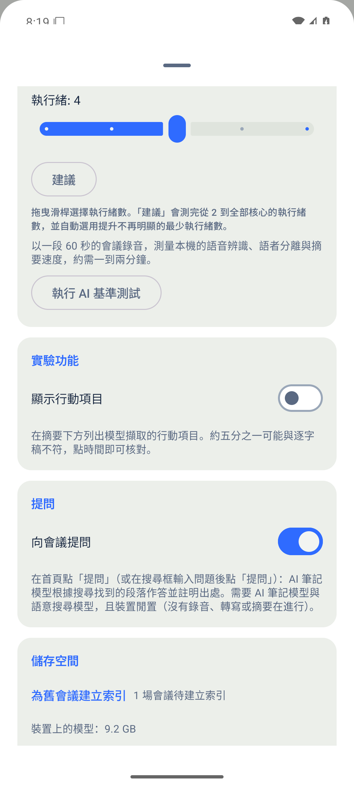

處理進行中時設定為唯讀。

| 節點 | 預期結果 | 驗證 |
|---|---|---|
| 外觀主題：自動／淺色／深色／電子紙 | 立即套用 | ✅ 自動（SettingsContentTest） |
| 桌布配色（Material You） | Android 12 以上可開啟，依桌布換色；電子紙主題不提供 | ✅ 手動 |
| 文字大小（85–150%） | 整個 App 的文字（含對話框）立即放大或縮小，疊加於系統字型大小；重新開啟 App 後保留 | ✅ 手動 |
| 硬體狀態列 | 錄音時在錄音室標題列右側、處理時在會議畫面的狀態列右側顯示 CPU／記憶體／電池細條；數值過高時轉紅；預設開啟 | ✅ 手動 |
| 推論：執行緒滑桿（2 至全部核心）與「建議」 | 拖曳滑桿手動指定；「建議」測完 2 至全部核心的執行緒數，自動選用提升不再明顯的最少執行緒數並移動滑桿 | ✅ 手動 |
| 語言：跟隨系統／English／繁體中文／简体中文 | 介面與產生的文字一起切換 | ✅ 手動、✅ 自動（SettingsContentTest） |
| 說話者名錄（N 人） | 開啟說話者名錄（第 9a 節） | ✅ 手動（模擬器） |
| 即時語者標註延遲（5–30 秒） | 錄音時語者標籤出現的延遲；重新開啟 App 後保留 | ✅ 手動 |
| 語音轉寫延遲：0.16／0.48／0.96／1.92 秒（預設 1.92 秒） | 說話後文字出現所需的時間；延遲越長，文字越準確（即時顯示與儲存的逐字稿皆是）。選擇新的延遲會在背景下載對應的語音模型（約 155 MB，依下載設定），下載完成前仍以已安裝、最接近的模型轉寫；新模型第一次載入後刪除其他延遲的模型 | ✅ 手動（模擬器：切換、下載、刪除舊模型）、✅ 自動（AsrRegistryTest、DownloadPlanTest） |
| AI 筆記模型：行動版 E2B／行動版 E4B | 下次閱讀時使用所選模型（未下載時先下載）；E4B 只在 RAM 8 GB 以上的手機可選 | ✅ 手動（Note 10+：E2B、E4B） |
| 推論：執行 AI 基準測試 | 以一段 60 秒的會議錄音測量本機的語音辨識、語者分離與摘要速度，約需一到兩分鐘 | ⬜ |
| 實驗功能：顯示行動項目 | 摘要下方出現行動項目卡片（分享的 PDF／Word 一律附上待辦事項，不受此設定影響） | ✅ 手動 |
| Podcast：在背景檢查新集數 | 預設關閉；開啟後每天在 Wi‑Fi 下讀已訂閱節目的 RSS，有新集時通知（第 4a 節） | ✅ 手動（Galaxy A53）、✅ 自動（BackgroundCheckTest） |
| 向會議提問（預設開啟） | 首頁搜尋框右側出現「提問」（第 1a 節）；需要 AI 筆記模型與搜尋模型 | ✅ 手動（Note 10+） |
| 儲存空間：下載搜尋模型／為舊會議建立索引 | 未下載時顯示「下載搜尋模型（約 160 MB）」；下載後顯示待建立索引的會議數與「為舊會議建立索引」，全部完成時顯示「所有會議都已建立搜尋索引。」 | ✅ 手動 |
| 儲存空間：模型與刪除 | 顯示用量；刪除前確認「刪除這個模型？」，刪除後下次使用時重新下載 | ✅ 手動 |
| 背景可靠性：允許背景執行 | 系統的電池最佳化例外對話框（長時間工作開始時也會先說明並詢問一次，見第 1 節） | ✅ 手動（Note 10+） |
| 關於：檢查更新、GitHub | 顯示「已是最新版本」或更新橫幅 | ✅ 手動（檢查更新）、✅ 自動（SettingsContentTest，版本號） |
| 關於：開放原始碼授權 | 列出 App 內含的第三方元件與授權（與 NOTICE 相同），點一列開啟該專案 | ✅ 手動（Note 10+） |

 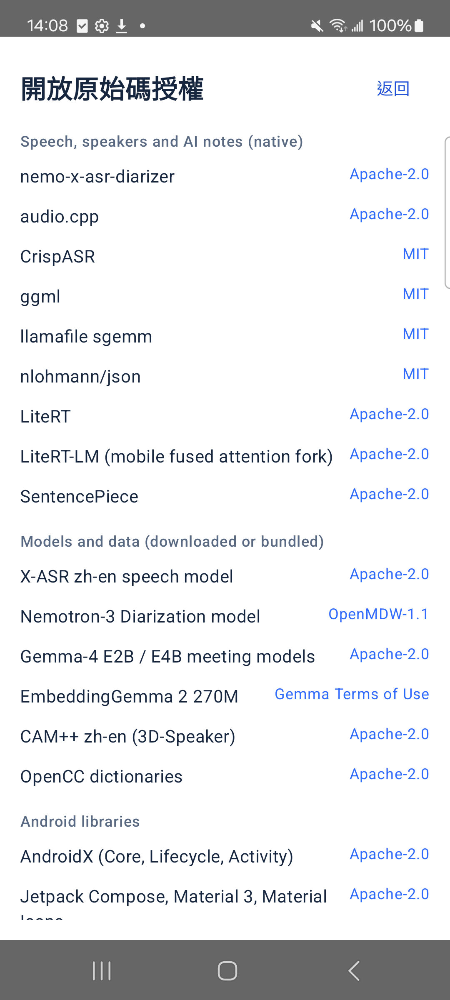

## 9a. 說話者名錄

<p>    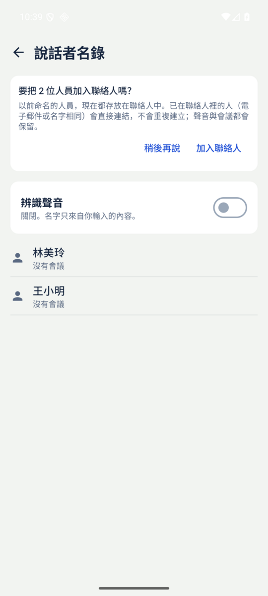</p>

設定 → 說話者名錄：你命名過的每個人，與他出現的會議。**人就是手機的聯絡人**：把語者命名為新的人時，App 在系統「聯絡人」中建立這個人，App 本身只記住與聯絡人的連結和聲音；電子郵件等資料存在聯絡人裡。第一次需要允許存取聯絡人；不允許時仍可為這場會議輸入名字，但不會成為人員（沒有電子郵件，也不辨識聲音）。舊版在 App 內命名過的人，名錄頂端會出現「要把 N 位人員加入聯絡人嗎？」：已在聯絡人中的人（電子郵件或名字相同）直接連結，不會重複建立，聲音與會議都保留。點逐字稿的語者名稱會開啟選人面板：依聲音建議（開啟辨識聲音時）、這場會議中、最近、聯絡人，以及搜尋、「新增為新的人」、「清除名字」。名字跨會議共用：在人物頁全部改名，每場會議都跟著更新。

**辨識聲音**（選用，預設關閉）：開啟前先說明隱私（只在這支手機上，不上傳，不含於匯出與備份；「聲音」是最多 60 秒語音算出的一串數字；建議絕不自動套用；可忘記某人的聲音或刪除所有聲音資料；刪除會議也刪除它的聲音樣本；命名前請先徵得同意）。聲音模型（約 29 MB，Hugging Face `Luigi/primeminutes-speaker-litert` 版本 `8b7a1151`）開啟時下載一次並驗證 SHA-256。

| 節點 | 預期結果 | 驗證 |
|---|---|---|
| 聲音比對狀態 | 選人面板的「依聲音建議」下方說明目前狀態：「轉錄結束後才會比對聲音。」／「等候比對聲音…」／「電量低於 20%，充電時才會比對聲音。」／「正在比對聲音…」；失敗時「這場會議的聲音比對失敗。」＋**重試**；缺模型時「還沒下載聲音模型。」＋**下載**。畫面上這場會議優先比對，只解碼有說話的段落（Note 10+：20 分鐘的單集約 6 秒）。沒有建議時說明原因：這位語者清楚的單獨發言不到 10 秒，或要先在別場會議標過這個人、兩場都分析完 | ✅ 手動（Note 10+） |
| 選人面板 | 依聲音建議（●●● 很可能／●●○ 可能）、最近、全部；建議的人不在「最近／全部」重複 | ✅ 手動（模擬器：AMI 會議，Laura ●●●；辦公室搬遷示範會議，陳經理 ●●●） |
| 辨識聲音開關 | 先顯示說明，「開啟」後下載模型，再於背景為每場會議計算聲音；關閉時保留資料 | ✅ 手動（模擬器，HF 版本 8b7a1151，SHA-256 相符） |
| 這是我… | 「讓 App 認得你的聲音」：先說明用途（會議中自動把你標為「我」；朗讀約 20 秒，只保留聲音特徵、不存錄音）與按「開始」後要做什麼；按「開始」時才要求麥克風，被拒時提供「前往設定」；缺聲音模型時提供「下載」；點對話框外不會關閉 | ✅ 手動（Note10+：停留 6 秒以上、點外面不關、麥克風被拒顯示前往設定） |
| 刪除所有聲音資料 | 先確認；刪除所有聲音資料並關閉辨識；名字保留 | ✅ 手動（模擬器：確認後人物聲音與 21 場會議的聲音資料全部刪除、開關關閉、名字保留）、✅ 自動（單元測試：背景仍在計算的會議不會在刪除後寫回聲音資料）、✅ 手動（Note 10+：開啟辨識後背景正在比對聲音時刪除，101 秒後沒有任何 voices.bin） |
| 人物頁：聲音／忘記聲音 | 學自幾場會議；忘記後停止學習直到重新開啟 | ✅ 手動（模擬器：「從 2 場會議學習（120 秒）」→ 確認忘記 →「尚未學習」、開關關閉，只刪除此人的聲音，重開 App 後仍保留；名字保留） |
| 聽起來不像 X | 詢問「仍要學習」或「只保留名字」；名字一律保留 | ✅ 自動（單元測試） |
| 人物頁：全部改名、備註、合併、刪除、分出某場會議 | 改寫每場相關會議；以新的人命名後重開仍在 | ✅ 手動、✅ 自動（單元測試） |


## 9b. 聯絡人

<p></p>

人物頁的 **聯絡人** 卡片顯示「聯絡人：名字」與 **在聯絡人中編輯**（開啟系統聯絡人 App）；聯絡人在系統中被刪除時，會議裡仍保留這個名字。「我」的人物頁可用 **聯絡人中的我…** 連結到你自己的聯絡人卡片。要把會議寄給別人，用 **分享 → 電子郵件**（第 2a 節）。

| 節點 | 預期結果 | 驗證 |
|---|---|---|
| 命名為新的人 | 在手機聯絡人中建立這個人；未允許聯絡人權限時只能輸入這場會議的名字 | ✅ 手動（Note10+）、✅ 自動（OsContactsTest） |
| 加入聯絡人卡片 | 舊版 App 內的人員依電子郵件或名字連結到既有聯絡人，其餘新建；不重複 | ✅ 自動（OsContactsTest） |

## 10. 中斷錄音的復原


錄音中 App 被系統終止時，下次開啟會詢問 **要復原中斷的錄音嗎？**

| 節點 | 預期結果 | 驗證 |
|---|---|---|
| 完成轉錄 | 處理已錄下的部分並存入場次庫 | ✅ 手動 |
| 捨棄 | 刪除這段錄音 | ✅ 手動 |

---

### 尚未驗證（⬜）的節點

更新橫幅（需要有更新的版本才會出現）；提問時裝置忙碌。部分確認：未連 Wi‑Fi 時的「僅限 Wi‑Fi」。

### 如何重跑自動測試

```bash
scripts/test-on-device.sh <實機序號> -- -e class studio.primeminutes.AddSourceSheetTest,studio.primeminutes.SourceSheetsTest,studio.primeminutes.UiComponentsTest,studio.primeminutes.SettingsContentTest,studio.primeminutes.ExportSheetTest,studio.primeminutes.TranscriptUiTest,studio.primeminutes.TranscriptFlowTest
```

Compose 介面測試需在實機上執行（x86_64 模擬器上會出現 “Unable to resolve activity”，見腳本開頭說明）。

---

## 附錄 A. 示範影片與更多畫面

示範會議為兩場合成會議：尾牙籌備會議與辦公室搬遷會議（各三位語者，約 7 分半，[`docs/demo`](demo)）。動畫與截圖在 Galaxy Note10+ 上錄製（E4B 行動版 v2，淺色主題）。加速的段落在畫面右側標示倍數（×N），其餘為即時。

<p><br><sub>錄音進行中（約第 5 分半起），AI 筆記讀完一段逐字稿後逐字寫下筆記（×2）。</sub></p>

| 語意搜尋 | 向會議提問 |
|:---:|:---:|
|  |  |
| 輸入「大家的車要停哪裡」：原話說的是「停車位……月租一個四千五」，用詞不同也找得到；點段落就從該處開始播放。 | 輸入「誰負責聯絡遊覽車公司？」再點「提問」：模型讀到的摘錄標有語者，回答指出「語者 3」並附上出處（閱讀摘錄的等待 ×4）。 |

搜尋在輸入時先比對關鍵字，約一秒後補上語意相近的結果；提問在 Note10+ 上用 E2B 約 8 秒完成，用 E4B 約 20 秒至一分鐘（依摘錄數量），作答時面板顯示目前的階段（搜尋、閱讀 N 段摘錄、回答）與秒數。英文介面的會議內搜尋與提問：[搜尋](screenshots/meeting-search-en.png)、[提問](screenshots/meeting-ask-en.png)。

| 移動分界（中文） | 分界編輯器 | Adjust a boundary (English) |
|:---:|:---:|:---:|
|  |  | [Moving a speaker boundary](screenshots/boundary-en.gif) |

<p>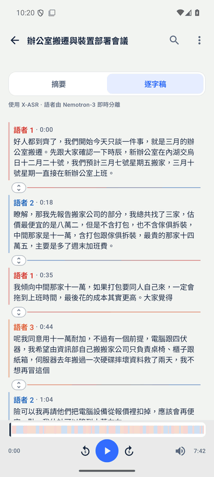<br><sub>在尾牙示範會議命名「陳經理」後，App 在辦公室搬遷會議依聲音建議他。英文介面（AMI 公開會議）：<a href="screenshots/people-voice-en.gif">為語者命名</a>、<a href="screenshots/people-people-en.png">名錄</a>、<a href="screenshots/people-person-en.png">人物頁</a>、<a href="screenshots/people-voice-explain-en.png">說明</a>。</sub></p>

| 分享 | 重新處理 | 設定 | 匯入 |
|:---:|:---:|:---:|:---:|
| 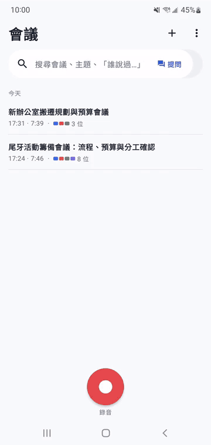 |  |  |  |

## 附錄 B. 運作方式

- **聽寫**：[nemo-x-asr-diarizer](https://github.com/vieenrose/nemo-x-asr-diarizer.cpp) 是單一串流引擎，在同一條時間軸上完成語音辨識（X-ASR）與語者分離（Nemotron-3）；換人的位置會對齊語者分離偵測到的起點（不重疊時）。
- **AI 筆記與摘要**：[Gemma-4-E2B 會議模型（行動版 v1）](https://huggingface.co/Luigi/gemma-4-E2B-meeting-agent-zh-GGUF/tree/main/mobile-v1) 在 [LiteRT](https://github.com/google-ai-edge/LiteRT) 上執行（[自訂引擎](https://github.com/vieenrose/LiteRT-LM/tree/mobile-fused-attention)）；RAM 8 GB 以上的手機可改用 [E4B 行動版 v2](https://huggingface.co/Luigi/gemma-4-E4B-meeting-agent-zh-LiteRT/tree/main/mobile-v2)（摘要較完整、與原話不符的筆記較少）。從舊版 E4B 升級時，新版在 Wi‑Fi 下於背景下載（相同的檔案直接沿用），下載完成前繼續使用舊版。
- **閱讀方式**：錄音時語音辨識優先；AI 筆記在背景把已確定的句子讀進上下文，每累積約 1,500 token（數分鐘的語音）閱讀一次並寫筆記，停止後只剩最後一段要讀，所以摘要很快完成。閱讀協定見 meeting-summarizer 的 [`docs/voxsumdroid-integration.md`](https://github.com/vieenrose/meeting-summarizer/blob/main/docs/voxsumdroid-integration.md)；Prime Minutes 的差異：每窗筆記超過上限時優先保留決議與待辦，錄音停止後直接以即時逐字稿寫摘要。
- **搜尋與提問**：[EmbeddingGemma 2 270M](https://huggingface.co/Luigi/primeminutes-embed-litert)（LiteRT，動態 int8）把每段逐字稿、每則筆記與摘要轉成向量，查詢時與關鍵字比對的結果融合（RRF）；「提問」先找出最相關的兩場會議，把分數最高的段落交給 AI 筆記模型作答。
- **辨識聲音**：[CAM++ zh-en](https://huggingface.co/Luigi/primeminutes-speaker-litert)（3D-Speaker）在 CPU 上執行，只在沒有錄音、轉錄或 AI 筆記時於背景計算。
- **CPU 推論**：首次啟動偵測核心數並做一秒測試選執行緒；GPU 沒有加速，見 [`GPU_NPU.md`](GPU_NPU.md)。

## 附錄 C. 已知限制

- 摘要模型以中文會議訓練：英文會議的筆記、標題與摘要改寫成英文（依逐字稿自動判斷），英文品質只在少數公開會議上量測過；中英夾雜的會議依多數語言決定。
- 部分會議紀錄內容可能與原話不符（E4B 較少），請點時間核對。
- 很長的會議：AI 筆記每段只帶著精簡過的前段筆記閱讀；筆記多到一次寫不完時（約 40–75 分鐘以上，依討論密度而定），摘要分成最多四段依時間順序撰寫，從開頭到結尾都涵蓋，但摘要較長，停止後撰寫摘要也多花約 1–2 分鐘；較短的會議仍一次寫成。標題只取最重要的筆記。

  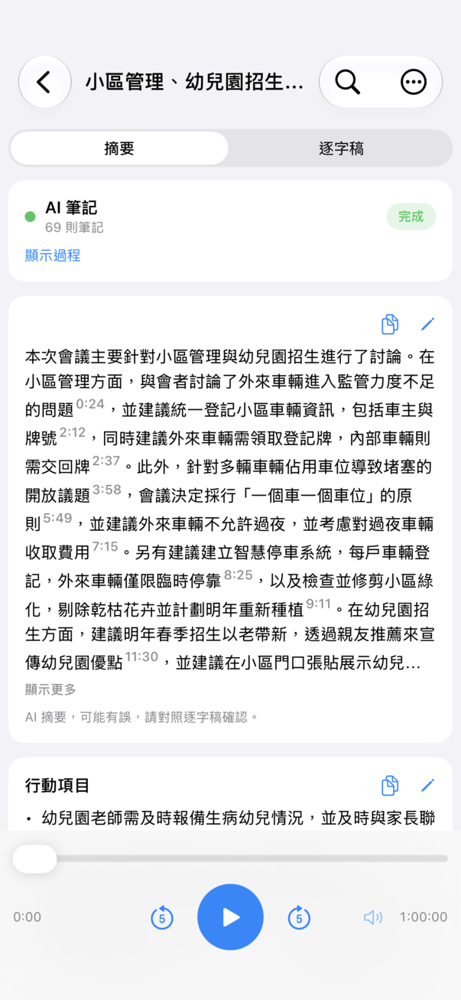 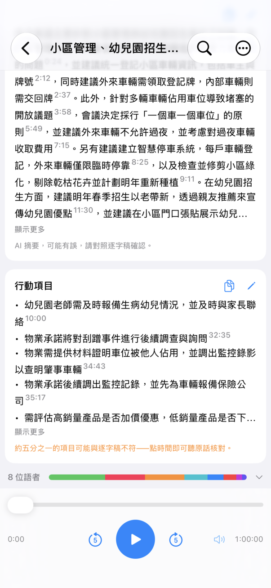

  64 分鐘的公開中文會議（AliMeeting 兩場合併，Note10+，E4B 行動版 v2）：79 則筆記，摘要分 4 段撰寫（約 6 分半），時間標記從開頭一路到會議後段。
- 偶爾會多分出發言很少的語者，可用「合併語者」修正；語音辨識漏掉標點時，換人的位置可能落在一個詞的中間。
- E4B 只能在 RAM 8 GB 以上的手機選用；錄音中同時執行時整個 App 約佔 4 GB 記憶體。
- 語意搜尋可能列出不相關的句子；「提問」由裝置上的小模型作答，可能漏掉段落中明明有的答案，請以出處為準。
