# Prime Minutes 使用說明（含介面測試地圖）

這份文件有兩個用途：

- **使用說明**：每一節介紹一個畫面，附截圖。
- **測試地圖**：每一節最後的表格列出該畫面上的每個操作（節點）、進入方式、預期結果與驗證狀態，作為介面測試的清單。

驗證欄：✅ 手動＝在模擬器或實機上實際操作確認；✅ 自動＝由 `app/src/androidTest` 的儀器測試涵蓋（括號內為測試類別）；⬜＝尚未驗證。最後一次全面驗證：2026-10-03，v0.47.0，Pixel 模擬器（8 GB）與 Galaxy Note 10+。

畫面結構：

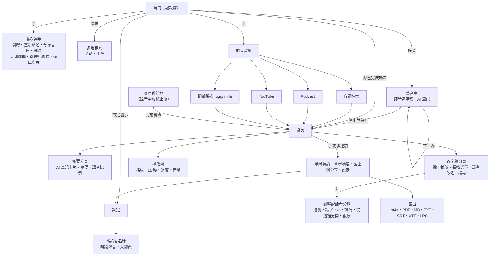

---

## 1. 首頁（場次庫）

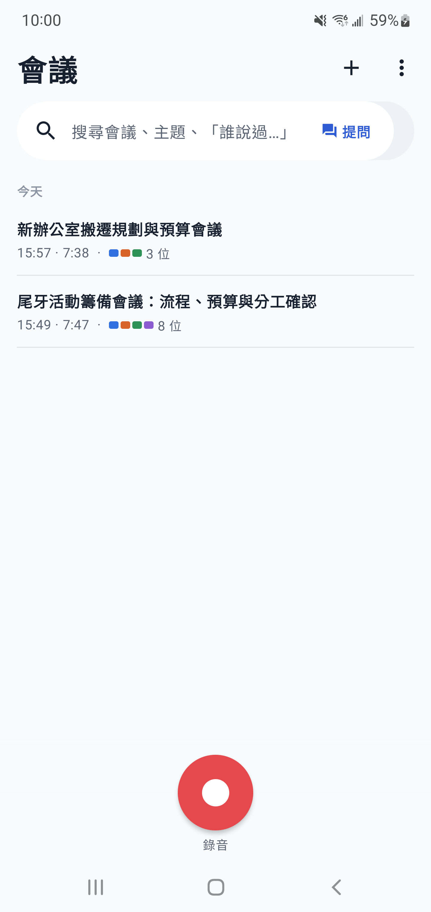

所有錄音與匯入的場次依日期分組列在這裡（還沒有場次時，會說明第一次錄音要下載多少模型，建議使用 Wi‑Fi）。沒有偵測到說話的錄音（靜音、只有雜音）以麥克風關閉圖示與「未偵測到語音」標示：可以開啟與刪除，但不寫 AI 筆記，也不列在「已完成」。上方可搜尋標題，右側的 **提問** 向會議提問（第 1a 節）；有「新」場次（尚未處理）時會出現篩選晶片。底部的 **錄音** 開始一場新會議；有尚未處理的錄音時，上方會多一個 **處理待辦（N）**。

| 節點 | 如何到達 | 預期結果 | 驗證 |
|---|---|---|---|
| 搜尋會議、主題、「誰說過…」 | 首頁上方輸入框 | 立即依標題與關鍵字篩選；停頓後依語意比對段落、筆記與摘要，符合的段落（≈，附時間與語者）列在會議下方，點段落從該處播放；語意比對進行中且還沒有結果時顯示「搜尋中…」，比對完仍沒有結果才顯示「沒有符合搜尋的會議。」 | ✅ 手動（Note 10+）、✅ 自動（EmbedDeviceTest.hybridSearch） |
| 依語意搜尋 — 下載模型 | 搜尋模型未下載時，搜尋框下方 | 下載約 160 MB 後，閒置時為既有會議建立索引（「正在建立索引…」） | ✅ 手動 |
| 提問 | 搜尋框右側；AI 筆記模型與搜尋模型都已下載時出現（設定 › 向會議提問，預設開啟） | 搜尋框有文字時直接提問，空白時開啟提問面板（第 1a 節） | ✅ 手動（Note 10+） |
| 未偵測到語音 | 沒有說話的錄音處理完後 | 麥克風關閉圖示；不列在「已完成」篩選；點開可看錄音 | ✅ 手動（Note 10+） |
| 篩選晶片 全部／新／已完成 | 有「新」場次時出現 | 只列出該狀態的場次；全部已完成時晶片不顯示 | ✅ 手動 |
| 點場次（已完成） | 點一列 | 開啟場次（第 6 節） | ✅ 手動 |
| 點場次（處理中） | 點正在處理的一列 | 即時查看處理進度：狀態列右側顯示硬體狀態列，逐字稿與 AI 筆記隨處理出現，音訊可同時播放 | ✅ 手動 |
| 點場次（下載中） | 點 Podcast／YouTube 下載中的一列 | 開啟該場次：下載卡片顯示進度（百分比與已下載量）、「已暫停」或失敗原因，可「立即繼續」「重試」或「刪除」（連同已下載的部分）；下載完成後同一畫面接著顯示處理進度 | ✅ 手動（Note 10+） |
| 處理待辦（N） | 有未處理錄音時 | 依序轉錄並摘要；完成後列變為已完成 | ✅ 手動（Note 10+） |
| 錄音 | 底部大按鈕 | 首次要求麥克風權限，進入錄音室（第 5 節） | ✅ 手動 |
| 錄音中…（返回） | 錄音進行中回到首頁 | 回到錄音室，錄音不中斷 | ✅ 手動 |
| ＋ | 右上 | 加入音訊選單（第 4 節） | ✅ 手動 |
| 設定圖示 | 右上 | 設定（第 9 節） | ✅ 手動 |
| 有可用更新橫幅 | 有新版本時 | 更新＝下載並安裝；稍後＝隱藏 | ⬜ |

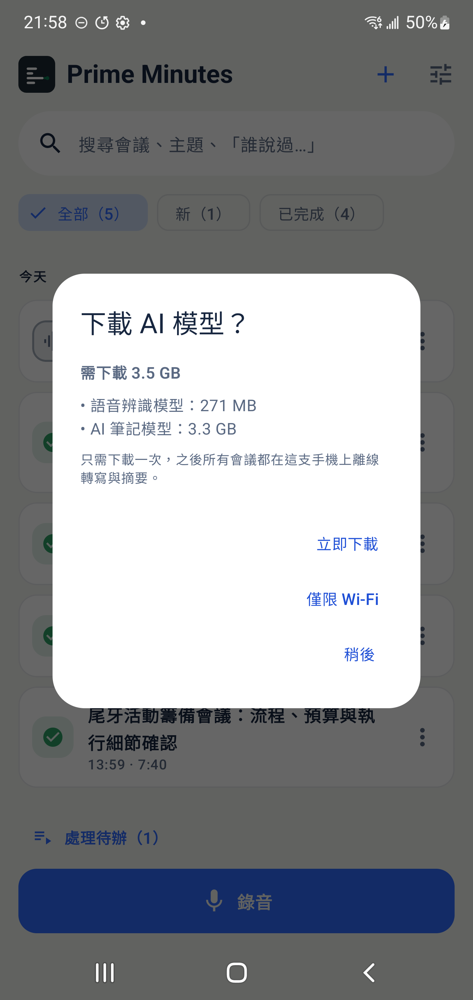

第一次開啟時（以及之後錄音或匯入前若還缺模型），**下載 AI 模型？** 列出需下載的總量與每個模型的大小；未連上 Wi‑Fi 時以橘色提醒可能使用行動數據。

| 節點 | 如何到達 | 預期結果 | 驗證 |
|---|---|---|---|
| 立即下載 | 下載對話框 | 在背景下載；首頁上方（不論資料庫是否為空）與設定頂端都顯示下載卡片：已下載／總量、百分比與「取消」 | ✅ 手動（Note 10+，語音模型 271 MB 約 1 分鐘下載完成；模擬器：空資料庫與設定上的卡片） |
| 下載卡片：取消 | 下載進行中 | 停止下載；本次開啟期間網路變化不會自動重新開始（重新開啟 App 或再次同意下載才會）；錄音或匯入仍會下載所需的模型 | ✅ 手動 |
| 下載暫停 | 下載中斷線、手機休眠 | 不再當成失敗：卡片顯示「下載已暫停 · 會自動繼續」與「繼續」，已下載的部分保留；網路恢復、回到 App、按「繼續」或稍候片刻就從中斷處接續，已完成的檔案不重新下載 | ✅ 手動（Note 10+：下載語音模型時切斷 Wi‑Fi 與行動數據；模擬器：恢復網路後接續） |
| 僅限 Wi‑Fi | 下載對話框 | 已連上 Wi‑Fi 時立即在背景下載；未連 Wi‑Fi 時提示並在連上後自動下載 | ✅ 手動（Note 10+，Wi‑Fi 下立即下載；未連 Wi‑Fi 的情況未實機確認） |
| 稍後 | 下載對話框 | 本次不下載；下次錄音或匯入前再詢問 | ✅ 手動（Note 10+） |
| 長時間工作的電池提示 | 錄音、10 分鐘以上的匯入或批次處理開始時，App 仍受電池最佳化限制 | 「讓長時間工作持續執行？」說明原因；允許＝系統的「停止最佳化電池用量嗎？」對話框；暫時不要＝工作照常進行，答案會記住、不再詢問（可在設定開啟）；未作答就關閉＝下次長時間工作再問 | ✅ 手動（Note 10+，以錄音觸發：暫時不要、允許 → 系統對話框 → 已列入例外） |

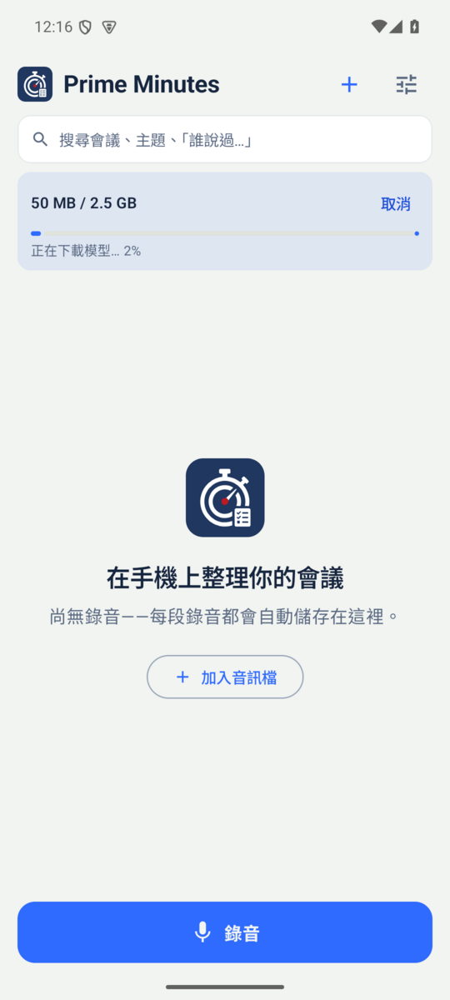 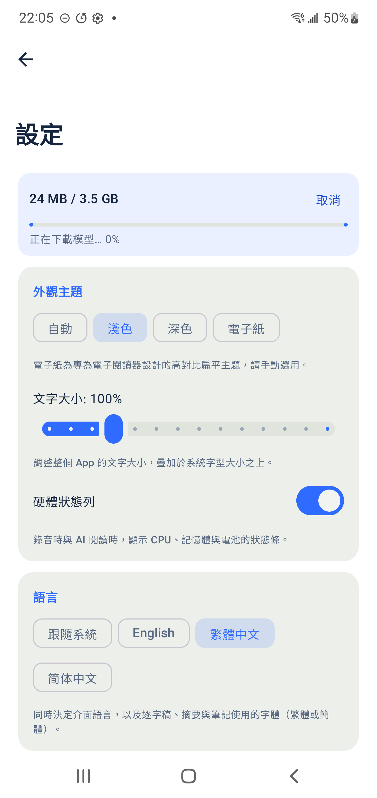 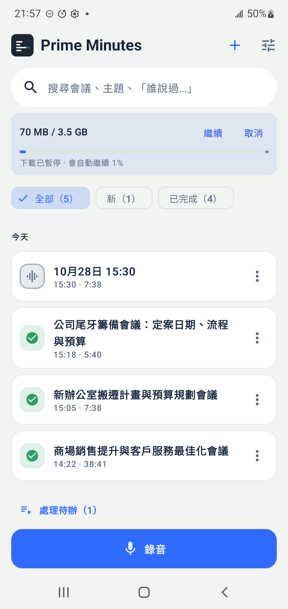

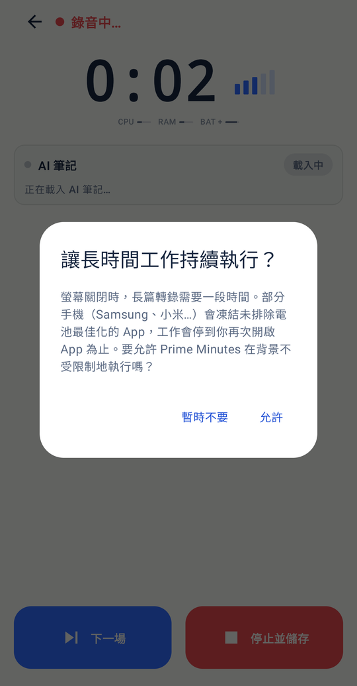

錄音、10 分鐘以上的匯入或批次處理第一次開始時，若 App 仍受電池最佳化限制，會先說明原因（部分手機在螢幕關閉時會凍結受限制的 App）並詢問一次。

### 1a. 向會議提問（實驗性）

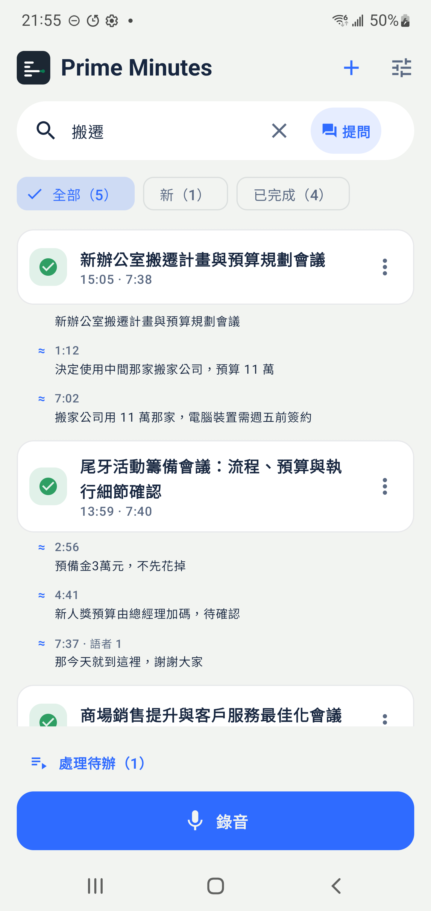 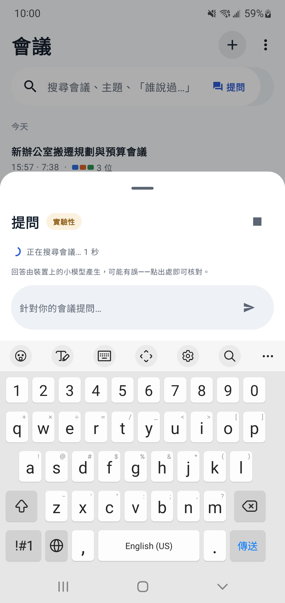 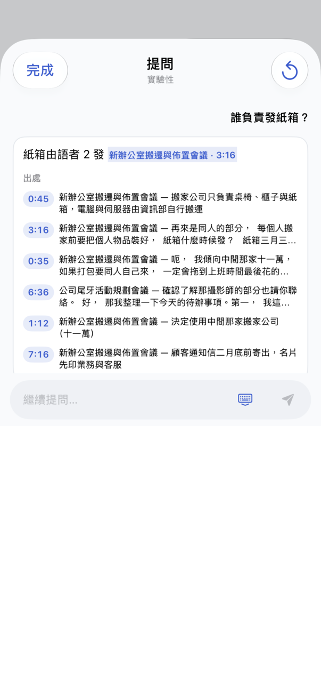

需要 AI 筆記模型與語意搜尋模型；兩者都在手機上時，首頁搜尋框右側出現 **提問**。作答時面板顯示目前的階段與經過的秒數。

| 節點 | 如何到達 | 預期結果 | 驗證 |
|---|---|---|---|
| 提問 | 搜尋框輸入問題 → 提問；或空白時點提問，在面板輸入 | 「正在搜尋會議… N 秒」→「正在閱讀 N 段摘錄… N 秒」→「正在回答… N 秒」→ 答案逐字出現，下方列出出處（會議 · 時間）與免責聲明 | ✅ 手動（Note 10+、iPhone 14 Pro Max） |
| 點出處 | 答案下方 | 開啟該會議並從該時間播放 | ✅ 手動 |
| 回答的語言 | 用英文或中文提問 | 回答使用提問的語言（例如中文介面下用英文問，就用英文答）；問題太短或中英夾雜時跟隨介面語言 | ✅ 手動（Note 10+、iPhone 14 Pro Max） |
| 繼續提問… | 面板底部輸入框 | 帶著前一輪對話追問；↻ 清除對話 | ✅ 手動 |
| 裝置忙碌 | 錄音、轉寫或摘要進行中提問 | 「請等目前的錄音、轉寫或摘要完成後再提問。」；答題中若有工作開始，答案中止 | ⬜ |
| 停止 | 答題中 | 保留已產生的部分 | ✅ 手動 |

## 2. 場次 ⋮ 選單

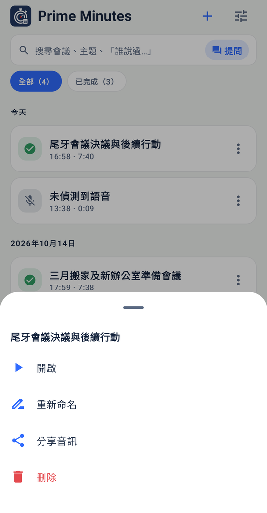 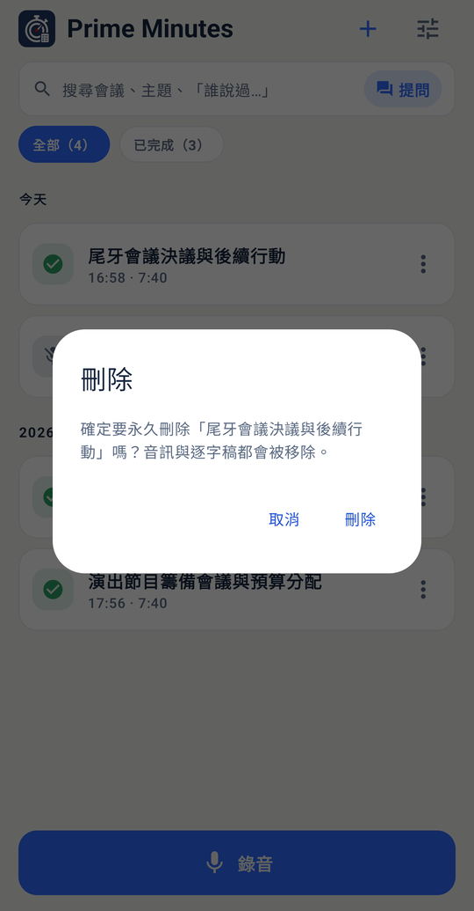

每列右側的 **⋮** 依場次狀態提供不同操作。

| 節點 | 何時出現 | 預期結果 | 驗證 |
|---|---|---|---|
| 開啟 | 已完成 | 開啟場次 | ✅ 手動 |
| 重新命名 | 一律 | 對話框輸入新標題，確定後列上標題更新（新場次的預設標題為日期時間，如「10月6日 00:11」，摘要完成後換成 AI 擬的標題） | ✅ 手動 |
| 分享音訊 | 一律 | 系統分享面板，附 `.m4a` | ✅ 手動 |
| 刪除 | 一律 | 確認對話框「確定要永久刪除「…」嗎？」；取消不刪 | ✅ 手動 |
| 繼續處理 | 處理被中斷（停止、App 被終止）且已留有進度 | 從已存的最後穩定段落接續語音辨識，語者編號與先前一致；已完成的部分不重做 | ✅ 手動 |
| 立即處理 | 未處理，或已排入佇列且沒有正在處理的項目 | 開始轉錄與摘要；在「停止」之後也能再次開始 | ✅ 手動 |
| 從佇列移除 | 已排入佇列、尚未處理 | 移出佇列，保留錄音（列變為「新」） | ✅ 手動 |
| 正在處理的場次 | 該列沒有 ⋮；點一下開啟即時畫面 | 即時畫面頂端的「停止」停止處理，該列回到「排入佇列」，稍後自動繼續 | ✅ 手動 |

處理中按下「停止」，或 App 被終止後，已轉錄的穩定段落與 AI 筆記會存下來。下次開啟時會詢問 **繼續中斷的場次？**，也可隨時從 ⋮ 選 **繼續處理**。「停止」一定會保留進度：連按兩次，或通知與畫面上的「停止」先後按下，都只存一次、不會遺失；在 AI 筆記整理時停止，完整的逐字稿也會保留，繼續處理時只需重寫筆記。匯入檔案中途停止時，原始檔會保留：繼續處理從已存的段落接續，並一路轉錄到檔案結尾。

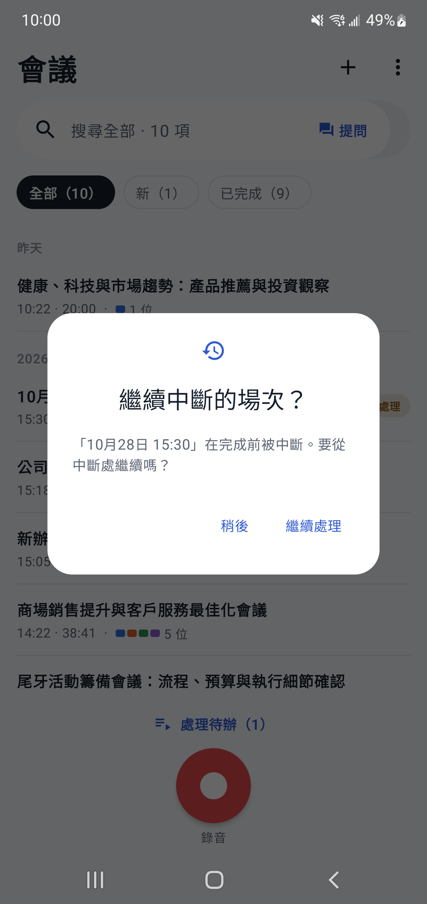 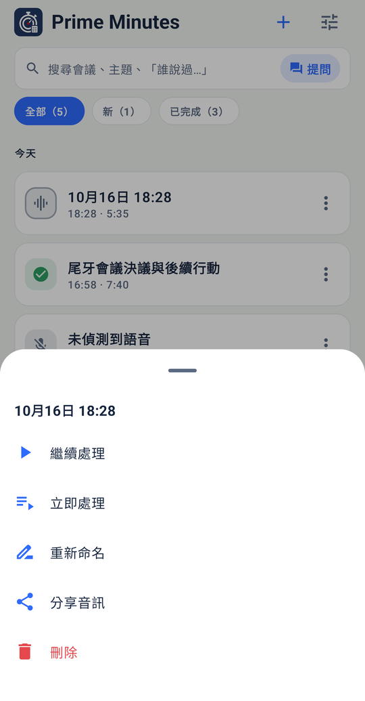

## 3. 多選模式

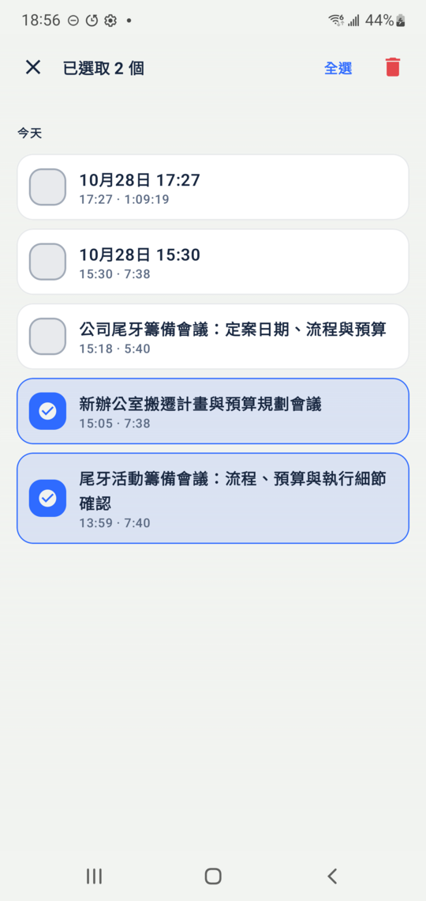 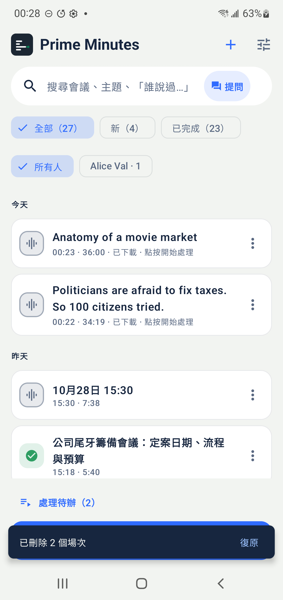

長按一列進入多選。

| 節點 | 如何到達 | 預期結果 | 驗證 |
|---|---|---|---|
| 長按場次 | 首頁 | 進入多選，標題列顯示「已選取 1 個」 | ✅ 手動 |
| 點其他場次 | 多選中 | 加入或取消選取 | ✅ 手動 |
| 全選 | 多選標題列 | 選取所有顯示中的場次 | ✅ 手動 |
| 刪除 | 多選標題列 | 「確定要永久刪除 N 個場次嗎？」確認後刪除 | ✅ 手動（確認框） |
| 結束選取（X） | 多選標題列 | 回到一般首頁 | ✅ 手動 |

## 4. 加入音訊

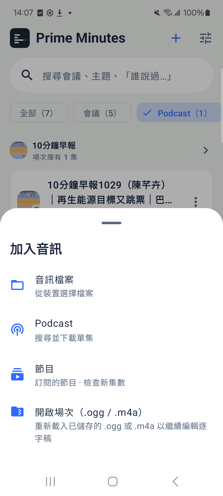  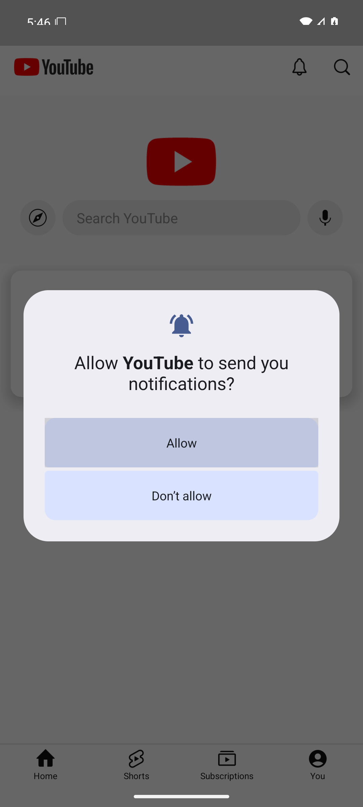

處理事先錄好的音訊。也可以從其他 App 把音訊「分享」給 Prime Minutes。

| 節點 | 如何到達 | 預期結果 | 驗證 |
|---|---|---|---|
| 音訊檔案 | ＋ → 音訊檔案 | 系統檔案選擇器；選取後轉錄並摘要（長時間的靜音會快速略過） | ✅ 手動、✅ 自動（AddSourceSheetTest） |
| Podcast → 搜尋 → 節目 → 轉錄 | ＋ → Podcast | 列出單集與長度；選取後首頁立刻出現這一集（標題即單集名稱），標示下載進度，下載完成後自動轉錄（正在處理其他項目時排在其後） | ✅ 手動、✅ 自動（SourceSheetsTest，搜尋） |

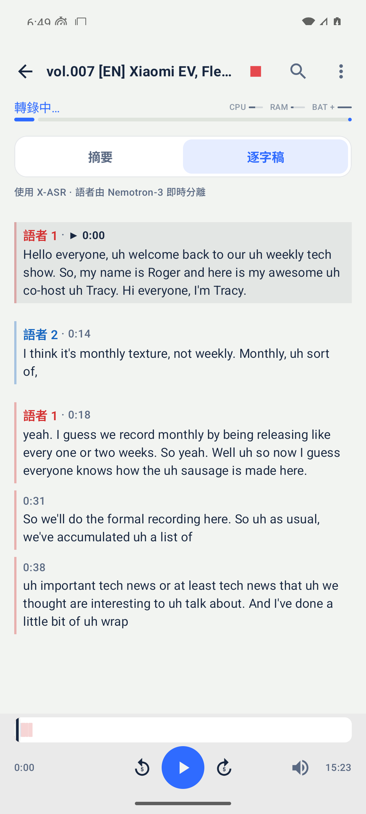
| YouTube → 搜尋或貼上連結 | ＋ → YouTube | 搜尋結果或直接前往影片；首頁立刻出現這部影片（取得影片標題後即顯示），下載音訊後轉錄；直播顯示「直播無法轉錄，請選擇一般影片。」 | ✅ 手動、✅ 自動（SourceSheetsTest，搜尋） |
| 開啟場次（.ogg / .m4a） | ＋ → 開啟場次 | 開啟先前匯出的 Prime Minutes 檔，含逐字稿與摘要 | ✅ 手動、✅ 自動（AddSourceSheetTest） |
| 從其他 App 分享 | 其他 App → 分享 → Prime Minutes | 閒置時直接轉錄；處理中時詢問「匯入這個檔案？」（匯入會中斷處理） | ✅ 手動 |
| Podcast／YouTube 下載中斷線 | 下載單集或影片音訊時網路中斷 | 不當成失敗：該列與場次畫面顯示「下載已暫停 · 會自動繼續」；網路恢復、回到 App 或按「立即繼續」後從中斷處接續，下載完成後照常轉錄 | ✅ 手動（Note 10+，Podcast：下載中切斷 Wi‑Fi 與行動數據 → 暫停、已下載部分保留 → 恢復後接續；YouTube 未實機確認） |
| Podcast／YouTube 下載失敗 | 來源無法下載（例如已下架） | 該列標示「下載失敗：原因」（紅色），保留在首頁；點開後可「重試」或「刪除」 | ✅ 自動（DownloadItemTest），實機未確認 |
| 下載中 App 被關閉 | 下載途中強制關閉或重新開機後開啟 App | 該列仍在首頁，從已下載的部分接續下載 | ✅ 手動（Note 10+：強制停止後重開，從中斷處接續） |

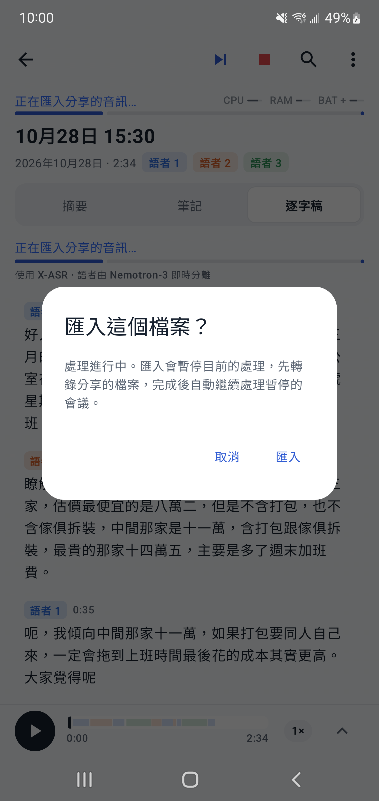 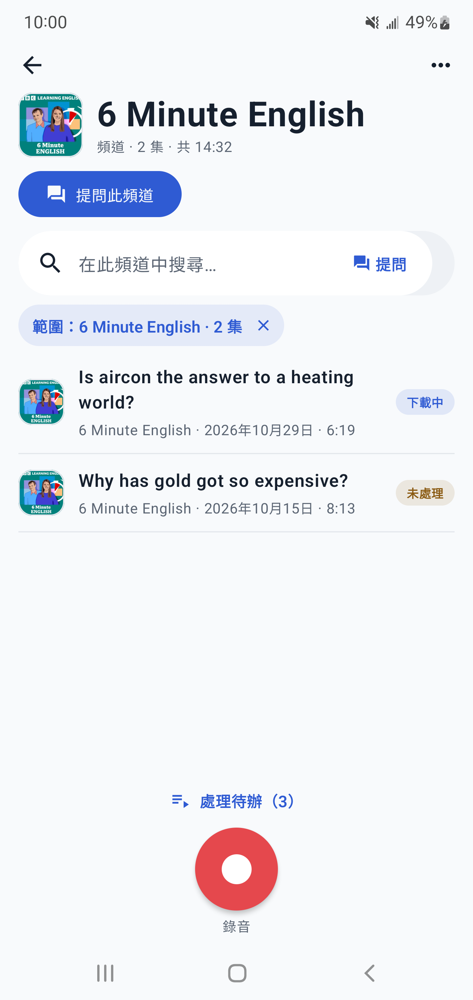 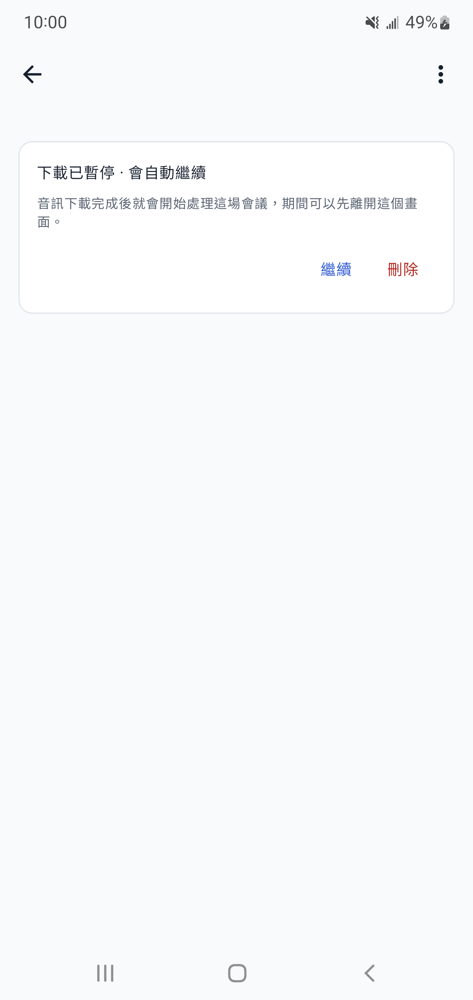

## 5. 錄音室

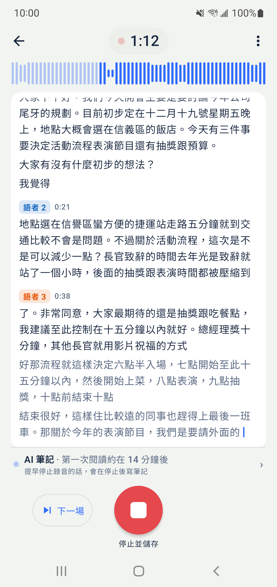 

逐字稿在說話約 0.4 秒後出現；語者確定後標上顏色，尚未確定的句子為淺灰。上方 **AI 筆記** 卡片顯示它正在閱讀逐字稿或正在寫筆記（正在寫的筆記逐字出現）。AI 筆記每讀滿一段逐字稿（約 1,500 個詞元）才寫一批，所以第一則筆記要等幾分鐘才出現（示範會議約在第 6 分鐘），這是正常的。標題列右側的細條是硬體狀態列（CPU、記憶體、電池；「BAT +」表示充電中），數值過高時轉紅，可在設定中關閉。RAM 8 GB 以上的手機在錄音中同步閱讀；較小的手機在錄音結束後閱讀。第一次錄音時，模型下載的進度也顯示在這裡，麥克風在下載期間已開始錄音；下載後 AI 筆記模型會準備一次（「正在準備…（僅首次，約一分鐘）」）。

| 節點 | 如何到達 | 預期結果 | 驗證 |
|---|---|---|---|
| 計時器與音量條 | 錄音中 | 時間遞增，音量條隨聲音跳動 | ✅ 手動 |
| 硬體狀態列 | 錄音中；處理中的會議畫面 | 錄音時在標題列右側，處理時在進度條上方的狀態列右側，每 2 秒更新；閒置、首頁與已完成的會議不顯示；關閉設定後隱藏 | ✅ 手動（Note 10+） |
| 即時逐字稿 | 錄音中 | 文字即時出現，語者依序上色 | ✅ 手動（模擬器、Note 10+） |
| AI 筆記卡片 | 錄音中（8 GB 以上） | 閱讀逐字稿 → 整理筆記中，筆記逐字出現 | ✅ 手動 |
| 下一場 | 錄音中 | 存檔並立刻開始下一場；前一場自動處理 | ✅ 手動 |
| 停止並儲存 | 錄音中 | 存檔並開啟場次；AI 筆記讀完最後一段後寫摘要 | ✅ 手動 |
| 返回 | 左上 | 回首頁，錄音不中斷 | ✅ 手動 |
| 錄音失敗 | 例如語音引擎無法載入 | 顯示錯誤並回到首頁；已錄的音訊保留在「處理待辦」 | ✅ 手動（Note 10+，修正前後） |

## 6. 場次：摘要分頁

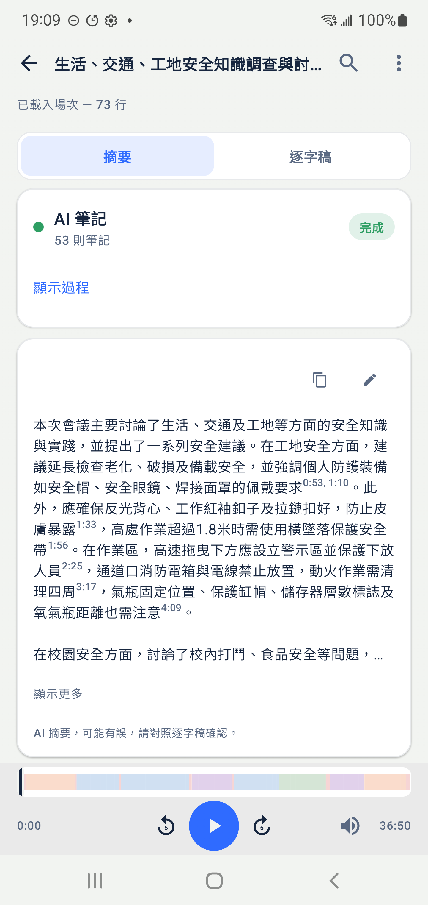 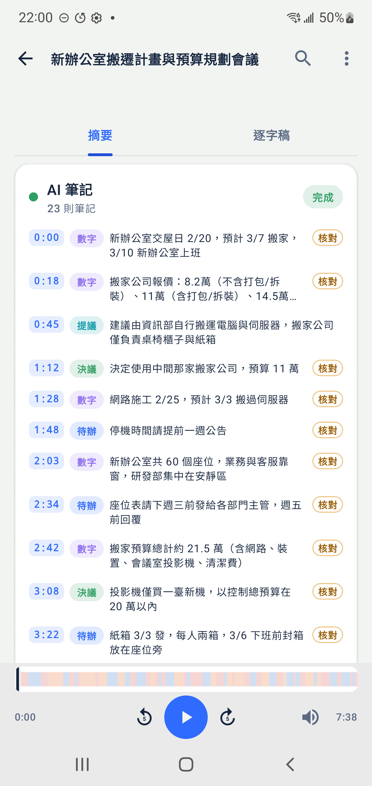 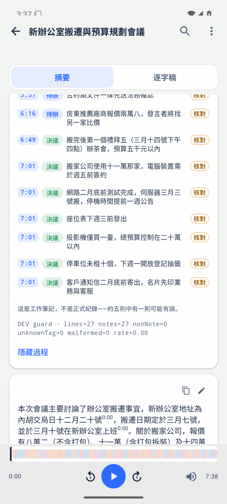

**AI 筆記** 卡片列出所有筆記：類型（決議、待辦、提議、未決、數字）與時間，時間一點就從原話播放；決議、待辦與數字另有 **核對**。下方是段落式摘要，灰色時間標籤同樣可播放，提到的語者以粗體和該語者的顏色標示（改名後跟著更新）；最下方一行是各語者的發言比例。

| 節點 | 如何到達 | 預期結果 | 驗證 |
|---|---|---|---|
| AI 筆記卡片狀態 | 摘要分頁 | 停止後依序：整理筆記中 → 撰寫摘要 → 完成 | ✅ 手動 |
| 重新開啟場次 | 首頁點已完成場次 | 筆記與時間點仍在（「N 則筆記」） | ✅ 手動 |
| 顯示過程／隱藏過程 | AI 筆記卡片 | 展開／收合筆記列表 | ✅ 手動 |
| 顯示詳細過程／簡化顯示 | 展開後 | 每段的處理與上下文用量 | ✅ 手動 |
| 顯示活動紀錄（N） | 詳細過程中 | 每則筆記的保留或捨棄原因 | ✅ 手動 |
| 筆記時間／核對 | 筆記上 | 從該時間播放 | ✅ 手動 |
| 編輯摘要（鉛筆） | 摘要卡右上 | 編輯摘要，儲存／取消 | ✅ 手動 |
| 複製摘要 | 摘要卡右上 | 提示「已複製摘要」 | ✅ 手動 |
| 摘要中的時間點 | 藍色時間 | 從該時間播放 | ✅ 手動 |
| 語者比例 | 點一下 | 展開／收合圖例 | ✅ 手動 |
| 英文會議 | 匯入或錄製英文會議 | 筆記、標題、摘要與紀錄標題為英文；從會議開頭起，同意的事項即標為決議，語氣保留的說法（如 “we could…”）仍為提議；中文會議不變（語言依逐字稿判斷，設定的語言只切換繁／簡） | ✅ 手動（Note 10+、iPhone 14 Pro Max，E2B，英文與中文會議各一） |

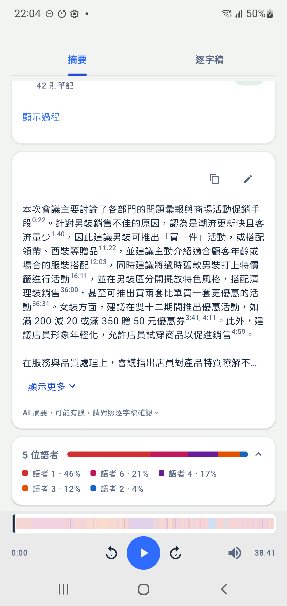 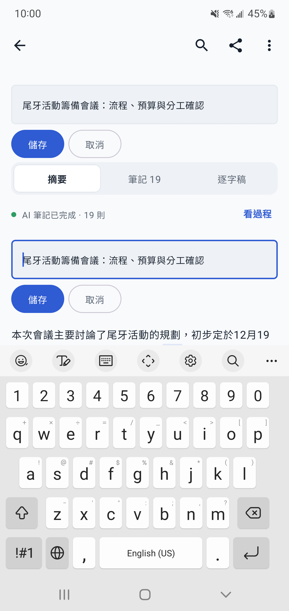

| 節點 | 如何到達 | 預期結果 | 驗證 |
|---|---|---|---|
| 標題 | 點頂端標題 | 編輯標題，儲存／取消 | ✅ 手動 |
| 行動項目卡片 | 設定 → 實驗功能開啟時 | 列在摘要下方，可複製與編輯 | ✅ 手動 |

## 7. 場次：逐字稿分頁

 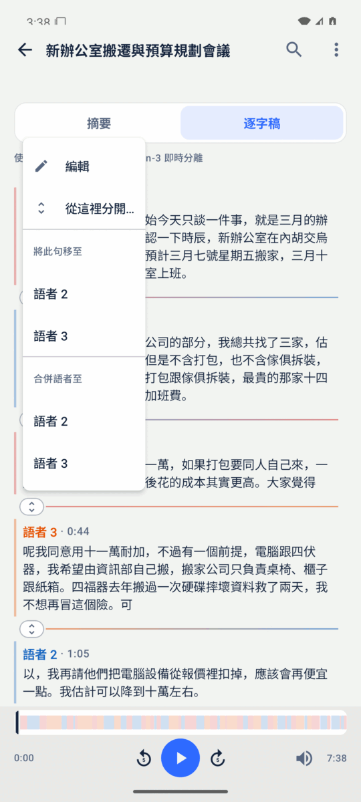 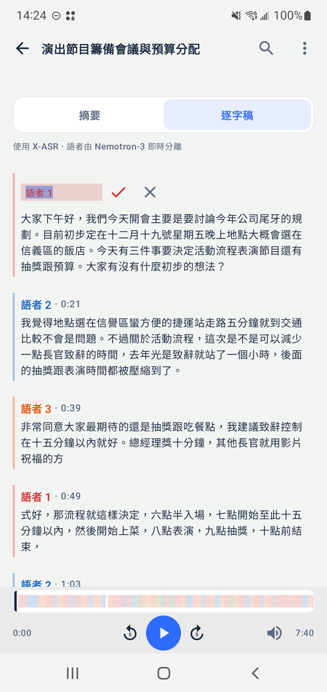

| 節點 | 如何到達 | 預期結果 | 驗證 |
|---|---|---|---|
| 點一句 | 逐字稿 | 從該句播放，播放中的句子高亮 | ✅ 手動 |
| 長按一句 → 編輯 | 長按選單 | 就地編輯，儲存後保存在場次中 | ✅ 手動（重新開啟後仍在） |
| 長按 → 將此句移至 → 語者 N | 長按選單 | 該句改派語者，保存在場次中 | ✅ 手動（重新開啟後仍在） |
| 長按 → 合併語者至 → 語者 N | 長按選單 | 先確認「將「語者 1」合併至「語者 2」？」；合併後整位語者併入另一位，其他語者的名稱不變；下方提示「已合併語者」，點 **復原** 可還原（移動單句同樣可復原） | ✅ 手動（Note 10+）、✅ 自動（SpeakerEditsTest） |
| 點語者名稱 | 每段開頭的「語者 N」 | 只有點的那一行變成輸入框，直接改名（例如「王經理」），按 ✓ 或鍵盤的完成儲存、✕ 取消；清空則恢復預設 | ✅ 手動 |
| 搜尋逐字稿 | 頂端放大鏡 | 標示符合處，上一個／下一個，關閉搜尋 | ✅ 手動 |
| ≈（依語意搜尋） | 搜尋列右側，搜尋模型已下載時 | 關閉：只標示完全相同的字；開啟：列出意思相近的句子並標示最接近的詞 | ✅ 手動（Note 10+、iPhone 14 Pro Max） |

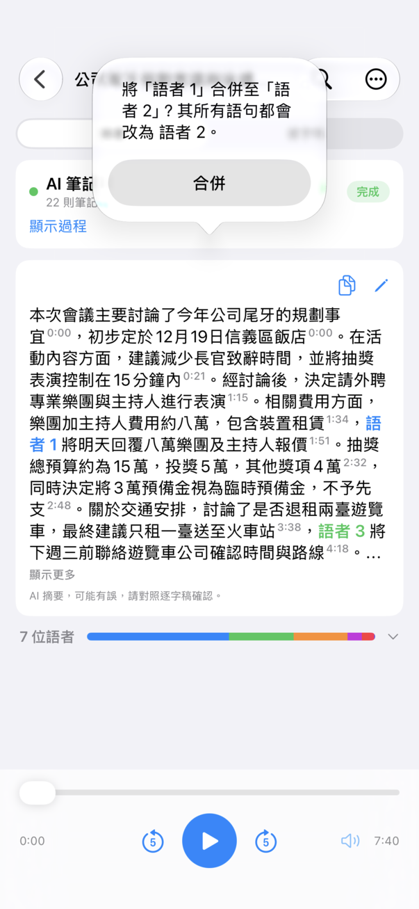 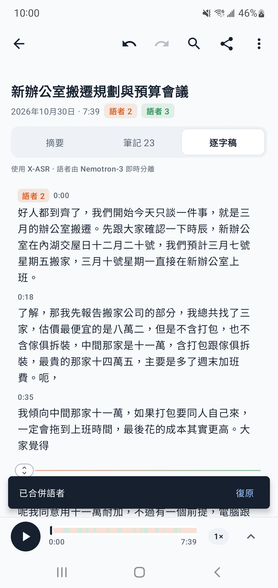 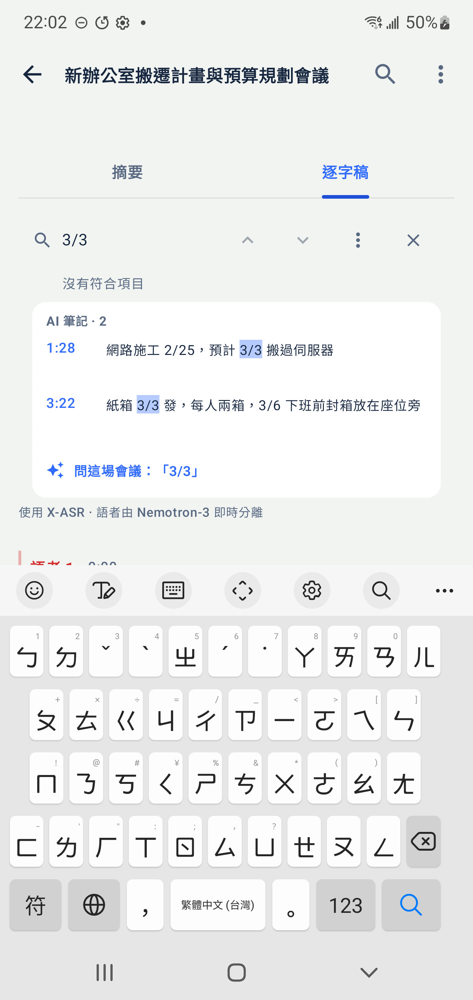

### 7b. 在這場會議內搜尋與提問

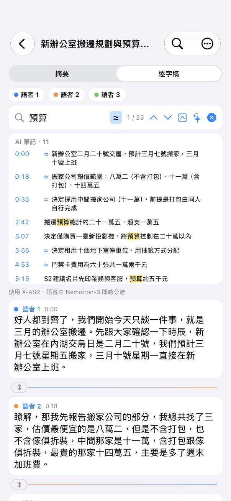 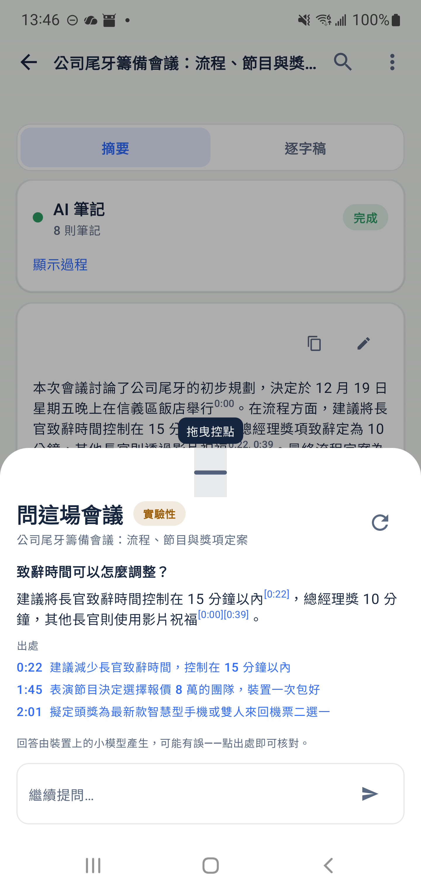

搜尋列下方列出這場會議符合的 **AI 筆記** 與 **逐字稿** 句子（各依時間排序，標示 **≈** 的是依語意找到的）；點一筆就捲到那句並把播放位置停在那裡。**✦**（搜尋列、結果清單最後一列、⋮ 選單的「問這場會議」）只拿這場會議的段落作答，不會被其他相似的會議搶走出處；出處只顯示時間。設計與預設值：[docs/design/in-session-search-ask.md](design/in-session-search-ask.md)。英文介面：[搜尋](screenshots/meeting-search-en.png)、[提問](screenshots/meeting-ask-en.png)（AMI 公開會議）。

| 節點 | 如何到達 | 預期結果 | 驗證 |
|---|---|---|---|
| 結果清單 | 頂端放大鏡 → 輸入 | AI 筆記・N、逐字稿・N 兩組，各附時間；可用清單鈕收合／展開；最多 50 筆 | ✅ 手動（Note 10+、模擬器、iPhone 14 Pro Max） |
| 點結果 | 結果清單 | 清單收合，逐字稿捲到該句（筆記的 m:ss 對到以該時間顯示的那句）並標為播放中，播放位置停在該句開頭（不自動播放） | ✅ 手動（Note 10+：關鍵字筆記、≈ 筆記、關鍵字句子、≈ 句子各一）、✅ 自動（單元測試：筆記 3:22 對到 202.4 秒那句、播放位置不落在上一句） |
| ≈ 依語意 | 搜尋列的 ≈ | 加入依語意找到的筆記與句子（標 ≈）；會議尚未建立索引時不顯示 ≈ | ✅ 手動（Note 10+） |
| 問這場會議 | ✦ 或 ⋮ → 問這場會議 | 「正在搜尋這場會議…」→ 答案，出處為這場會議的時間；點出處回到逐字稿該處 | ✅ 手動（Note 10+、模擬器、iPhone 14 Pro Max） |
| 尚未建立索引 | 沒有搜尋模型，或索引尚未完成 | 仍可提問（只用關鍵字找段落），同時在背景建立索引 | ✅ 手動（模擬器） |
| 先前的問題 | 再次開啟問這場會議 | 這場會議先前的問答列在「先前的問題」下（最多 20 則）；↻ 清除 | ✅ 手動（Note 10+） |
| 處理中的會議 | 正在轉寫或閱讀的會議 | 可搜尋已出現的句子與筆記（只用關鍵字，沒有 ≈ 與 ✦）；點結果捲到該句，播放位置在處理完成後才停到該處；提問等工作完成後才回答 | ✅ 手動（Note 10+：轉錄中搜尋「紙箱」4 筆，點結果捲到該句） |

### 7a. 調整說話者分界（Adjust a speaker boundary）

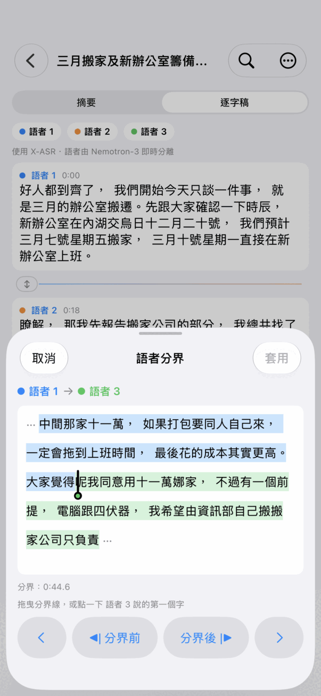 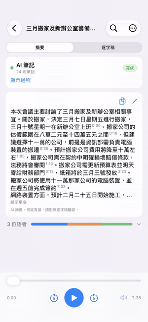 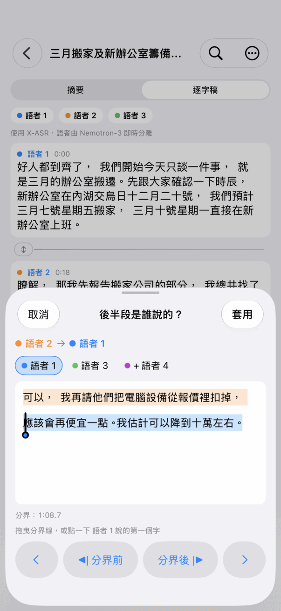

語者換人時，逐字稿偶爾把下一位的前一兩個字留在上一句（或反過來）。完成的逐字稿中，兩位不同語者的相鄰句子之間有一條細線和 **⇕** 把手；點把手開啟「語者分界」：

- 上方是上一句的結尾接著下一句的開頭，前一位語者的字底色為其顏色，標記（直線加圓點）之後屬於下一位。中文以字為單位，英文以詞為單位。
- **拖曳**標記、**點**下一位開始說的那個字，或用 **‹ ›** 一次移一格。
- 每次移動後自動播放分界之後約 2 秒，聽是誰在說；**◀| 分界前**／**分界後 |▶** 重播分界前、後各 2 秒。
- **套用** 後兩句的文字與時間一起更新（匯出的 SRT、VTT 也跟著改），其他句子、語者名稱與 AI 筆記不變，也不會要求重新摘要。
- 一句話裡其實有另一個人插話時：長按該句 → **從這裡分開…**，在「後半段是誰說的？」選好分界與語者（先列相鄰句的語者，再列其他語者，最後是「＋ 新語者」）。
- 頂端的 **↶ 復原**／**↷ 重做** 可逐步還原或重做分界調整、分句、改字與改名。
- 讀屏（TalkBack、VoiceOver）：標記是一個可調整的元素，上下滑動即左右移動，並唸出「語者 N 從「某字」開始」。

| 節點 | 如何到達 | 預期結果 | 驗證 |
|---|---|---|---|
| 分界把手 ⇕ | 完成的逐字稿，兩位語者之間 | 開啟「語者分界」 | ✅ 手動（Note 10+、iPhone 14 Pro Max） |
| 拖曳／點字／‹ › | 語者分界 | 標記移動，自動試聽分界之後 | ✅ 手動（Note 10+） |
| 分界前／分界後 | 語者分界 | 播放分界前／後 2 秒 | ✅ 手動（Note 10+） |
| 套用 | 語者分界 | 兩句文字與時間更新；強制停止 App 後重新開啟仍在；匯出 SRT 反映 | ✅ 手動（Note 10+）、✅ 自動（BoundaryEditsTest） |
| 長按 → 從這裡分開… | 長按選單 | 選分界與語者，後半句成為新的一句 | ✅ 手動（Note 10+）、✅ 自動（BoundaryEditsTest） |
| ↶ 復原／↷ 重做 | 頂端列，編輯後 | 逐步還原與重做 | ✅ 手動（Note 10+）、✅ 自動（SessionReducerTest） |

## 8. 播放列與場次選單

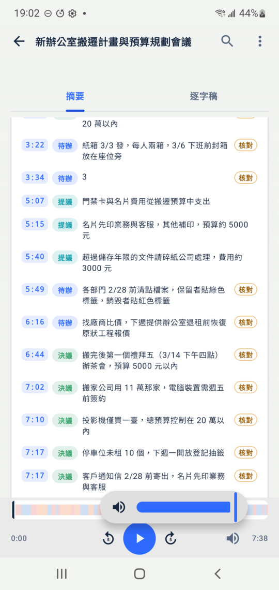 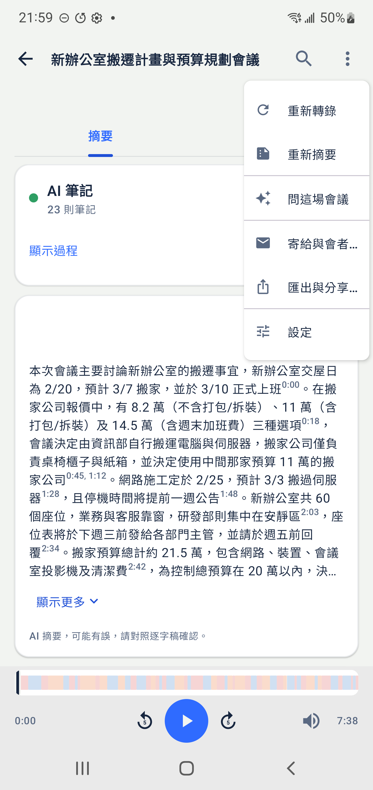 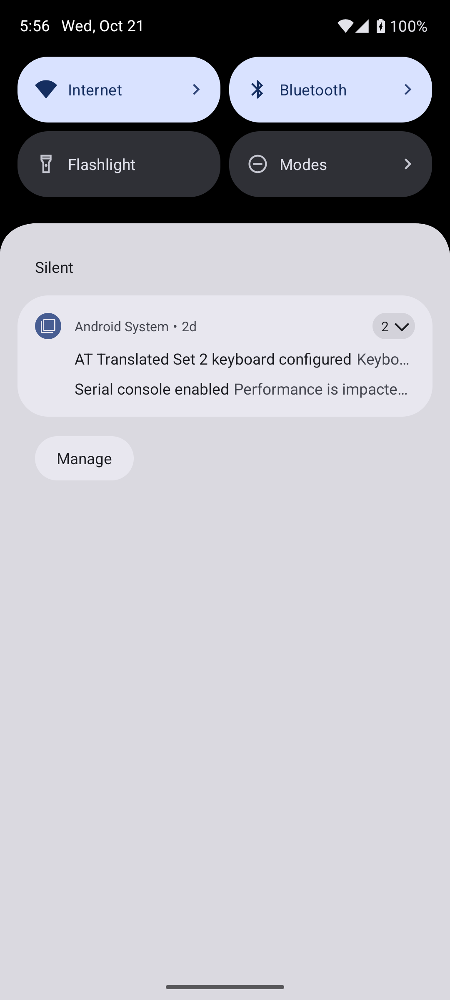

播放列的色塊代表語者，點或拖曳可跳轉。右上 **⋮**（更多選項）提供重新處理與匯出。

| 節點 | 如何到達 | 預期結果 | 驗證 |
|---|---|---|---|
| 播放／暫停 | 播放列 | 播放並切換圖示 | ✅ 手動、✅ 自動（TranscriptFlowTest） |
| 倒退 5 秒／快進 5 秒 | 播放列 | 跳轉 5 秒 | ✅ 手動 |
| 進度條 | 點或拖曳 | 跳到該處 | ✅ 手動 |
| 音量按鈕 | 播放列右側 | 音量滑桿、靜音 | ✅ 手動 |
| 重新轉錄 | ⋮ | 重跑語音辨識與語者分離，標題保留 | ✅ 手動 |
| 重新摘要 | ⋮ | 只重跑 AI 筆記與摘要；筆記不重複 | ✅ 手動 |
| 匯出與分享… | ⋮ | 匯出選單 | ✅ 手動、✅ 自動（ExportSheetTest） |
| 匯出：.m4a／PDF／MD／TXT／SRT／VTT／LRC → 儲存或分享 | 匯出選單 | 存檔或系統分享 | ✅ 手動（MD 儲存）、✅ 自動（ExportSheetTest、PdfExportTest） |
| 複製逐字稿 | 匯出選單底部 | 提示「已複製逐字稿」 | ✅ 手動 |
| 設定 | ⋮ | 設定（第 9 節） | ✅ 手動 |

## 9. 設定

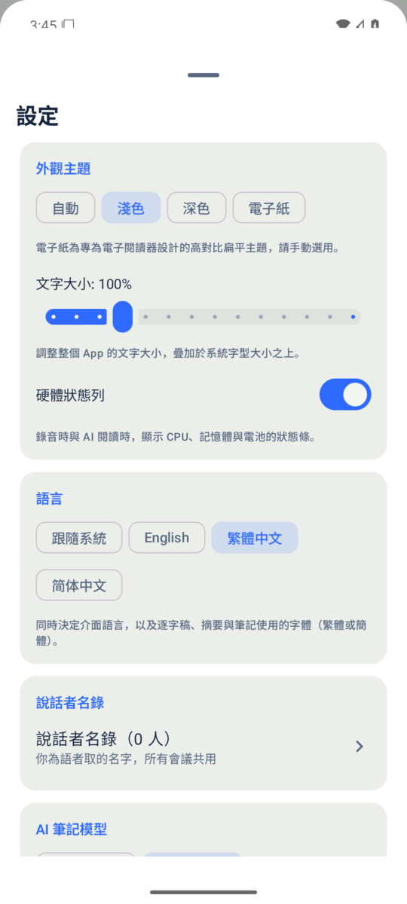 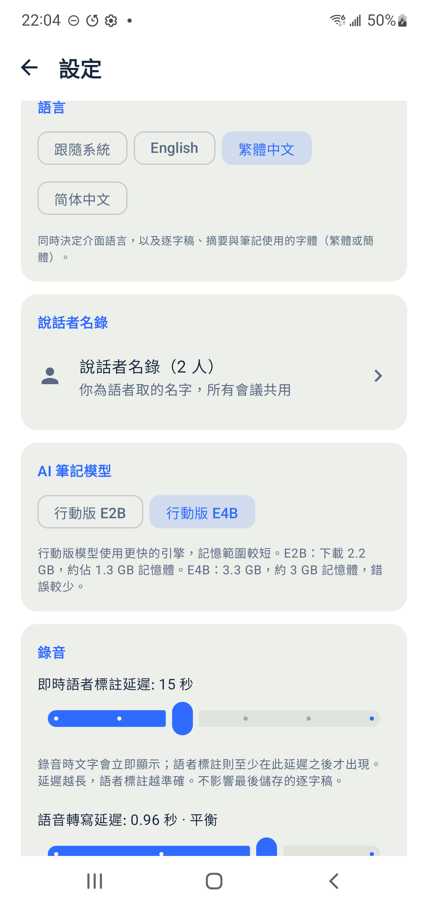

處理進行中時設定為唯讀。

| 節點 | 預期結果 | 驗證 |
|---|---|---|
| 外觀主題：自動／淺色／深色／電子紙 | 立即套用 | ✅ 自動（SettingsContentTest） |
| 文字大小（85–150%） | 整個 App 的文字（含對話框）立即放大或縮小，疊加於系統字型大小；重新開啟 App 後保留 | ✅ 手動 |
| 硬體狀態列 | 錄音時在錄音室標題列右側、處理時在會議畫面的狀態列右側顯示 CPU／記憶體／電池細條；數值過高時轉紅；預設開啟 | ✅ 手動 |
| 推論：執行緒滑桿（2 至全部核心）與「建議」 | 拖曳滑桿手動指定；「建議」測完 2 至全部核心的執行緒數，自動選用提升不再明顯的最少執行緒數並移動滑桿 | ✅ 手動 |
| 語言：跟隨系統／English／繁體中文／简体中文 | 介面與產生的文字一起切換 | ✅ 手動、✅ 自動（SettingsContentTest） |
| 即時語者標註延遲（5–30 秒） | 錄音時語者標籤出現的延遲；重新開啟 App 後保留 | ✅ 手動 |
| AI 筆記模型：行動版 E2B／行動版 E4B | 下次閱讀時使用所選模型（未下載時先下載）；E4B 只在 RAM 8 GB 以上的手機可選 | ✅ 手動（Note 10+：E2B、E4B） |
| 實驗功能：顯示行動項目 | 摘要下方出現行動項目卡片 | ✅ 手動 |
| 向會議提問（預設開啟） | 首頁搜尋框右側出現「提問」（第 1a 節）；需要 AI 筆記模型與搜尋模型 | ✅ 手動（Note 10+） |
| 儲存空間：下載搜尋模型／為舊會議建立索引 | 未下載時顯示「下載搜尋模型（約 160 MB）」；下載後顯示待建立索引的會議數與「為舊會議建立索引」，全部完成時顯示「所有會議都已建立搜尋索引。」 | ✅ 手動 |
| 儲存空間：模型與刪除 | 顯示用量；刪除前確認「刪除這個模型？」，刪除後下次使用時重新下載 | ✅ 手動 |
| 背景可靠性：允許背景執行 | 系統的電池最佳化例外對話框（長時間工作開始時也會先說明並詢問一次，見第 1 節） | ✅ 手動（Note 10+） |
| 關於：檢查更新、GitHub | 顯示「已是最新版本」或更新橫幅 | ✅ 手動（檢查更新）、✅ 自動（SettingsContentTest，版本號） |

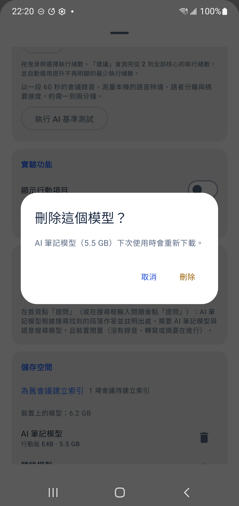

## 9a. 說話者名錄

<p>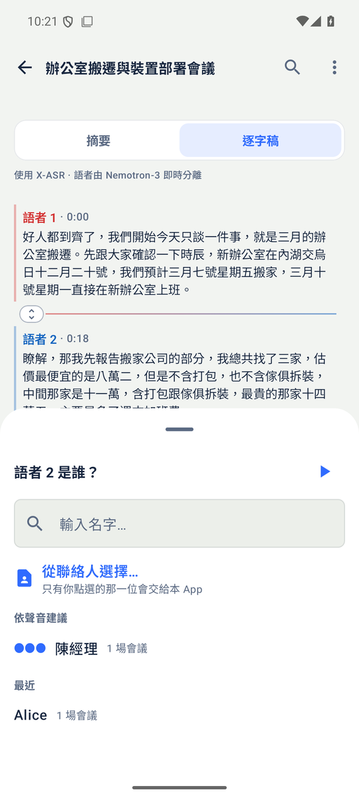 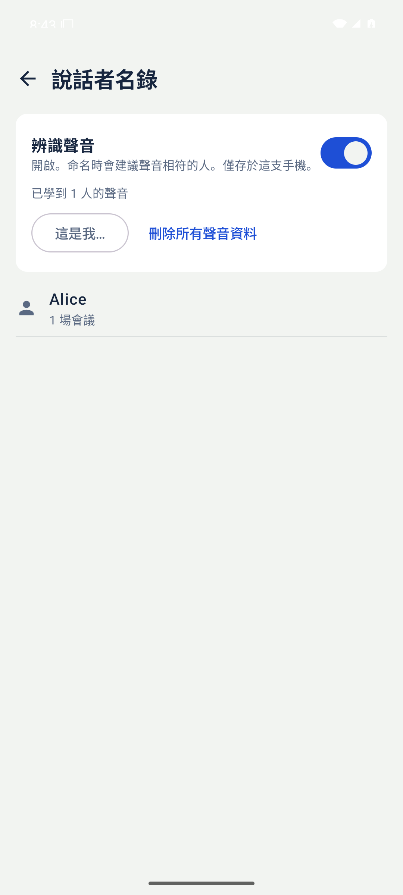 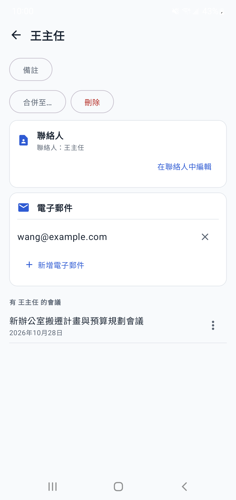 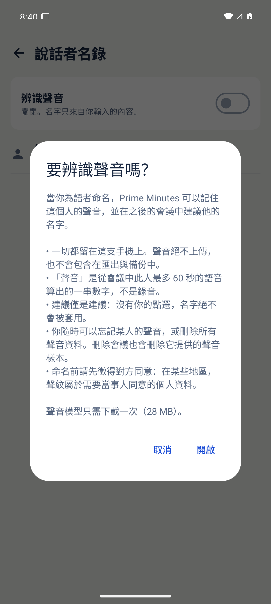</p>

設定 → 說話者名錄：你命名過的每個人，與他出現的會議。點逐字稿的語者名稱會開啟選人面板：依聲音建議（開啟辨識聲音時）、最近、全部，以及搜尋與「新增為新的人」、「清除名字」。名字跨會議共用：在人物頁全部改名，每場會議都跟著更新。

**辨識聲音**（選用，預設關閉）：開啟前先說明隱私（只在這支手機上，不上傳，不含於匯出與備份；「聲音」是最多 60 秒語音算出的一串數字；建議絕不自動套用；可忘記某人的聲音或刪除所有聲音資料；刪除會議也刪除它的聲音樣本；命名前請先徵得同意）。聲音模型（約 29 MB，Hugging Face `Luigi/primeminutes-speaker-litert` 版本 `8b7a1151`）開啟時下載一次並驗證 SHA-256。

| 節點 | 預期結果 | 驗證 |
|---|---|---|
| 選人面板 | 依聲音建議（●●● 很可能／●●○ 可能）、最近、全部；建議的人不在「最近／全部」重複 | ✅ 手動（模擬器：AMI 會議，Laura ●●●；辦公室搬遷示範會議，陳經理 ●●●） |
| 辨識聲音開關 | 先顯示說明，「開啟」後下載模型，再於背景為每場會議計算聲音；關閉時保留資料 | ✅ 手動（模擬器，HF 版本 8b7a1151，SHA-256 相符） |
| 這是我… | 朗讀約 20 秒，只保留聲音向量 | ⬜ |
| 刪除所有聲音資料 | 先確認；刪除所有聲音資料並關閉辨識；名字保留 | ✅ 手動（模擬器：確認後人物聲音與 21 場會議的聲音資料全部刪除、開關關閉、名字保留）、✅ 自動（單元測試：背景仍在計算的會議不會在刪除後寫回聲音資料）、✅ 手動（Note 10+：開啟辨識後背景正在比對聲音時刪除，101 秒後沒有任何 voices.bin） |
| 人物頁：聲音／忘記聲音 | 學自幾場會議；忘記後停止學習直到重新開啟 | ✅ 手動（模擬器：「從 2 場會議學習（120 秒）」→ 確認忘記 →「尚未學習」、開關關閉，只刪除此人的聲音，重開 App 後仍保留；名字保留） |
| 聽起來不像 X | 詢問「仍要學習」或「只保留名字」；名字一律保留 | ✅ 自動（單元測試） |
| 人物頁：全部改名、備註、合併、刪除、分出某場會議 | 改寫每場相關會議；以新的人命名後重開仍在 | ✅ 手動、✅ 自動（單元測試） |


## 9b. 聯絡人與寄給與會者

<p> 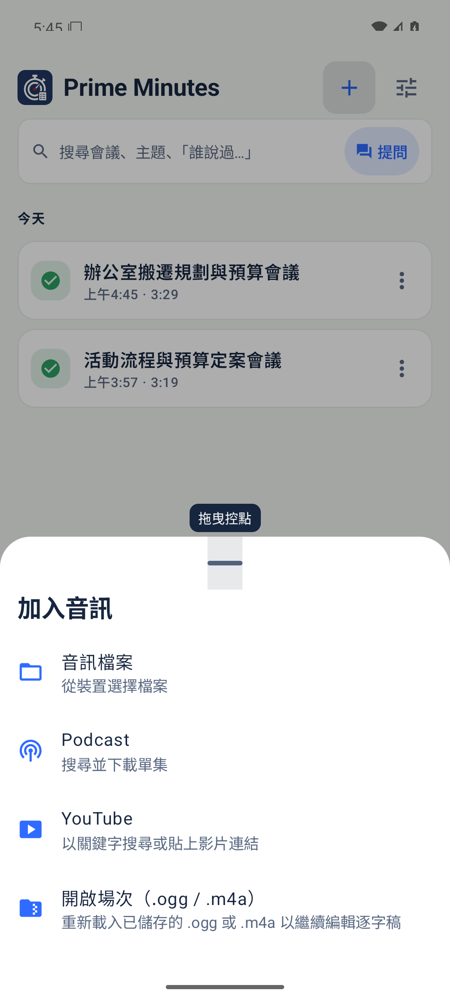</p>

人物頁的 **聯絡人** 卡片：**從聯絡人選擇…** 開啟系統聯絡人選擇器（不需要聯絡人權限；沒有電子郵件的聯絡人無法選），選擇後加入其電子郵件並記住連結；**從聯絡人更新**、**取消連結**（地址可保留或一併移除）。同一位聯絡人連到兩個人時，提示「是同一個人嗎？」並可合併。**電子郵件** 卡片：★ 為寄信時預設使用的地址，⋮ 可設為預設或移除，「新增電子郵件」可自行輸入。為語者命名時，選人面板也有「從聯絡人選擇…」，先確認在 App 中的名字（同名時詢問是否為同一人）。

會議選單 → **寄給與會者…**（語者卡片也有按鈕）：收件人預先勾選這場會議中有電子郵件的人，「我」不勾選；沒有地址的人可直接輸入（存入此人）；未命名的語者顯示「命名」；「新增其他收件人」只用於這封信，不存入名錄。內容：摘要、紀要、只要決議與待辦；附件：無、PDF、TXT、`.m4a`（超過 20 MB 時提醒）；郵件語言（只換範本文字，筆記不翻譯）；「預覽」顯示完整內文。**在郵件 App 中開啟** 只交給郵件 App（有多個時讓你選），沒有郵件 App 時改用分享選單並複製地址；**分享到其他 App…** 送出較短的聊天版本。App 不知道信是否送出，只記錄「上次分享」。

| 節點 | 預期結果 | 驗證 |
|---|---|---|
| 從聯絡人選擇（人物頁、選人面板） | 不需權限；選擇後加入地址與連結，名字不變 | ✅ 手動（Note10+，Samsung 聯絡人選擇器）、✅ 自動（單元測試） |
| 郵件內文 | 與設計範本逐位元相同（中文、英文、只要決議與待辦、mailto 長度上限、聊天版） | ✅ 自動（Android 與 iOS 共用的黃金檔） |
| 在郵件 App 中開啟 | 只開郵件 App，帶收件人、主旨、內文與附件 | ✅ 手動（Note10+ 開啟 Outlook；內容未在已登入的郵件 App 中確認） |
| 分享到其他 App | 系統分享選單，附件一併帶出 | ✅ 手動（Note10+） |
| 刪除某人 | 從各會議的上次分享紀錄移除 | ✅ 自動（單元測試） |
## 10. 中斷錄音的復原


錄音中 App 被系統終止時，下次開啟會詢問 **要復原中斷的錄音嗎？**

| 節點 | 預期結果 | 驗證 |
|---|---|---|
| 完成轉錄 | 處理已錄下的部分並存入場次庫 | ✅ 手動 |
| 捨棄 | 刪除這段錄音 | ✅ 手動 |

---

### 尚未驗證（⬜）的節點

更新橫幅（需要有更新的版本才會出現）；提問時裝置忙碌。部分確認：未連 Wi‑Fi 時的「僅限 Wi‑Fi」；YouTube 下載中斷線後的暫停（Podcast 已確認）。

### 如何重跑自動測試

```bash
scripts/test-on-device.sh <實機序號> -- -e class studio.primeminutes.AddSourceSheetTest,studio.primeminutes.SourceSheetsTest,studio.primeminutes.UiComponentsTest,studio.primeminutes.SettingsContentTest,studio.primeminutes.ExportSheetTest,studio.primeminutes.TranscriptUiTest,studio.primeminutes.TranscriptFlowTest
```

Compose 介面測試需在實機上執行（x86_64 模擬器上會出現 “Unable to resolve activity”，見腳本開頭說明）。
