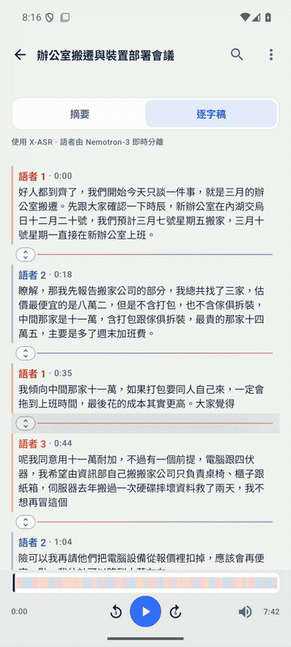
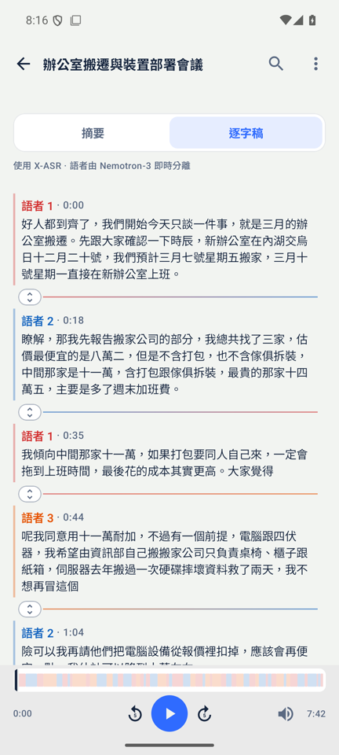
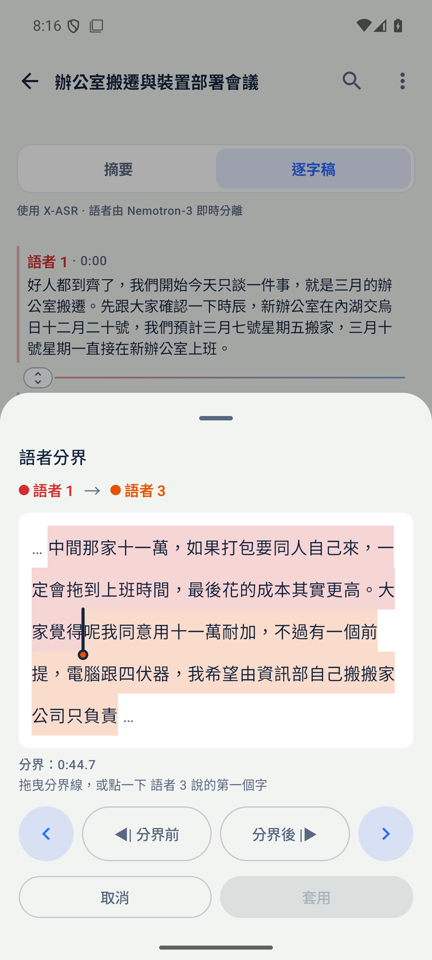
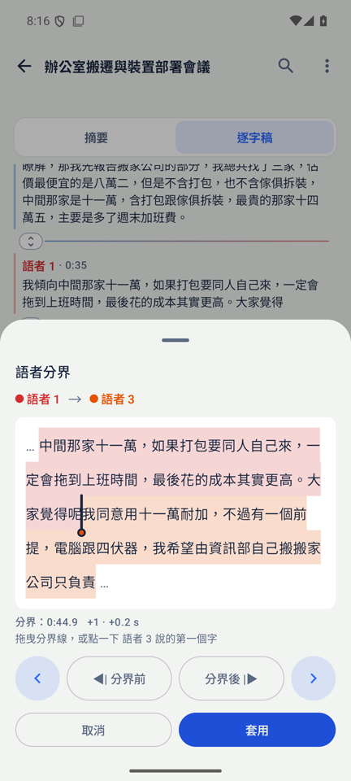
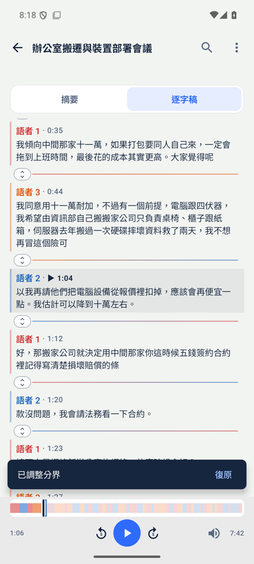
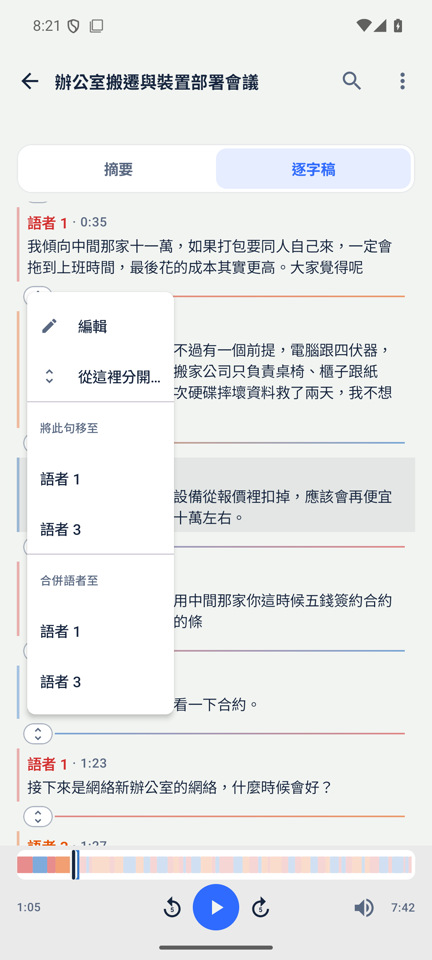
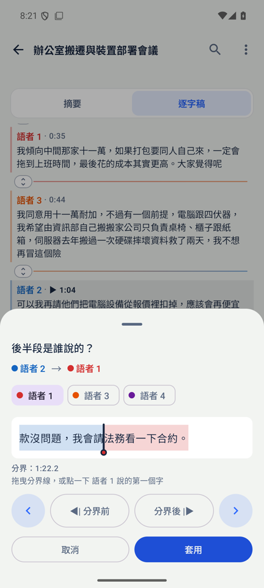

# Adjusting the boundary between two speakers

Status: design and Android prototype, branch `boundary-ux`, 2026-10-17. Nothing ships until the user approves.

*Emulator, office-move demo meeting (`docs/demo/move-meeting-zhTW.m4a`), 繁體中文 UI. Clip 1: drag the marker so that 呢 goes back to 語者 1 (「大家覺得呢」) and apply. Clip 2: tap ‹ once so that 險 goes back to 語者 3 (「冒這個險」) and apply. Both errors are real errors made by the engine on this meeting.*

## 1. How big are the errors?

### Method

`tools/quality-eval/score_boundaries.py` (new) scores the app's transcripts from the October quality-eval harness (`work/out/<name>.asr.json`, the shipped engine) against the reference files:

- 4 AMI meetings (EN, word times from `words.xml`, 2.5 h);
- 6 AISHELL-4 meetings (ZH, TextGrid segments, 3.8 h).

1. Align the tokens (EN words, ZH characters).
2. Map transcript speakers to reference speakers with the Hungarian algorithm.
3. For every reference speaker change A→B where both turns have at least 3 tokens, compare the split the transcript makes with the reference split.

Offsets are counted in reference tokens:

- `+` = late: B's first words are left on A's line.
- `−` = early: A's last words are given to B.

A change is "overlap" when the two reference turns overlap in time.

### Results

When the transcript does contain the change (*detected*):

| | EN all | EN overlap | EN clean | ZH all | ZH overlap | ZH clean |
|---|---:|---:|---:|---:|---:|---:|
| changes scored | 263 | 82 | 181 | 295 | 44 | 251 |
| detected | 202 (77 %) | 56 (68 %) | 146 (81 %) | 188 (64 %) | 24 (55 %) | 164 (65 %) |
| exact (0 token) | 40 % | **11 %** | 51 % | 33 % | 29 % | 34 % |
| within 2 tokens | 80 % | 59 % | 88 % | 81 % | 67 % | 83 % |
| within 5 tokens | 96 % | 96 % | 96 % | 91 % | 88 % | 92 % |
| > 10 tokens | 1.5 % | 0 % | 2.1 % | 2.1 % | 0 % | 2.4 % |
| median / p90 (tokens) | 1 / 4 | 2 / 4 | 0 / 3 | 1 / 5 | 2 / 6 | 1 / 5 |
| late / early | 46 % / 15 % | **73 % / 16 %** | 35 % / 14 % | 34 % / 33 % | 58 % / 13 % | 31 % / 36 % |
| median / p90 offset (s) | 0.20 / 1.9 | 0.56 / 1.3 | 0.0 / 2.0 | 0.36 / 3.0 | 0.36 / 1.1 | 0.36 / 3.5 |

Changes the transcript misses entirely:

- EN: 61 (23 %), the B turn's median length is 7 words. In 37 of the 61, A's whole short turn was absorbed into B's line.
- ZH: 107 (36 %), median 11 characters.

Rate per hour of meeting:

- EN: about 49 boundaries off and 25 changes missed.
- ZH: about 33 boundaries off and 28 changes missed.

These counts only include changes between turns of at least 3 tokens. Back-channels add more.

### Caveats

- AISHELL-4 has no character times. They are spread evenly over each segment, so the ZH figures in seconds are approximate.
- AMI words of two speakers interleave during overlap, so short overlapped turns are partly excluded by the ≥ 3-token rule.

### What this means for the design

1. The fix is moving a few tokens of text, not editing time. 80 % of the offsets are within 2 tokens and 91–96 % within 5. A word or character picker covers the problem. A waveform editor is not needed.
2. In overlap the error is directional: 73 % (EN) and 58 % (ZH) are late. The speaker who interrupts keeps losing their first 1–3 words to the previous speaker. By default the marker should therefore be easy to move earlier.
3. The other large class is the missed change: a short reply is swallowed by a neighbour's line (23 % EN, 36 % ZH). This needs a "split here and give the rest to…" action. It reuses the same token picker.
4. An assisted marker helps on clean changes, but not in overlap. As a test, the suggested split was set to the start of the diarizer's own B turn nearest to the transcript's split (`work/turns/*.turns.json`, ±3 s):

   | | transcript exact → suggestion exact | suggestion better / worse |
   |---|---|---|
   | EN clean | 51 % → **74 %** | 31 % / 16 % |
   | ZH clean | 38 % → **65 %** | 43 % / 18 % |
   | EN overlap | 11 % → 20 % | 39 % / 34 % |
   | ZH overlap | 30 % → 0 % | 26 % / 65 % |

   Note that those turns come from a separate host run (`nemo_eval_noggml`) of the same engine and geometry, not from the same run as the transcripts.

5. **What the engine snap actually achieved (implemented, `Fusion::snap_to_turn_starts`).** The numbers in point 4 were measured with reference token times. In the engine only the hypothesis character times exist, so the gain is smaller. Each non-overlapped change moves to the first word starting at least 0.30 s after B's padded turn start, under these rules: it never crosses a pause of 0.5 s or more that the text already put it at, it never moves by more than 0.4 s, and it never moves only spaces or punctuation. Before → after, measured on the 10 meetings by replaying the final pass:

   | | exact (clean) | exact (all) | ER | cpER | DER (transcript, collar 0.25) |
   |---|---|---|---|---|---|
   | EN | 53 % → **59 %** | 44 % → 49 % | 18.67 → 18.67 | 26.77 → 26.61 | 27.74 → 27.73 |
   | ZH | 36 % → 37 % | 36 % → 36 % | 18.45 → 18.45 | 39.17 → 39.17 | 21.79 → 21.79 |

   Without the 0.4 s cap the exact rate rose further (EN 65 %, ZH 46 %). But only 56 % of the moved tokens went to the right speaker, so EN cpER rose by 0.15 and DER by 0.3 to 0.7, and the cap was kept. Moving a boundary across a pause stretched a line over the silence; that was the DER cost of the first version. `NEMO_TURN_SNAP=0` turns the snap off.

6. **Aiming the snap at the silence, not at the turn's padding (`DiarHost::energy_min`, `Fusion::refine_target_to_energy`).** A clean speaker change is a silence, and the diarizer's own mel frontend (10 ms frames, the one its encoder eats, `diar_host.cc`) already measures where that silence is: `log(sum of mel powers)` per 10 ms, silence floor about −11.8. Inside the same ±0.4 s the snap may move, the deepest dip of that curve replaces the padded-turn-start + 0.30 s target — but only when it is deeper by `turn_energy_dip` log units than the dip around the shipped target, so a change the turn start already puts in silence stays where it is, and ties go to the turn start. A dip beyond a pause of 0.5 s is not the change (the move cap and the pause guard of point 5 apply, and the energy move adds its own check that it crosses no pause).

   Measured on the same 10 meetings (`tools/nemo-eval` on the gain-normalized clips of the October harness, 480 ms graph, offset 300 ms, `--max-seg 10`; the same run with `NEMO_ENERGY_SNAP=0` reproduces the shipped transcripts byte for byte). Exact on clean changes, before → after, for three margins of "sharper":

   | margin (log units) | EN clean | ZH clean | EN overlap | ZH overlap | EN cpER | ZH DER (transcript, 0.25) |
   |---|---|---|---|---|---|---|
   | 1.0 | 52.1 → 55.2 % | 33.8 → 35.0 % | 34.5 → 34.5 % | 34.8 → 34.8 % | 23.44 → 23.46 | 21.18 → 21.19 |
   | **0.3 (shipped)** | 52.1 → **58.6 %** | 33.8 → 34.4 % | 34.5 → 35.2 % | 34.8 → 34.8 % | 23.44 → 23.53 | 21.18 → 21.19 |
   | 0.001 | 52.1 → 60.0 % | 33.8 → 36.3 % | 34.5 → 37.0 % | 34.8 → **30.4 %** | 23.44 → 23.48 | 21.18 → 21.19 |

   Median / p90 offset seconds do not move: EN clean 0.0 / 1.70 s, ZH clean 0.28 / 2.95 s at every margin; missed changes 35 (EN) and 94 (ZH); ER 18.18 (EN) / 17.82 (ZH) unchanged, transcript DER +0.02 at every margin. The permissive margin is not shipped because of one column: it drags one ZH overlapped change the wrong way (34.8 → 30.4 % of 23 changes), and the DER cost of dragging a line across a silence is the known failure of the first snap version.

   Per reference change at the shipped margin: of the 145 detected EN clean changes, 10 became exact and 1 left exact; of the 157 ZH, 2 became exact, 1 moved closer, 1 left exact. A re-split change moves by a median 0.2 s (max 1.0 s); 123 of 1844 transcript lines change speaker at the 1.0 margin, 307 at the permissive one. The margin is what limits the gain: in a 15-minute AMI excerpt the snap finds 14 clean changes the energy curve is asked about and takes 4 of them at the 1.0 margin, 7 at the permissive one - the rest have no deeper dip inside ±0.4 s, which is the point (a turn start already sitting in silence is not going to be improved by moving).

## 2. Current state (both platforms)

### Data model

| | Android | iOS |
|---|---|---|
| Line type | `TranscriptEvent.Utterance(index, text, startSec, endSec, speaker, tokens?, tokenTimes?)` | `Utterance(speaker, start, end, text)` |
| Stored in | the `PRIMEMINUTES` tag of `session.m4a` (`PrimeMinutesSession.encodeSession`, keys `tokens` / `token_times` already exist) | `sessions/<uuid>.json` |
| Per-token times | none in practice: `NemoStreamEngine.parseSegments` never fills them, and `LongUtteranceSplitter` nulls them | none |

On both platforms the native engine has per-token times and per-token speakers (`Engine::token_table()`, built with `NEMO_HAVE_TOKEN_TIMES`) and the diarizer turns (`Engine::turns()`). The JNI and C bridges only send `speaker␟start␟end␟text` per segment, so this data is lost at the boundary.

### Existing edits

| Edit | Android | iOS |
|---|---|---|
| Rename speaker | yes | yes |
| Move a whole line to another speaker | yes, undoable | yes, undoable |
| Merge a speaker into another | yes, undoable | yes, undoable |
| Edit text | yes, no undo | yes, no undo |
| Split or merge lines, edit times | no | no |

Undo is a snackbar (Android) or banner (iOS) holding the single previous state, valid only while nothing else changed.

### Playback

Tapping a line seeks to its start. The playing line gets a wash. There is no word highlight.

### Propagation

Everything reads the current lines at use time:

- speaker stats, timeline, search, Ask (by utterance index ranges);
- exports (SRT, VTT, LRC, TXT, MD, PDF);
- the embedded m4a.

The search index is rebuilt when its fingerprint changes (text, speaker and start of every line). Notes and the summary are not recomputed. A text edit offers "Re-summarize"; speaker edits do not.

## 3. Concepts compared

**A. Seam handle + token-strip sheet** (recommended)

A slim ⇕ grip sits on the gap between two lines of different speakers. Tapping it opens a bottom sheet:

- the end of A and the start of B form one strip of tokens, each washed in its speaker's colour;
- a marker sits between two tokens; the user drags it, taps the first word B says, or steps with ‹ ›;
- "Before" / "After" play 2 s up to or from the marker, and every move auto-plays B's first words.

| Pros | Cons |
|---|---|
| Matches the error: a few tokens at a known place | One more element per speaker change (about 8 dp; it reuses the turn gap) |
| Works the same for 字 and words | A sheet covers half the transcript |
| One-handed: all controls are at the bottom, 52 dp targets | |
| Discoverable: the affordance only appears where an error can be | |
| Simple to port to SwiftUI | |

**B. Tap a word in the transcript → "B starts here" / "move to previous speaker"**

The action works directly in the transcript, with a word-level hit test on every line.

| Pros | Cons |
|---|---|
| No sheet | Collides with tap-to-seek and long-press, which are already taken |
| | Selecting one Han character in running text is fiddly |
| | Gives no audio preview before committing |
| | Nothing shows where boundaries can be adjusted |

**C. Waveform / timeline editor**

Speaker lanes on a zoomable waveform, with draggable time boundaries and overlap shown as stacked lanes.

| Pros | Cons |
|---|---|
| The only concept that can express overlap and silence precisely | Edits time while the user thinks in words |
| | The data says the problem is 1–5 tokens |
| | Needs waveform decoding |
| | Hard to use one-handed on a phone; heavy to build twice |

**Recommendation:** A, with B's best idea folded in. Inside the sheet, a tap on a token means "B starts here". Missed turns get the same sheet from the line menu (*Split line here…*) with speaker chips: the neighbouring speakers first, then the others, then a new speaker. C is left out.

## 4. Recommended UX (prototype on Android)

| Seams on a finished transcript | Sheet: marker between 得 and 呢 | After a drag (+1 · +0.2 s) |
|---|---|---|
|  |  |  |

| Applied, with an Undo snackbar | Line menu: *Split line here…* | Split: who says the rest? |
|---|---|---|
|  |  |  |

### Seam

- Shown only between consecutive lines of different speakers, and only when the transcript is not running. During live capture lines still move.
- A hairline fades from A's colour to B's, with a 28 dp tall clickable row and a ⇕ grip.
- TalkBack: "Adjust where 語者 1 stops and 語者 3 starts".

### Sheet

- The strip shows up to 40 tokens on each side, which covers more than 99 % of offsets.
- Gestures on the strip:
  - tap = this token is B's first;
  - drag = nearest gap, with a haptic tick on each token.
- ‹ › step one token. The marker is a bar with a knob, like a text-selection handle.
- The readout shows the boundary time to 0.1 s and the delta in tokens and seconds.
- Hint text: "Drag the marker, or tap the first word 語者 3 says".
- Audio:
  - "Before" plays [t − 2 s, t];
  - "After" plays [t, t + 2 s];
  - every move auto-plays [t, t + 1.8 s] after 450 ms of rest, so the user hears whether B's first word is really B's.
- TalkBack: the strip is one element with the custom actions "One word earlier" and "One word later", and a state that names the token after the marker.
- Apply is disabled until something changes. Cancel or swipe down discards.

### Split

- The line menu has *Split line here…*.
- The same sheet opens on one line, titled 「後半段是誰說的？」, with speaker chips. The default is the other speaker of the neighbouring lines. "語者 N+1" creates a new speaker.

### Undo

- The existing speaker-edit snackbar ("Boundary moved / Undo"), restoring the exact previous lines.
- Gap seen in testing: the snackbar is gone after about 4 s, which is too short when the user wants to listen again. The plan is a small session-level undo stack: Undo/Redo in the top bar while the session is open, covering speaker, boundary, split and text edits.

### Assisted mode (phase 2)

A hollow "suggested" marker in the strip at the start of the diarizer's B turn. It is shown only when that differs from the current split and the two turns do not overlap; in overlap the suggestion was worse (see §1). It also adds a one-tap "Use suggestion" chip.

### Not in scope

- Marking a span as spoken by both speakers: the transcript model is one speaker per line. Overlapped speech stays assigned to one side. See open question 3.
- Word-level karaoke highlighting.

## 5. Data model changes

1. **Per-token times and speakers from the engine** (both platforms). Extend the native bridge with an optional token record per segment (token text, start time) and keep it in `Utterance.tokens` / `tokenTimes` (Android: already in the format, keys `tokens` / `token_times`; iOS: add `tokens` / `tokenTimes` to `Utterance` and its CodingKeys).
   - Size: about 8 bytes per token gzip'd; about 60 KB for an hour of zh.
   - The prototype does not need this: without real times it spreads time over the line by character count, as `LongUtteranceSplitter` does. After an edit it writes back the per-token times it used, so repeated nudges stay consistent.
   - `LongUtteranceSplitter` must split `tokens` / `tokenTimes` with the text instead of dropping them.
2. **Tokenization** (`BoundaryEdits.tokenize`, to port 1:1 to Swift):
   - one Han character, or one Latin word, is a token;
   - trailing punctuation and spaces attach to the previous token;
   - it is lossless.

   Joining across the seam adds a space only between two Latin words.
3. **Diarizer turns** for the assisted mode: `[[speaker, start, end], …]` at session level, optional, written at `finish()`. Not needed for phase 1.
4. **No format version bump.** All fields are optional; old readers ignore them.

## 6. Propagation rules

| What | After a boundary move / split |
|---|---|
| Line texts, `startSec`/`endSec` | A.end = B.start = time of B's first token (estimated if needed). Speakers and the other lines are untouched. |
| Line indices | A move keeps all indices. A split renumbers after the split point (`index` = position), like a fresh transcript. |
| Speaker stats, timeline, search hits, exports (SRT/VTT/LRC/TXT/MD/PDF), m4a tag | Read live, nothing to do. Persisted on pause (`persistEdits`); verified on the emulator: a move survives a force-stop. |
| Search / Ask index (`index.bin`) | The fingerprint covers text, speaker and start, so it is rebuilt by `LibraryIndexer` after persist; unchanged chunks reuse their vectors. Until then Ask's index ranges can be one line off after a split: acceptable, same as today's text edits. |
| AI notes (time anchors `[m:ss]`) | Unchanged: they point at times, and the audio did not move. |
| Summary, title, actions | Not recomputed and no "Re-summarize" prompt. Like speaker relabels, a boundary move changes who said a few words, not what was said. To be confirmed: open question 4. |
| Speaker names (`speakerNames`) | Unchanged. A split onto a new speaker id gets the default label. Coordinate with the speaker-directory design (another topic): the split sheet's speaker chips should use that list once it exists. |

## 7. Edge cases

- **A or B would become empty.** The marker is clamped to keep at least one token on each side. Moving a whole line is the existing "Move line to…".
- **Seam inside a same-speaker run.** No seam is shown; a split is used instead.
- **Two lines of the same speaker after a split.** They are allowed; they read as one turn, as today.
- **Lines that overlapped or had a gap in time.** After a move both ends meet at B's first token. The gap or overlap is lost on that seam only. This is acceptable because the audio is unchanged and seeking still works.
- **Mixed zh/en text** ("我用 iPhone 錄音"): handled by the tokenizer. Unit test: `BoundaryEditsTest`.
- **Live / queue processing.** No seams while `running`. Edits during a re-summarize run go through the same `sessionGen` / undo guard as speaker edits.
- **Search open.** Seams stay. The highlight follows the new text.
- **E-ink theme.** The washes use alpha; check contrast on e-ink before shipping.
- **Similar speaker colours** (語者 1 red vs 語者 3 orange in the demo): the marker, not the wash, carries the boundary. Consider a thin underline in B's colour as a second cue.

## 8. Implementation plan

The prototype on `boundary-ux` already contains these files.

New:
- `data/BoundaryEdits.kt`: tokenize, token times, move, split (pure).
- `ui/BoundaryEditor.kt`: seam + sheet.
- `BoundaryEditsTest`.
- `tools/quality-eval/score_boundaries.py`.

Edited:
- `SessionReducer` / `SessionViewModel`: `moveBoundary`, `splitLine`, both undoable through `OfferSpeakerUndo`.
- `MainActivity`: seam item, sheets, preview player, DEV extras `--ei vox_boundary N` / `--ei vox_split N`.
- `SessionComponents`: the *Split line here…* menu item, `topPadding`.
- Strings: EN, zh-TW, zh-CN.

| Step | Android | iOS | Effort |
|---|---|---|---|
| 1. Harden the prototype: undo stack in the top bar; marker contrast; e-ink; TalkBack/VoiceOver pass; landscape; pause preview on sheet close | yes | — | 1–1.5 d |
| 2. SwiftUI port: `BoundaryEdits.swift` (same tests), seam row in `transcriptTab`, `.sheet` with the token strip (a `Text` layout via `TextKit`/`Layout`, or a wrapping `HStack` of token views), AVAudioPlayer preview, undo through the existing `SpeakerUndo` | — | yes | 2–2.5 d (plus one 14 Pro Max cycle) |
| 3. Engine token times over JNI / C bridge, persisted; `LongUtteranceSplitter` keeps them | yes | yes | 1–1.5 d (native + both parsers + parity test) |
| 4. Assisted marker from diarizer turns (export turns, suggestion only on non-overlapping changes, "Use suggestion" chip) | yes | yes | 1 d |
| 5. Guide and README media refresh, release | yes | yes | 0.5 d |

Total: about 6–7 days for both platforms. Steps 1–2 alone give the full feature with estimated times.

**Not verified:**
- the audio of the preview: the emulator was run with `-no-audio`, but the seek and pause logic was seen moving the playhead;
- the Note10+;
- iOS: no prototype was built.

## 9. Open questions for the user

1. Seams always visible on finished transcripts (prototype), or only after an "Edit speakers" toggle?
2. Is auto-play on every marker move wanted, or only on the Before/After buttons?
3. Overlap: is "one speaker per line" fine, or should a span be markable as "both speaking" (needs a model change and display rules)?
4. After a boundary move or split, offer "Re-summarize" like text edits, or stay silent like speaker relabels?
5. Phase 2: also fix the root cause in the engine, by placing the change at the diarizer's B-turn start on non-overlapping changes? That moved exact boundaries from 51 % to 74 % (EN) and from 38 % to 65 % (ZH) in the test above, before any user edit. *Decided: yes. See §1, point 5, for what it achieved with real character times.*
