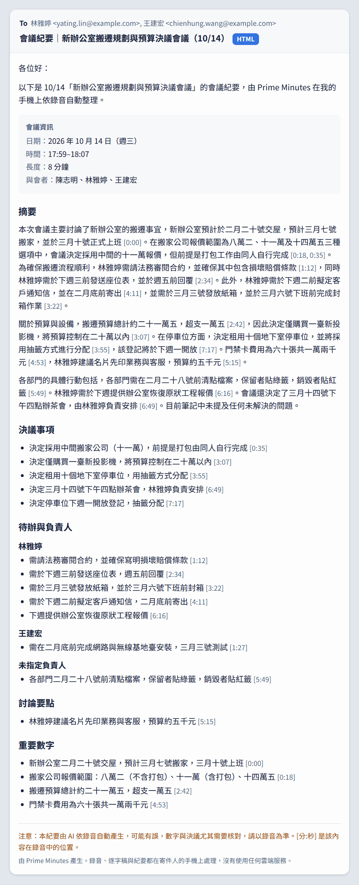
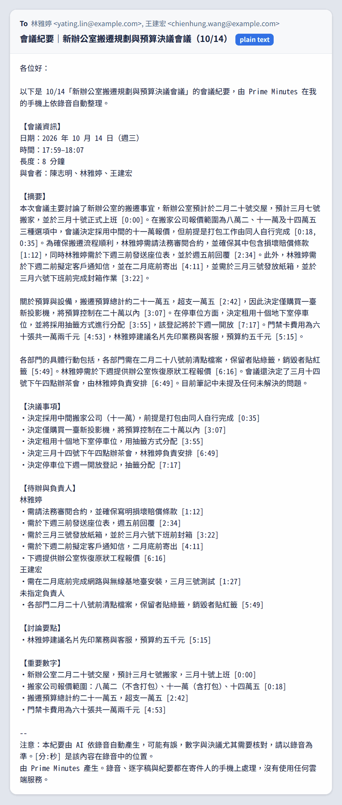
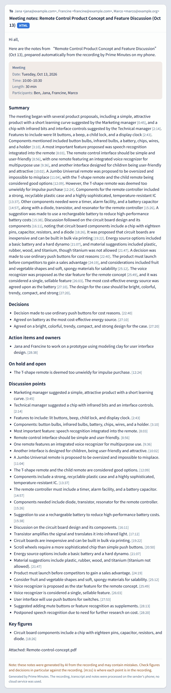
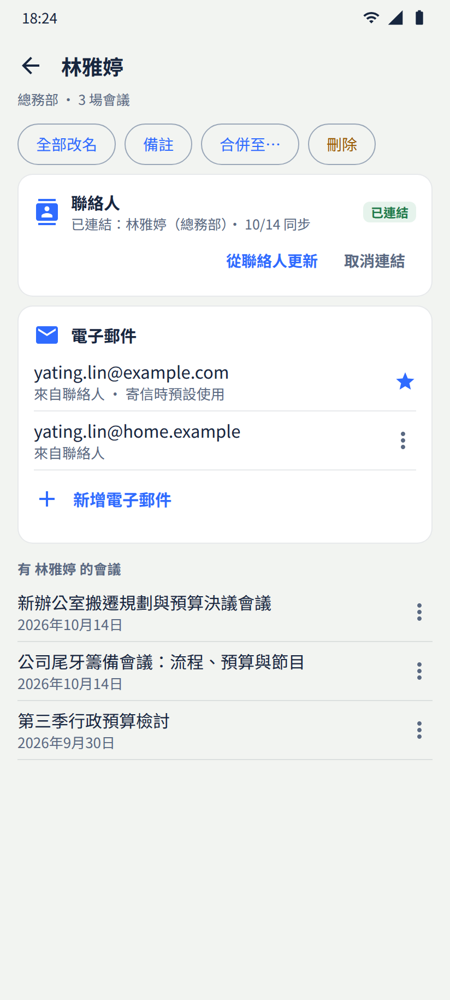
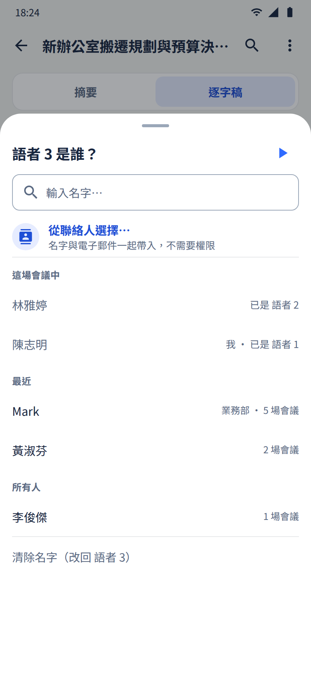
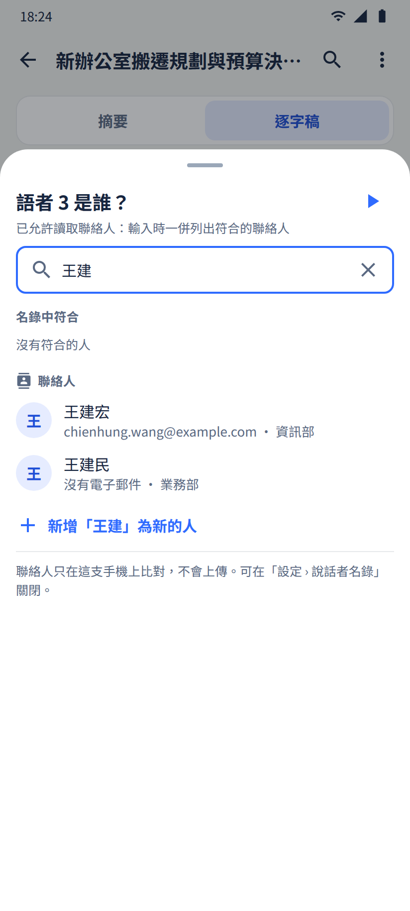
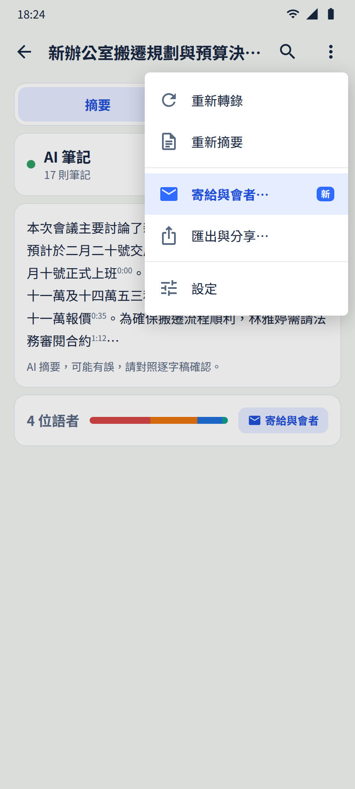
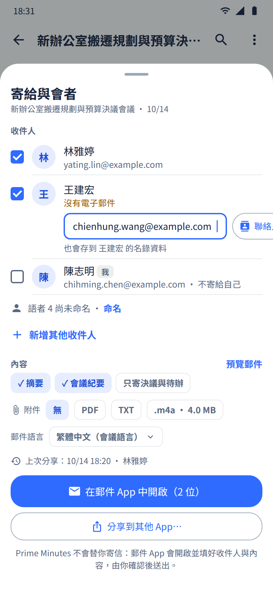
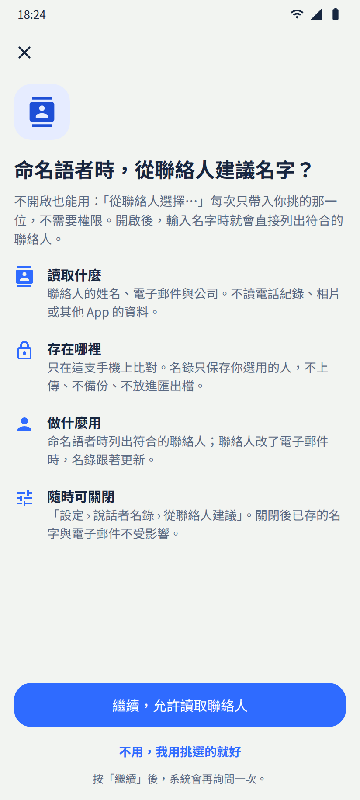
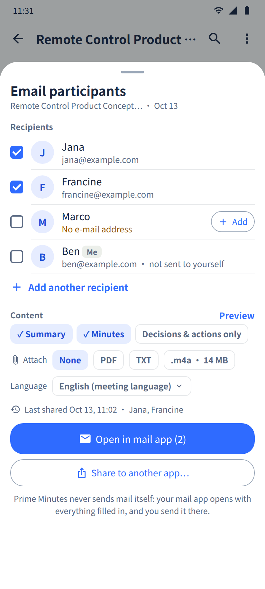

# Design: people as contacts, and sending a meeting to its participants

Status: proposal, 2026-10-17. Nothing here is implemented. Android + iOS (same behaviour on both).
It builds on the people directory ([`speaker-tags.md`](https://github.com/vieenrose/PrimeMinutes/blob/speaker-tags-design/docs/design/speaker-tags.md),
Phase 1 on `android` since `4679eb0c` / `786430fb`; iOS port in progress).

User requests:
- "Can my speaker directory also come from phone contacts if the user has authorised its access?"
- "For each person in the speaker directory, can we have something like a contact db with an e-mail
  address, so that later we can share the meeting session with all speakers by e-mail in one click on
  the phone?"
- "Please dedicate a topic to design the speaker as a contact, later to send the meeting session to."
- Added: design the e-mail content template, with rendered samples; and test whether the on-device
  reader model can write the e-mail itself (template vs LLM vs hybrid), with data.

Files of this design:

| | |
|---|---|
| Mockups (PNG + HTML source) | [`speaker-contacts/mockups/`](speaker-contacts/mockups/) (`make_mockups.py` regenerates them) |
| E-mail templates + fixed text | [`speaker-contacts/mail/`](speaker-contacts/mail/) (`meeting_mail.txt`, `meeting_mail.html`, `chat.txt`, `strings.json`) |
| Rendered e-mail samples | [`speaker-contacts/samples/out/`](speaker-contacts/samples/out/) (`render_samples.py`: executable spec of the template, from real reader outputs) |
| LLM e-mail experiment | [`tools/email-eval/`](../../tools/email-eval/) (prompts, host harness `EmailEvalHarness`, scoring, results) |

## 0. Summary

1. **A person gets a contact side: e-mail addresses and an optional link to an address-book entry.**
   Nothing else is stored. Phone numbers, photos and addresses do not serve the share use case
   (§2.1).
2. **No contacts permission by default.** "Choose from contacts…" opens the system picker, which
   needs no permission on either platform and hands over only the one person the user taps, with
   their name and e-mail (Android `ACTION_PICK` on e-mail data / Android 17 contact picker, iOS
   `CNContactPickerViewController`). Full access (autocomplete while typing a name, automatic
   updates when a contact changes) is an **optional later phase**, off by default, behind an
   explanation screen (§3).
3. **"Email participants" on the meeting screen.** It opens a sheet with the meeting's linked people
   pre-checked (Me unchecked), lets the user add a missing address inline, choose the content, and
   then opens **the user's own mail app** with recipients, subject, body and optional attachments
   filled in. The user sends from there. **The app never sends mail and never talks to a server**
   (§4).
4. **The e-mail is built from a deterministic template**: greeting, a line saying what this is,
   meeting facts (date, time, length, participants by name), the existing prose summary, the minutes
   by section with `[m:ss]` times (actions grouped by owner when the notes name one), a
   "machine-generated, check the recording" note, and a footer. Plain text always; HTML where the
   mail app takes it (iOS Mail). Language = the meeting's language. Templates and fixed text live in
   shared resource files, the renderer is pure code with golden tests on both platforms (§5).
5. **LLM-written e-mail: measured, see §6.** Six prompt variants x 2 models (E2B, E4B) x 12 meetings (zh + en), blind-judged statement by statement against the notes. The deterministic template is 0 % contradicted (378 statements); the shipped prose is 5-6 %; letting the model write the mail (free, sections) is 20-28 % on E4B, almost all proposal->decision flips; a short "typed" lead reaches 2-4 %. **Recommendation: the mail is the deterministic template + the existing prose summary; no model-written mail text in v1.** A typed lead is an optional later Phase D, off by default.
6. **Privacy**: addresses and contact links live only in `people.json` on the phone, already
   excluded from backups. They never go into exports, the `.m4a` session file, search, Ask or any
   prompt. Deleting a person deletes their addresses everywhere in the app (§7).
7. **Effort**: Phase A (contacts + addresses, picker only) ≈ 4 dev-days; Phase B (Email participants
   + template + share history) ≈ 7–8 dev-days; Phase C (optional full contacts access) ≈ 3 dev-days;
   Phase D (model-written lead paragraph) ≈ 1.5 dev-days if chosen (§9).

## 1. What exists today

| | Android (`app/src/main/java/studio/primeminutes/`) | iOS (`ios/App/`) |
|---|---|---|
| People directory | `core/people/People.kt`, `PeopleStore.kt`: `filesDir/people/people.json`, per meeting `library/<id>/speakers.json` (speaker → person). `Person(id, name, note, aliases, created, lastUsed, voiceEnabled, me, extra)`. **`extra` keeps unknown keys on write-back** (`786430fb`), so a newer app can add `emails` / `contact` without an older one dropping them. `PeopleStore.peopleOf(context, entryDir)` gives a meeting's speaker → person. | `People.swift`, `PeopleStore.swift`, `PeopleViews.swift` in the `speaker-dir-ios` worktree (not pushed yet). Must keep unknown person keys too (see §7.5). |
| Rename sheet | `ui/PersonPicker.kt` (`PersonPickerSheet`, `SpeakerNameFlow`): search, in this meeting, recent, all, "add new", "clear name" | being ported |
| People screen | `ui/PeopleScreen.kt`: rename everywhere, note, merge, delete, meetings of a person, split | being ported |
| Export / share | `ui/ExportSheet.kt` groups the formats: session `.m4a`, document PDF / MD / TXT (title, summary, notes, transcript), subtitles SRT / VTT / LRC, copy transcript. `MainActivity.shareExport` writes the file to `cache/share_export/` and fires `ACTION_SEND` + `EXTRA_STREAM` (FileProvider) + `EXTRA_SUBJECT` through a chooser. **No recipients anywhere.** | `Export.swift` (`text(_:_:)`, `file(_:_:)`), `SessionView.swift`: `ShareLink` of the plain transcript, `ExportSheet` → `UIActivityViewController`. No `MessageUI`, no recipients. |
| Exporters | `core/export/TranscriptExport.kt` (plain text, Markdown, SRT, VTT, LRC), `PdfExport.kt` (A4, CJK fonts), `exportExtras` adds the notes sections | same set in `Export.swift` |
| Permissions | no contacts permission; no `<queries>` element | no `NSContactsUsageDescription`; `PrivacyInfo.xcprivacy`: no collected data types, no tracking |
| Backups | `backup_rules.xml` excludes the whole `file` domain (cloud + device transfer) | app data `isExcludedFromBackup` (`App.swift`) |
| Privacy statement | README: "完全離線、無帳號：音訊不離開手機"; F-Droid description: "no account, no server, no cloud" | privacy manifest comment: "Nothing is tracked or collected" |

What the reader produces for a meeting, and what the e-mail can reuse:
- **title** (≤ 20 characters zh / 10 words en);
- **prose summary** (`ReaderLane.prose`: notes → paragraphs, every sentence ending in a `[m:ss]` that
  is checked against the notes; judged 8–12 % contradicted against the notes upstream);
- **minutes** assembled deterministically from the typed notes, in the card's sections for the
  meeting language: 決議事項 / 待辦與負責人 / 保留與未決 / 討論要點 / 重要數字 (en: Decisions / Action items
  and owners / On hold and open / Discussion points / Key figures), each item `text [m:ss]`;
- speaker references `S2` in all of them, resolved to names at display/export time (`SpeakerRefs`).

The upstream integration note (meeting-summarizer `docs/voxsumdroid-integration.md` §7 "What the UI
should say") measures about one statement in five contradicted by the *transcript*, mostly relational
errors, with key figures (~22 %) and decisions (~19 %) the most error-prone. Anything sent to other
people must say so.

## 2. A person as a contact

### 2.1 Fields: only what the share needs

| Field | Kept? | Why |
|---|---|---|
| Display name | **existing** `name` | Shown in transcripts, summaries, mails. **Never overwritten** by the contact's name: the person was named for the meeting ("Mark"), the contact may say "Mark Chen 陳志明 (ACME)". The contact's name is shown beside it. |
| E-mail addresses | **new** `emails`, ordered, first = the one used when sending | The share use case. Several because people have work + personal; the user picks the default (★). |
| Link to an address-book entry | **new** `contact` (platform, key, snapshot of name and organisation) | Lets the person page say where the address came from, refresh it when the contact changes (Phase C), and re-pick quickly. |
| Organisation | snapshot inside `contact` only; **may pre-fill the existing `note`** when it is empty | The note is already the disambiguator ("Mark · Sales"). No new field. |
| Phone number | **no** | No share channel can use it: LINE's share has no recipient parameter; SMS is a poor carrier for minutes; WhatsApp `wa.me/<phone>` is rare in Taiwan. Revisit only if a phone-number channel is wanted (open question 6, recommendation: no). |
| Role / title, photo, postal address, birthday | **no** | Not needed. A photo would also make `people.json` large and more sensitive. |

### 2.2 Linking a person to a contact

- **Where**: in the rename sheet ("Choose from contacts…", mockup 02a), on the person page
  ("Link to a contact" / "Update from contacts", mockup 01), in the participants sheet for a person
  without an address (mockup 04), and for "Add another recipient".
- **What comes back from the picker**: display name, the chosen e-mail address (and the contact's
  other addresses when the platform gives them), organisation, and the platform's stable key:
  - Android: `ContactsContract.Data.LOOKUP_KEY` + `CONTACT_ID` (the lookup key survives contact
    aggregation changes; `Contacts.getLookupUri(id, key)` + `Contacts.lookupContact()` re-resolve it);
  - iOS: `CNContact.identifier`.
- **New person from a contact** (rename sheet): `name` = the contact's display name (the user can edit
  it before saving), `emails` = its addresses, `note` = organisation if any.
- **Existing person** (person page, participants sheet): the person keeps its name; addresses are
  added (deduplicated); the link is set. If the person already had a link to another contact, ask
  "Replace the link to ‹old›?".
- **Same contact linked to two people**: allowed but flagged on the person page ("also linked to
  Mark Chen — merge?"), because it usually means the same human was named twice.

### 2.3 Keeping in step when the contact changes

| Situation | Without contacts permission (default) | With permission (Phase C) |
|---|---|---|
| When to read the contact | Only at the pick (one-time grant). | When the person page opens, when the participants sheet opens (for the meeting's people only), at most once a day otherwise. Never a background job, never the whole address book. |
| Contact's addresses changed | Nothing happens until the user taps "Update from contacts" (re-opens the picker). | Addresses that came from the contact (`from: "contact"`) are replaced by the current set; addresses the user typed (`from: "user"`) are kept. If the default (★) vanished, the next one becomes default and the person page says so once. |
| Contact's name / organisation changed | — | The snapshot is updated; the person's `name` is **not** (it is meeting content). The person page shows "Contact name is now ‹X› — rename everywhere?" as a hint, never automatic. |
| Contact deleted, or not visible (iOS limited access, work profile) | — | Keep everything as is, show "Contact not found" with "Unlink". Never delete addresses silently. |
| Permission revoked | — | Behaves as "without permission"; links stay. |

### 2.4 Unlink

"Unlink from contact" removes `contact` only. The addresses stay and become `from: "user"`
(they are the user's data now). A second option "and remove its e-mail addresses" removes those that
came from the contact.

### 2.5 "Me"

- The People design's `me` person (the phone's owner) gets the same fields. Its address is
  **optional** and serves two things: the participants sheet leaves Me **unchecked by default**
  ("not sent to yourself"; the mail app keeps a copy in Sent anyway), and it recognises the owner
  when they pick themselves from contacts.
- No automatic discovery: Android's profile contact needs `READ_PROFILE`, iOS gives no access to
  "My Card". The user sets it on the Me entry ("Your e-mail (optional)").
- If no person is marked Me yet, the participants sheet cannot know which participant is the owner;
  it then pre-checks everyone, and the mail app shows the user's own address if they are in To.
  A one-time hint offers "Which one is you?" (sets `me`).

## 3. Getting contacts

### 3.1 Default: the system picker, no permission

| | Android | iOS |
|---|---|---|
| API | `Intent(Intent.ACTION_PICK).setType(CommonDataKinds.Email.CONTENT_TYPE)` (picks one e-mail row of a contact; only contacts with an address are listed). On Android 17+, the system upgrades this to the new contact picker; `Intent.ACTION_PICK_CONTACTS` with `EXTRA_PICK_CONTACTS_REQUESTED_DATA_FIELDS = [Email]` and a selection limit gives **multi-select** for "Add recipients". | `CNContactPickerViewController` with `predicateForEnablingContact = emailAddresses.@count > 0`, `displayedPropertyKeys = [CNContactEmailAddressesKey]`; `contactPicker(_:didSelect: CNContactProperty)` returns the tapped address, `didSelect: [CNContact]` the multi-select variant. |
| Permission | None: the returned URI carries a temporary read grant for that row (Android 17: a session URI, persist the data at once). | None: the picker runs out of process; the app gets only what the user taps. No `NSContactsUsageDescription` needed. |
| What we read | `DISPLAY_NAME`, `Email.ADDRESS`, `LOOKUP_KEY`, `CONTACT_ID` of the returned row; organisation needs a second query on the contact's data rows, which the grant may not cover: skip it without permission. | `givenName`/`familyName` (formatted with `CNContactFormatter`), the chosen address, `emailAddresses`, `organizationName`, `identifier`. |
| To check on devices | The grant for `Email.CONTENT_TYPE` without `READ_CONTACTS` on Android 12 (Note10+), 14–16 (emulator) and 17; some OEM contact apps were reported to require the permission. Fallback if a device refuses: the picker on `Contacts.CONTENT_URI` (name + lookup key) and a typed address. | iOS 17 and 18 on the 14 Pro Max. |

This is enough for the whole share feature: every address the app ever holds was either picked by
the user one person at a time, or typed by them.

### 3.2 Optional later: full access for autocomplete and updates (Phase C)

What it adds: while typing a name in the rename sheet, matching contacts appear under the directory's
own matches (mockup 02b), and addresses follow contact changes (§2.3).

- **Android**: `READ_CONTACTS` runtime permission. Query `ContactsContract.CommonDataKinds.Email` /
  `Contacts` with a `Filter` URI on the typed text, on demand only, never a copy of the address book.
- **iOS**: `CNContactStore.requestAccess(for: .contacts)` + `NSContactsUsageDescription`.
  - iOS 18 adds `.limited` authorization: the app sees only the contacts the user shared. Treat
    `.authorized` and `.limited` alike.
  - With `.limited`, put the iOS 18 `ContactAccessButton` in the rename sheet's results: it lets the
    user grant one more contact inline from the search text, which fits autocomplete exactly.
    `contactAccessPicker` is the sheet form.
- **Explanation screen first** (mockup 05), then the system prompt. It says: what is read (name,
  e-mail, organisation), where it stays (this phone, matched on the fly, only chosen people are
  saved, no upload, no backup, not in exports), what for (suggestions while naming, updating
  addresses), and how to turn it off (Settings › People › "Suggest from contacts"). Buttons:
  "Continue, allow" and "No, I'll pick people myself".
- **Denial**: never ask again unprompted. The toggle in Settings re-opens the explanation; if the
  system will not show its prompt any more (Android "don't ask again", iOS denied), the explanation
  ends with "Open system settings".
- **Revocation**: detected at the next use; the toggle shows off, links and addresses stay, the
  picker keeps working.

### 3.3 Store policies

- **App Store** (guidelines read 2026-10-17):
  - 5.1.1(iii) "Where possible, use the out-of-process picker … rather than requesting full access to
    … Contacts" → Phase A/B use only the picker. Phase C must justify full access by the
    autocomplete.
  - 5.1.1(iv) alternatives when consent is refused → the picker always remains.
  - 5.1.1(i) a privacy policy link in App Store Connect and in the app → needed anyway for the App
    Store. **The project has none today**: add `docs/PRIVACY.md` (published page), linked from
    Settings › About.
  - 5.1.2(iv) "Do not use information from Contacts … to build a contact database for your own use
    or for sale" → the directory is the user's own list on their phone, holds only people the user
    chose, and nothing leaves the device. Say exactly that in the privacy policy.
  - **5.1.2(v)** "Do not contact people using information collected via a user's Contacts … except at
    the explicit initiative of that user on an individualized basis; do not include a Select All
    option or default the selection of all contacts. You must provide the user with a clear
    description of how the message will appear to the recipient before sending it."
    → This is the guideline the e-mail feature must satisfy:
    - the mail is always the user's explicit action;
    - recipients are the **participants of this meeting**, each listed by name with a checkbox,
      never "all contacts";
    - there is no "select all";
    - the message is shown before sending (the composer itself, plus "Preview" in the sheet).
    - Pre-checking the meeting's participants is the one point a reviewer could question. Fallback if
      review objects: unchecked by default on iOS (open question 4).
  - `PrivacyInfo.xcprivacy` stays "no collected data": processing on the device is not collection.
    `NSContactsUsageDescription` only in Phase C.
- **Google Play** (User Data policy, read 2026-10-17). The app ships today via GitHub releases and
  F-Droid metadata; a Play listing is not in the repo (to confirm with the user). If it goes to Play:
  - Phase A/B add **no permission**, so there is no Play-side change. The `<queries>` element for
    `mailto` is not a sensitive declaration.
  - Phase C adds `READ_CONTACTS` (personal and sensitive data: "phonebook, contacts"). That needs a
    privacy policy (Play Console + in-app, public URL), an accurate Data safety form, and a request
    made in context.
  - The Data safety form for Phase C: data processed only on the device is not "collected" in
    Play's definition (to re-check when filling the form). The "prominent disclosure" rule applies to
    uses outside the user's reasonable expectation; the explanation screen of §3.2 meets its
    format anyway.
- **F-Droid**: no anti-feature (no tracking, no network for this feature).

### 3.4 What the app says about privacy, updated

Today: "完全離線、無帳號：音訊不離開手機". After Phase B, propose:
- README features list: "**完全離線、無帳號**：音訊、逐字稿與名錄都只在手機上；只有你按下「分享」或「寄給與會者」
  時，內容才會透過你選的 App 離開手機。"
- In-app, in the participants sheet: "Prime Minutes 不會替你寄信：郵件 App 會開啟並填好收件人與內容，由你確認
  後送出。"
- Privacy policy (new): the directory (names, addresses, contact links) is stored on the phone only,
  is excluded from backups and exports, is never uploaded, and is deleted with the person or the app.

## 4. Sending a meeting to its participants

### 4.1 Entry points (mockup 03)

- Meeting screen overflow menu: **"Email participants…"** (寄給與會者…), placed above "Export &
  share…". It is shown when the meeting is finished. It is disabled while processing, like export.
- The speakers card ("4 位語者"): a "Email participants" chip, shown only when at least one linked
  person has an address. This makes the one-tap path visible.
- People › person page › a meeting row menu: "Email this meeting to ‹name›" (pre-selects that
  person only). Phase B+, cheap.

### 4.2 Recipients

Built from `PeopleStore.peopleOf(meeting)`:
1. **One row per person**, not per speaker: two speakers linked to the same person (over-segmentation)
   give one row.
2. **Address** = the person's default address. Two persons with the same address (a shared mailbox)
   → one address in To.
3. **Pre-checked**: every linked person with an address, except Me. Me is listed, unchecked, "not sent
   to yourself".
4. **Missing address**: the row says "No e-mail address" with an inline field and a "Contacts" button
   (picker). An address typed or picked here is **saved to the person** (the row says so), so the
   next meeting has it. The row is checked as soon as the address is valid.
5. **Unnamed speakers**: one line "Speaker 4 has no name · Name" opening the rename sheet (which now
   offers "Choose from contacts…"). They are never recipients while unnamed.
6. **Plain labels** (a name typed before the directory and not linked): treated like unnamed, with
   "Link to a person".
7. **Add another recipient**: people from the directory (search) or the contact picker
   (multi-select on Android 17 / iOS). Typing a raw address is allowed for a one-off and is not
   saved. Absent colleagues are a common case.
8. **Remembered**: the sheet shows "Last shared: 10/14 18:20 · 林雅婷" (§4.6). The next time it opens
   on the same meeting, the previous recipients are pre-checked instead of the default rule.

Validation and normalisation of an address: §7.3.

### 4.3 The sheet (mockups 04 zh-TW, 06 en)

- **Recipients** (above).
- **Content**:
  - toggles **Summary** (the prose) and **Minutes** (the sections);
  - a preset **"Decisions and actions only"** (the two sections, no prose, for a quick follow-up);
  - **Attach**: None (default) / PDF / TXT / `.m4a` with its size.
  - The choices are remembered as defaults (app settings; they hold no personal data).
- **Language**: the meeting's language by default (§5.4). A menu offers the others.
- **Preview**: shows the subject and the rendered body (plain text). This answers App Store 5.1.2(v)
  and lets the user check the names before the mail app opens.
- **Primary button**: "Open in mail app (2)". **Secondary**: "Share to another app…" (§4.7).
- Footnote: the app never sends mail itself.

### 4.4 Handing over to the mail app

**One mail, all recipients in To** (they were in the meeting together; reply-all works). Bcc and one
mail per recipient are not offered in Phase B (see §5.6 for the per-recipient idea).

**Android**
```kotlin
val send = Intent(if (uris.size > 1) Intent.ACTION_SEND_MULTIPLE else Intent.ACTION_SEND).apply {
    type = if (uris.isEmpty()) "text/plain" else "*/*"
    putExtra(Intent.EXTRA_EMAIL, addresses.toTypedArray())     // raw addresses, no display names
    putExtra(Intent.EXTRA_SUBJECT, mail.subject)
    putExtra(Intent.EXTRA_TEXT, mail.plain)
    putExtra(Intent.EXTRA_HTML_TEXT, mail.html)               // used by the apps that support it, else ignored
    // attachments: EXTRA_STREAM (one Uri) or a ArrayList<Uri>, FileProvider, + ClipData and FLAG_GRANT_READ_URI_PERMISSION
    selector = Intent(Intent.ACTION_SENDTO, Uri.parse("mailto:"))   // only e-mail apps answer
}
```
- `selector = SENDTO mailto:` restricts the chooser to e-mail apps while keeping `ACTION_SEND`'s
  attachments (plain `ACTION_SENDTO` drops attachments in several apps).
- `<queries><intent><action android:name="android.intent.action.SENDTO"/><data android:scheme="mailto"/></intent></queries>`
  in the manifest lets the app check that an e-mail app exists (Android 11+ package visibility).
- **No e-mail app**: fall back to the plain share chooser (any app), copy the addresses to the
  clipboard, and say "Addresses copied".
- Keep the extras small: the binder limit is ~1 MB per transaction; the body is capped at 20 000
  characters (§5.7).
- **HTML on Android is best effort.** Gmail is reported to ignore `EXTRA_HTML_TEXT` and to send the
  plain `EXTRA_TEXT`; Samsung Email and Outlook are unknown. To test in Phase B on the Note10+
  (Gmail, Samsung Email) and the emulator. The plain text is therefore designed to read well on its
  own (§5).
- **The app cannot know whether the mail was sent** (no result from `ACTION_SEND`). It records
  "shared" when the mail app was opened.

**iOS**
1. `MFMailComposeViewController.canSendMail()` (Apple Mail with an account):
   - `setToRecipients`, `setSubject`, `setMessageBody(html, isHTML: true)`,
     `addAttachmentData(_:mimeType:fileName:)`;
   - the delegate's result (`.sent`, `.saved`, `.cancelled`) is recorded exactly.
2. Otherwise (Gmail or Outlook as the default mail app, or no account): `mailto:` through
   `UIApplication.open`, which opens the **default mail app** (iOS 14+).
   - It carries `to` (comma-separated), `subject` and the **plain** `body`, percent-encoded.
   - It carries **no attachments**, so the sheet hides the Attach choices in this case and offers
     "Share the PDF separately…" after.
   - The body is capped for URL length (§5.7).
3. Last resort: the share sheet (`UIActivityViewController`) with the plain body and the files, after
   copying the addresses to the pasteboard ("Addresses copied, paste them in To").

**Never a server, never SMTP, never an account in the app.** The mail goes out from the user's own
mail account, through their mail app, after they look at it.

### 4.5 Subject, body, attachments

- **Subject**:
  - zh-Hant `會議紀要｜{title}（{m/d}）`;
  - zh-Hans `会议纪要｜{title}（{m/d}）`;
  - en `Meeting notes: {title} ({Mon d})`.
- **Body**: §5.
- **Attachments**: off by default, because the body already carries the minutes. When chosen, they
  reuse the existing exporters, so there is no new format:
  - **PDF** = the existing "document" export (title, summary, notes, transcript with times). It is
    readable everywhere and keeps CJK fonts.
  - **TXT** = the plain transcript export.
  - **`.m4a`** = the session file: the recording plus the full session, reopenable in Prime Minutes,
    where the `[m:ss]` times then play.
    - Its size is shown: ≈ 4 MB for the 8-minute demo meeting, ~30 MB per hour.
    - Over 20 MB, it warns "too large for many mail servers (25 MB)".
    - Audio is never attached by default: it is the most sensitive item and the heaviest.
  - Markdown and subtitles are not offered here (not for meeting participants); they stay in Export.

### 4.6 Remembering "last shared"

A per-meeting sidecar, the same JSON on both platforms:
- Android: `library/<id>/shared.json`;
- iOS: `Application Support/shared/<uuid>.json`.

```json
{"version": 1, "shares": [
  {"at": 1792226400, "channel": "email", "status": "opened",          // iOS MFMail: "sent" | "saved" | "cancelled"
   "recipients": [{"person": "6f1c…", "address": "yating.lin@example.com"}],
   "content": {"summary": true, "minutes": true, "only": null, "attach": []}, "lang": "zh-Hant"}
]}
```
- It keeps the last 10 entries. A cancelled MFMail compose is not recorded.
- It is shown in the sheet ("Last shared …"). Optionally, a small "shared" mark appears in the
  library row (Phase B+).
- It is deleted with the meeting, never exported, and excluded from backups (it lives in the app's
  data directory).

### 4.7 Other channels (LINE and the share sheet)

LINE is the main messenger in Taiwan.
- LINE's share entry (`line.me/R/share?text=` or the system share sheet) **has no recipient
  parameter**: the user picks the chat or group inside LINE. The same is true for Messenger and
  Telegram.
- What carries over is the **content**: "Share to another app…" sends a shorter **chat variant** of
  the template (`mail/chat.txt`):
  - a one-line header, then the decisions and the actions grouped by owner, with times;
  - no greeting, facts or prose, capped at ≈ 2 000 characters (sample `move.zh-TW.chat.txt`).
  - Through the share sheet the user can still attach the PDF.
- The participants are not lost: the chat text names the owners, and a LINE group usually *is* the
  meeting's group.
- For a share-sheet channel, `shared.json` records `"channel": "share-sheet"` without recipients
  (unknown).

## 5. The e-mail content

### 5.1 Structure

Real output of the app for the 8-minute demo meeting (E4B, Note10+ transcript), names linked in the
directory (S1 陳志明 = Me, S2 林雅婷, S3 王建宏):
[`samples/out/move.zh-TW.txt`](speaker-contacts/samples/out/move.zh-TW.txt),
[HTML](speaker-contacts/samples/out/move.zh-TW.html), rendered:

| zh-TW, HTML | zh-TW, plain text | en (AMI IS1009c, 30 min, E2B), HTML |
|---|---|---|
|  |  |  |

Blocks, in order:
1. **Greeting**: 各位好： / Hi all, (fixed text, editable per user in Settings, remembered per language).
2. **Intro line**: 以下是 {m/d}「{title}」的會議紀要，由 Prime Minutes 在我的手機上依錄音自動整理。 It says what the
   mail is and that a machine made it, before anything else.
3. *(optional, Phase D)* **Lead paragraph** written by the model (2–4 sentences, §6).
4. **Meeting facts**: date with weekday, time range (from the recording's start and length), length,
   participants by name (+ "and 1 unnamed speaker"). From the library entry and the directory, never
   from the model.
5. **Summary**: the prose summary as the app shows it (speaker refs → names, `[m:ss]` kept).
6. **Minutes**, one block per non-empty section, in the card's order and with the card's headings for
   the meeting language (so a new model or section needs no template change):
   - **Actions grouped by owner** when at least one ACTION item starts with a speaker ref (`S2 需…`):
     the owner's name as a sub-heading, the item without the name, "No owner named" last. In the
     demo, 6 of 7 actions have an owner. This gives the "who does what" view of a per-recipient mail
     inside one mail.
   - Empty sections are left out (the app's "- 無" is noise in a mail).
7. **Key quotes** (option, off by default): for each decision, the transcript line at its time. It
   was rejected as a default because ASR errors look bad in a mail (the demo has "十一萬耐加", "四伏器"
   for "十一萬那家", "伺服器"). Keep it as a later option only.
8. **Attachments line** when files are attached.
9. **Note** (always, cannot be turned off): 注意：本紀要由 AI 依錄音自動產生，可能有誤，數字與決議尤其需要核對，
   請以錄音為準。[分:秒] 是該內容在錄音中的位置。 This follows the upstream measurement (figures and decisions are
   the error-prone sections). The demo itself shows why: the minutes say the movers were chosen "前提是打
   包由同人自行完成", while the meeting's condition was that IT moves the computers itself.
10. **Footer**: 由 Prime Minutes 產生。錄音、逐字稿與紀要都在寄件人的手機上處理，沒有使用任何雲端服務。
    - No links, no images, no tracking pixel, no unsubscribe junk.
    - It says "processed on the sender's phone", which is true. It does not say "not uploaded",
      because the mail itself goes through mail servers.

### 5.2 Formats

| Format | Used by | Notes |
|---|---|---|
| **Plain text** (`meeting_mail.txt`) | Android `EXTRA_TEXT`, iOS `mailto`, every fallback, the preview | Always produced. Headings `【決議事項】` (zh, matching the minutes' own convention) / `DECISIONS` (en); bullets `・` (zh) / `- ` (en); `[m:ss]` after each item. |
| **HTML** (`meeting_mail.html`) | iOS MFMail (`isHTML: true`); Android `EXTRA_HTML_TEXT` where honoured | Inline styles only, no `<style>`, no images, no links, a facts box, `max-width:640px`. Safe in Gmail, Outlook and Apple Mail as a recipient. |
| **Chat** (`chat.txt`) | Share sheet / LINE | Decisions + actions by owner, ≈ 2 000 characters max. |

Timestamps are plain `[m:ss]`. A deep link was considered and rejected:
- a custom scheme (`primeminutes://meeting/<id>?t=…`) only works on the sender's phone, because the
  meeting id is local;
- an `https://` link needs a server;
- a recipient who receives the `.m4a` can open it in Prime Minutes, where the same times play.

The note in §5.1 explains what the times mean.

### 5.3 Templates as resources, one renderer per platform, golden tests

- **Files**: `mail/meeting_mail.txt`, `mail/meeting_mail.html`, `mail/chat.txt`, `mail/strings.json`.
  They ship identical on both platforms, like the model cards:
  - Android `app/src/main/resources/mail/` (read through the class loader, so pure-JVM tests see
    them);
  - iOS `ios/App/Resources/mail/`.

  A test checks the two copies are byte-identical.
- **Template language**: a logic-less Mustache subset: `{{x}}` (HTML-escaped in the HTML template),
  `{{{x}}}` raw, `{{#list}}…{{/list}}`, `{{^x}}…{{/x}}`, and the standalone-line rule. That is about
  100 lines in Kotlin and in Swift; no dependency.
- **`strings.json`**: the fixed text per mail language (`zh-Hant`, `zh-Hans`, `en`), with named
  placeholders filled before rendering. It is separate from the UI's `strings.xml` /
  `Localizable.strings`, because it is *content* that must be identical on both platforms. The
  section headings are not in it: they come from the model card.
- **Mail model** (pure code: Android `core/share/MeetingMail.kt`, iOS `MeetingMail.swift`):
  - input: title, prose, minutes, speaker names, start time, length, recipients, options;
  - output: `subject`, `plain`, `html`, `chat`.
  - It holds the speaker-ref resolution (existing `SpeakerRefs`), the owner grouping, the
    truncation (§5.7) and the date formats.
- **Golden tests**: the fixtures `samples/fixtures/move.json` and `is1009c.json` (real reader outputs)
  → expected `.txt` / `.html` files. Both platforms must produce them byte for byte, the same idea as
  `ReaderParityTest`.
- `samples/render_samples.py` is the executable spec that produced the expected files in this
  design.

### 5.4 Language

- **The mail's language = the meeting's language** (`MeetingLanguage` on the transcript: `zh` / `en`).
  - The summary and the minutes are written in that language, so English fixed text around Chinese
    content would make a bilingual mail.
  - The recipients were in the meeting, so they read its language.
- **Script for zh**: the user's script (the app already shows the content converted with OpenCC to
  zh-Hant or zh-Hans). If the UI is not Chinese, use zh-Hant (the user base). Sample
  [`move.zh-CN.txt`](speaker-contacts/samples/out/move.zh-CN.txt).
- **Override** in the sheet ("Language"): it changes only the fixed text, not the meeting content
  (the content is not translated). The menu says so ("Only the mail's frame text changes").

### 5.5 Content options (remembered as defaults)

| Option | Default | Effect |
|---|---|---|
| Summary | on | the prose block |
| Minutes | on | all non-empty sections |
| "Decisions and actions only" (preset) | off | only DECISION + ACTION sections, no prose ([sample](speaker-contacts/samples/out/move.zh-TW.actions-only.txt)) |
| Attach | none | PDF / TXT / `.m4a` (§4.5) |
| Key quotes | off, not in Phase B | §5.1 item 7 |
| Greeting text | 各位好： / Hi all, | editable once in Settings |

### 5.6 "Your action items" per recipient: evaluated, not recommended for now

The idea: one mail per recipient, opening with that person's actions. Assessment:
- **Cost to the user**: N mail-composer round trips. Android cannot batch them; iOS presents one
  MFMail after another. This is the opposite of "one click".
- **Reliability**: the owner comes from the model's `S2 需…` wording, so a wrong owner would be sent
  privately to the wrong person, with no shared mail where others would catch it.
- **Most of the value is already in the single mail**: the actions are grouped by owner (§5.1 item 6),
  so each person finds their section.
- Revisit if users ask, as Phase 3: a per-recipient intro line "Your items: 5" at the top of the same
  shared mail is not possible either, since all recipients see the same body. So it really means
  separate mails.

### 5.7 Length and truncation

| Target | Body cap | Why |
|---|---|---|
| Mail composer (Android extras, MFMail) | 20 000 characters | binder transaction size; a 2-hour meeting's minutes are ≈ 8–10 k characters; the 30-min AMI sample is 6 200 |
| `mailto:` fallback (iOS without Mail, any URL path) | 1 500 characters zh / 2 000 en | each CJK character percent-encodes to 9 bytes; URL length limits of mail apps are undocumented: to check with Gmail and Outlook on iOS |
| Chat variant | 2 000 characters | LINE message limits; readable on a phone |

Truncation order (deterministic, stops as soon as it fits):
1. discussion points beyond 5;
2. prose beyond the first paragraph;
3. key figures beyond 5;
4. drop discussion points;
5. drop prose;
6. drop key figures;
7. open issues beyond 3.

Decisions and actions are never cut. Each trimmed section ends with "(N more not listed: see the
attachment or the recording)". When a cut happens in the composer path, the sheet suggests attaching
the PDF. Sample: [`is1009c.en.mailto.txt`](speaker-contacts/samples/out/is1009c.en.mailto.txt)
(6 200 → 1 360 characters).

## 6. Can the reader model write the e-mail? (measured)

Method: `tools/email-eval/` (prompts.json, run.sh, score.py; harness
`app/src/test/.../eval/EmailEvalHarness.kt`), host run of the shipped mobile models on CPU (LiteRT mfa),
12 meetings (AMI ES2004b/d, IS1009c, TS3003c in English; 6 Chinese corpus meetings + `move` + `weiya`).
Each model was given the same reader notes the app has (typed DECISION / ACTION / PROPOSAL / OPEN). Variants:

- **free**: "write the e-mail to the participants";
- **sections**: the model fills the four headed sections of the template;
- **hybrid**: the model writes only a 2-4 sentence lead, the template does the rest;
- **typed**: hybrid, with each note's type shown and "only a DECISION may be called decided";
- **prose**: the existing summary prose (what the app already ships), for reference;
- **template**: the deterministic minutes (control; measures judge noise).

A blind judge (Opus; ids random, model and variant hidden, items shuffled) labelled every statement as
supported / contradicted / unsupported against the notes only. Full table:
`tools/email-eval/results/table.md`.

| model | variant | statements | contradicted | type flips | markdown | truncated | host s (median) |
|---|---|---|---|---|---|---|---|
| - | template | 378 | 0 (0 %) | 0 | - | - | - |
| E2B | typed | 55 | 2 (4 %) | 2 | 0 | 3 | 75 |
| E2B | hybrid | 43 | 7 (16 %) | 7 | 0 | 0 | 29 |
| E2B | prose | 174 | 8 (5 %) | 6 | 0 | 8 | 113 |
| E2B | sections | 235 | 52 (22 %) | 52 | 0 | 5 | 103 |
| E2B | free | 202 | 6 (3 %) | 6 | 11 | 7 | 111 |
| E4B | typed | 42 | 1 (2 %) | 1 | 0 | 0 | 135 |
| E4B | hybrid | 35 | 11 (31 %) | 10 | 0 | 0 | 48 |
| E4B | prose | 163 | 9 (6 %) | 9 | 0 | 8 | 208 |
| E4B | sections | 210 | 42 (20 %) | 41 | 0 | 5 | 170 |
| E4B | free | 194 | 55 (28 %) | 53 | 10 | 4 | 284 |

Findings:

1. **The dominant error is a type flip**, not an invented fact: a PROPOSAL written as "會議決定了…" /
   "the meeting decided". Mail is the worst place for it: recipients read it as a commitment. Wrong
   owners, figures and invented names are rare (<= 2 per variant).
2. **Free and sections are unusable**: 20-28 % contradicted on E4B, markdown in 10-11/12 free outputs,
   sections broke the format in 2-4/12, and they hit the token cap. E2B "free" scored low (3 %) only
   because it mostly copied notes; it still emitted markdown and was truncated 7/12.
3. **Hybrid without types is worse than prose** (16 % / 31 %): a short lead compresses everything
   into "the meeting decided ...".
4. **Typed fixes most of it** (4 % E2B, 2 % E4B, on few statements: 42-55), i.e. at the level of the
   shipped prose, but it costs a second generation (median 75 s E2B / 135 s E4B on a loaded host, more
   on a phone) right when the user taps "Send", and 4-6 outputs had a bad timestamp tag (stripped by the
   cleaner, but a sign of drift). The sample is too small to claim it is *better* than prose.
5. The template, which only regroups typed notes, is exact by construction (0/378, also the judge-noise
   bound).

**Decision proposed**: the mail = deterministic template (decisions, actions with owners, open issues,
from the typed notes) + the summary prose the reader already produced (same text the user saw and could
edit in the app), with the "machine-generated" note. No generation at send time. A `typed` lead stays a
Phase D candidate, behind an option off by default, only if a larger run (>= 30 meetings, on device)
confirms <= prose error and a latency budget is met. Sample rendering of such a lead (E4B, `move`):
`docs/design/speaker-contacts/samples/out/move.zh-TW.hybrid.*`.

## 7. Data model, storage, privacy

### 7.1 `people.json`: new keys on a person

```json
{
  "id": "6f1c…", "name": "林雅婷", "note": "總務部", "aliases": [], "created": 1792000000, "lastUsed": 1792600000,
  "voiceEnabled": true, "me": false,
  "emails": [
    {"address": "yating.lin@example.com", "from": "contact"},
    {"address": "yating.lin@home.example", "from": "user"}
  ],
  "contact": {
    "platform": "android",                 // "android" | "ios": a link made on the other platform is ignored
    "key": "0r1-2C3A…",                    // Android LOOKUP_KEY | iOS CNContact.identifier
    "id": 1234,                            // Android CONTACT_ID (hint, re-resolved through the lookup key); absent on iOS
    "name": "林雅婷", "org": "總務部",      // snapshot shown on the person page
    "linked": 1792600000, "synced": 1792600000, "missing": false
  }
}
```
- The first address is the default (★); reordering = "make default".
- `version` stays 1: the keys are optional, and both readers ignore what they do not know. Android
  already writes unknown keys back (`Person.extra`, `786430fb`).
- `PeoplePicker` / `PeopleRouting` never read `emails` or `contact`: addresses do not take part in
  name matching, search or Ask.

### 7.2 Edits of the directory

| Edit | Addresses and link |
|---|---|
| Merge B into A | A gets the union of the addresses (A's first, deduplicated by normalised address). A keeps its link; if only B had one, A takes it; if both had different links, keep A's and drop B's. |
| Split "this meeting's Mark is someone else" | The new person has no address and no link. |
| Rename everywhere | No change. |
| Delete person | The addresses and the link go with it. The person's id and address are **scrubbed from every `shared.json`**, so that "delete Mark" removes Mark's address everywhere in the app. The mail app's Sent folder is the user's own business. |
| Delete meeting | Its `speakers.json` and `shared.json` go with its directory. People and their addresses stay. |
| Clear name of a speaker | No change to the person. |

### 7.3 E-mail address rules (shared, pure code, unit-tested on both platforms)

1. Trim, then apply Unicode NFKC to the whole address: a Chinese IME easily types `＠` and full-width
   letters, and NFKC turns them into ASCII.
2. Valid when there is exactly one `@`; the local part is 1–64 characters with no spaces; the domain
   has a dot and a 2+ character TLD and no spaces; the total is ≤ 254. It is deliberately not full
   RFC 5322: the mail app does the final check.
   - Android's `Patterns.EMAIL_ADDRESS` is not used: it is ASCII-only and not on iOS.
3. Dedup key: local part as typed, domain lowercased.
4. Display: as typed, after the NFKC step.

### 7.4 Where things live, and what never leaves

| Data | Where | Backups | Exports / share | Prompts, search, Ask |
|---|---|---|---|---|
| addresses, contact link | `people.json` | excluded (Android `file` domain, iOS excluded) | **never**: the `.m4a` session manifest keeps `name` + `person` id only (test: export a meeting whose people have addresses and assert the blob has no `@`) | never |
| per-meeting share history | `shared.json` next to the meeting | excluded | never | never |
| content defaults, greeting | app settings (SharedPreferences / UserDefaults) | settings back up (no personal data in them) | — | — |
| the mail itself | built in memory; attachments in `cache/share_export/` (cleared on each share, as today) | — | the user's mail app | — |

### 7.5 Migration and cross-platform

- No migration step: the keys are added on first use.
- **Dependency for the iOS People port** (`speaker-dir-ios`): its `PeopleCodec` must keep unknown
  person keys on write, like Android's `extra`. Otherwise a person edited by an older iOS build
  would lose its addresses. To tell the agent doing the port.
- A future directory export/import between the user's devices (speaker-tags Phase 3f) carries
  `emails`, and drops `contact` from the other platform (`platform` mismatch).

## 8. Mockups

Android light theme of the app (`ui/theme/Theme.kt` light palette), 412 × 915 dp, PNG at 2×. HTML
sources next to them; `python3 -I make_mockups.py` regenerates them. iOS follows the same layout with
native controls (`.sheet` with `.medium/.large` detents, `List` rows with checkmarks, the system
contact picker).

| 01 Person page: contact link + addresses | 02a Rename sheet: "Choose from contacts…" (no permission) | 02b Rename sheet with contacts access (Phase C) |
|---|---|---|
|  |  |  |

| 03 Meeting screen: entry points | 04 Participants sheet (missing address typed inline) | 05 Contacts access explanation (Phase C) | 06 Participants sheet, English |
|---|---|---|---|
|  |  |  |  |

## 9. Phasing, effort, risks

Effort for one developer on both platforms, including tests, the three string locales, and the
standing README/guide media refresh plus release (memory `readme-refresh-at-end`).

**Phase A: people get addresses and a contact link, picker only (≈ 4 dev-days)**
- Model fields, codec, merge/delete rules, address validation (shared rules + tests): 1 d.
- Contact picker integration (Android `ACTION_PICK` e-mail + Android 17 picker path; iOS
  `CNContactPickerViewController`): 1 d.
- Person page "Contact" and "E-mail" cards; rename sheet "Choose from contacts…"; Me address: 1.5 d.
- Device checks of the permissionless grant (Note10+ Android 12, emulator, 14 Pro Max), media: 0.5 d.

**Phase B: "Email participants" (≈ 7–8 dev-days)**
- Template renderer (Mustache subset) + mail model, Kotlin and Swift, golden tests from this design's
  fixtures: 2 d.
- Participants sheet (recipients rules, inline add, unnamed line, options, preview, language): Android
  1.5 d, iOS 1.5 d.
- Composer hand-off with fallbacks (Android selector + `<queries>`; iOS MFMail / mailto / share sheet),
  attachments from the existing exporters, chat variant: 1 d.
- `shared.json`, "last shared", privacy text, README, privacy policy page: 1 d.
- Mail-app matrix on devices (Gmail, Samsung Email; Apple Mail, Gmail iOS): 0.5 d.

**Phase C (optional): contacts access for autocomplete and updates (≈ 3 dev-days)**
- Explanation screen, permission flow, Settings toggle, denial/revocation: 1 d.
- Rename sheet "Contacts" section (filtered on demand); iOS limited access + `ContactAccessButton`:
  1.5 d.
- Sync rules of §2.3 + tests: 0.5 d.

**Phase D (optional): a model-written lead paragraph (≈ 1.5 dev-days)**: only if §6 says it is safe
enough.
- An `email_lead` one-shot in the model card per language;
- one extra fresh call at "Open in mail app" (or cached after the reading);
- the prose cleaning;
- a regression gate on the eval set.

**Risks**
- The Android permissionless grant for e-mail rows may differ by OEM contacts app. Mitigation: test
  early; fallback to the contact-only picker + a typed address.
- HTML bodies are ignored by Gmail on Android (likely). Mitigation: the plain text is the primary
  design; HTML is a bonus.
- **App Store 5.1.2(v)** and pre-checked recipients. Mitigation: participants only, no select-all,
  preview; switch to unchecked on iOS if review objects.
- Wrong content in a mail sent to others: model errors in figures and decisions (upstream ~20 %
  against the transcript). Mitigation: the fixed AI note, times on every item, no model-written
  content beyond what the app already shows (§6), and the user reads it in the composer.
- `mailto` length limits on iOS mail apps are undocumented. Mitigation: a conservative cap and a
  share-sheet fallback.
- Scope creep into a contact manager: hold the line at name + addresses + link.

## 10. Open questions for the user (with recommendations)

1. **Full contacts access** (autocomplete while naming, addresses that follow contact changes):
   build it (Phase C), or keep the permissionless picker only? **Recommendation: picker only for now**.
   It covers the whole share flow with zero permission and zero store-policy work; Phase C later if
   naming from contacts turns out to be frequent.
2. **Default mail content**: summary + minutes (recommended), or minutes only? **Recommendation:
   summary + minutes**, with "Decisions and actions only" one tap away.
3. **Model-written text in the mail**: Should the mail contain any text written by the model at send time? **Recommendation: no** for v1: template + existing prose (already shown in the app and editable). Measured in §6: model-written mail flips proposals into decisions in 20-31 % of statements (free/sections/hybrid); only the `typed` lead (2-4 %) is acceptable, and it adds a 1-2 min generation at send. Revisit as Phase D after a larger on-device run, and again when the new summarizer the user is fine-tuning ships.
4. **Recipients pre-checked by default** (the meeting's linked people with an address, Me excluded)?
   **Recommendation: yes on both platforms**, with the documented App Store fallback (unchecked on
   iOS) if review objects.
5. **Attachments default**: none (recommended; the body carries the minutes), or the PDF always?
6. **Phone numbers**: store them for a future SMS/WhatsApp channel? **Recommendation: no**; LINE,
   the main channel in Taiwan, cannot target a recipient anyway.
